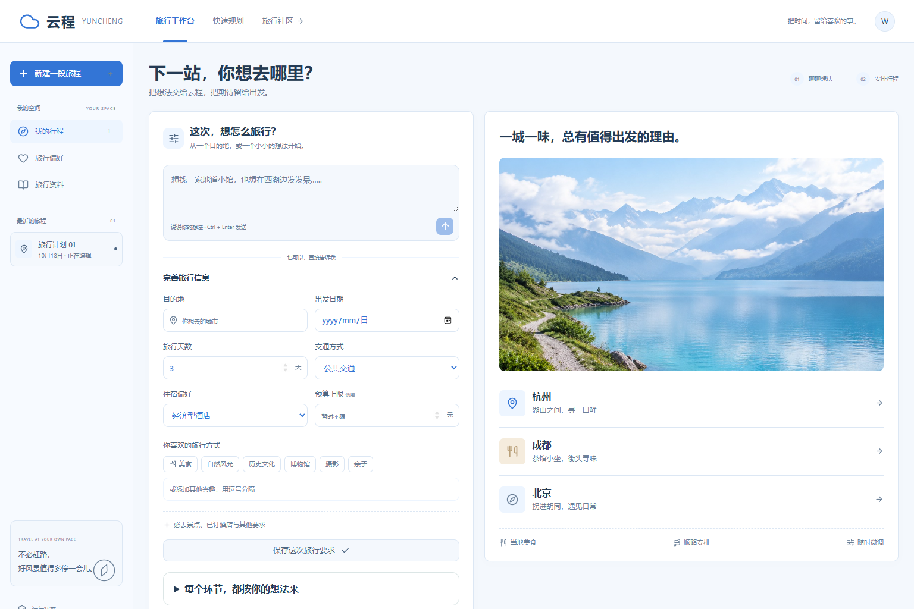
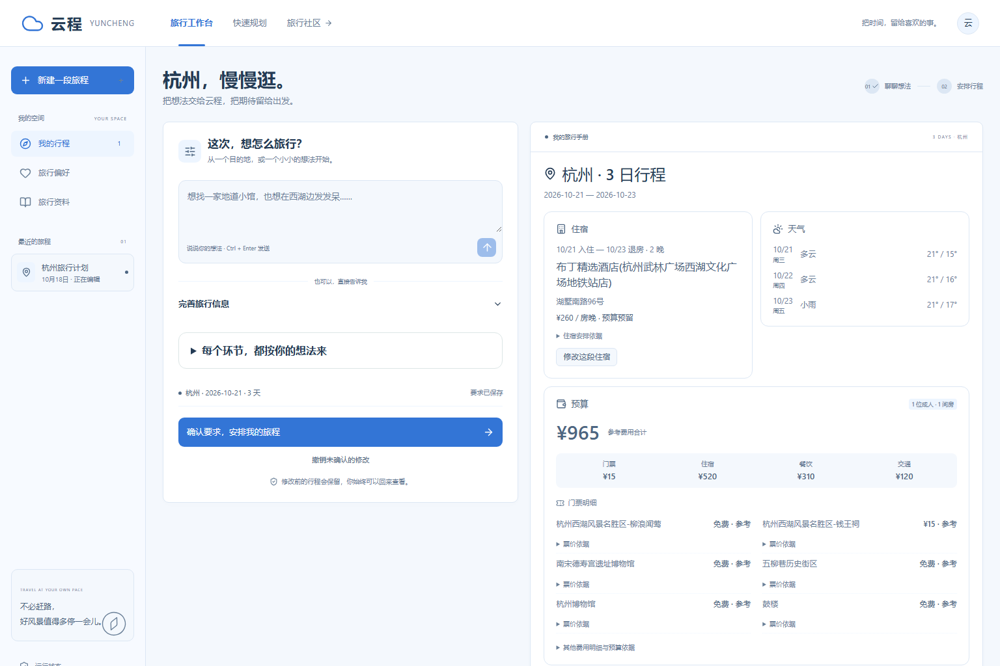
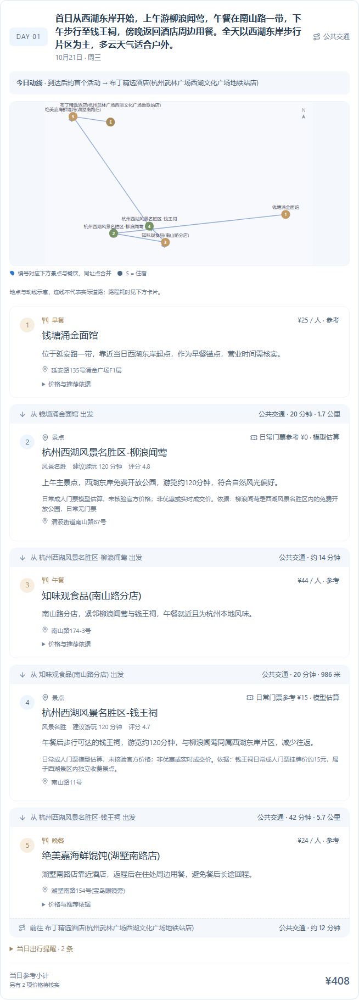
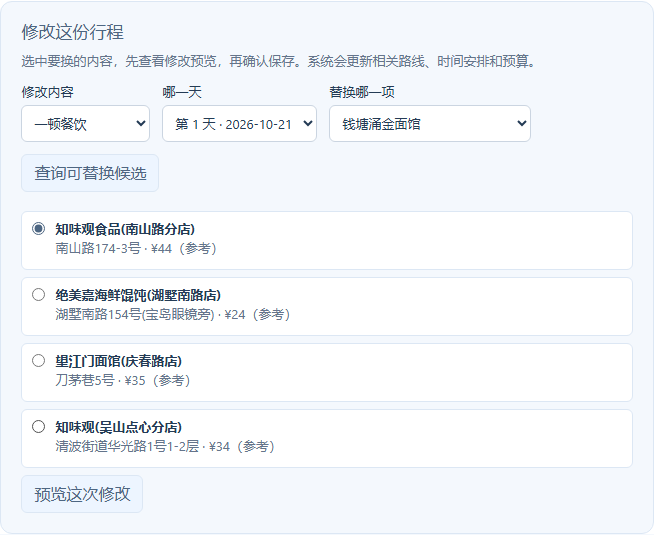
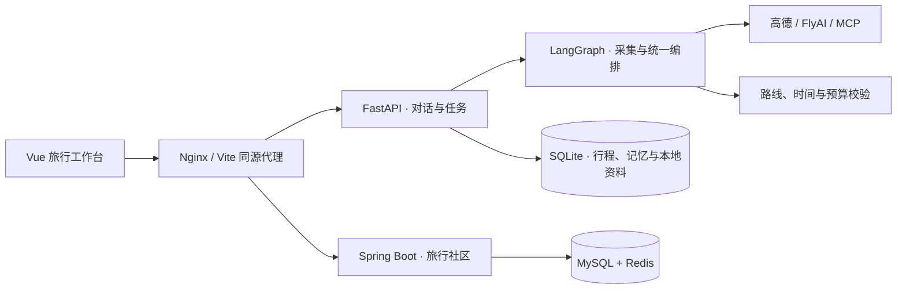

# 云程 YUNCHENG

一个能边聊边改的旅行规划助手。告诉它去哪、玩几天、想吃什么，它会把景点、三餐、住宿和交通排成逐日行程，并算出预算。

[功能](#能做什么) · [设计](#几个设计选择) · [架构](#架构) · [运行](#本地运行) · [部署](#docker-部署) · [项目教学](docs/项目教学.md)



## 能做什么

- **对话规划**：用自然语言描述想法，也可以直接填写日期、人数、预算、必去景点和住宿要求。
- **吃住玩一起安排**：景点和餐厅按每天的路线组合，结合天气、游玩时长、酒店位置和城市特色安排节奏。
- **出发到返程**：支持出发城市、火车与飞机候选，将到达和离开时间纳入首末日行程。
- **随时修改**：换一顿饭、一个景点、某一天或一段住宿，先看预览，确认后更新相关路线和预算。
- **费用明细**：展示门票、餐饮、住宿与交通，按成人数和房间数汇总，并保留参考价、估算与价格依据。
- **保存和分享**：账号下保存行程、旅行偏好和资料，支持导出，以及社区发布、点赞和排行。

住宿、天气和预算集中在结果顶部，每天的地图与景点、餐饮卡片放在一起。



<details>
<summary>查看逐日路线与景点、餐饮卡片</summary>



</details>

## 几个设计选择

**由同一个编排 Agent 做整体选择。** 景点、天气、餐饮、酒店分别采集，再汇入同一份上下文。编排时同时考虑位置、价格和时间，选出的酒店和餐厅能与每天的景点相互配合。

**住宿按夜晚安排。** 城市内游览可以连续住同一家；跨区域或去远郊时，比较往返路程、换住时间和住宿成本，再决定在哪里过夜。已订酒店可以按具体夜晚锁定。

**修改有明确范围。** 换第二天午餐时保留其他安排；换酒店时重算受影响日期的起终点和路线。每次修改先预览，再通过版本校验保存。

**让代码负责可计算的部分。** Agent 从候选池选择地点，代码检查地点身份、必去要求、路线时长和费用。预算超限或时间排不下时，带着具体原因进入有次数与成本上限的重排。

**本地检索和在线查询配合。** 景点、餐饮和酒店资料先检索本地库，按相关性、新鲜度和约束检查是否够用，再补查在线服务。个人旅行资料支持分块检索和来源引用，工具也可通过 MCP 接入。



截图来自本地页面与示例行程，展示的是查询时的参考费用。

## 架构



| 部分 | 技术 | 职责 |
| --- | --- | --- |
| 前端 | Vue 3、TypeScript、Vite | 对话、行程地图、预算、修改预览与导出 |
| Agent 服务 | Python、FastAPI、LangGraph、Pydantic | 意图识别、并行采集、编排、校验与任务恢复 |
| 资料与记忆 | SQLite、本地检索、天气与价格缓存 | 候选地点、会话、偏好与资料引用 |
| 社区 | Java 17、Spring Boot、MySQL、Redis | 行程发布、点赞去重与热度排行 |

## 本地运行

需要 **Python 3.13、Node.js 22**。先启动 Python 和前端即可使用旅行工作台；完整社区可按下文使用 Docker 启动。

### 1. 获取代码并配置 API

```bash
git clone https://github.com/khanvhujil-byte/yuncheng-agent.git
cd yuncheng-agent
```

将 `backend/.env.example` 复制为 `backend/.env`，填写：

```dotenv
LLM_API_KEY=你的模型服务密钥
LLM_BASE_URL=https://api.deepseek.com
LLM_MODEL_ID=deepseek-chat
AMAP_API_KEY=你的高德Web服务密钥
```

模型服务使用兼容 Chat Completions 的接口，地址与模型名可按自己的服务调整。高德 Key 在[高德开放平台](https://console.amap.com/)申请，选择“Web 服务”类型。

如需平台酒店报价、火车与飞机查询，再配置 `FLYAI_API_KEY`。真实密钥仅存放在本地环境或服务器环境变量中。

### 2. 启动后端

```bash
cd backend
python -m venv .venv
```

Windows PowerShell 激活虚拟环境：

```powershell
.\.venv\Scripts\Activate.ps1
```

macOS / Linux：

```bash
source .venv/bin/activate
```

接着安装依赖并启动：

```bash
pip install -r requirements.txt
python run.py
```

启用 FlyAI 时，在后端目录、已激活的虚拟环境内先运行一次 `python scripts/install_flyai.py`，本机需有 Node.js。接口文档位于 <http://127.0.0.1:8000/docs>。

### 3. 启动前端

另开终端，在项目根目录执行：

```bash
cd frontend
npm ci
npm run dev
```

打开 **<http://127.0.0.1:5173/chat>**，注册账号，开始第一份行程。例如：

> 去杭州玩三天，喜欢美食和历史街区，公共交通出行，住经济型酒店，预算 2000 元，每天别安排太满。

前端默认通过同源代理访问后端，`VITE_API_BASE_URL` 留空即可。地图展示配置见 [frontend/.env.example](frontend/.env.example)。

手机体验时，将前端启动命令换为 `npm run dev:lan`，手机与电脑连同一 Wi-Fi，访问 `http://电脑局域网IP:5173/chat`。

## Docker 部署

完整部署包含前端、Python、Java、MySQL 与 Redis，需要安装 Docker 和 Compose。

1. 将 `backend/.env.example` 复制为 `backend/.env`，填写模型、高德及需要启用的平台服务密钥。
2. 将根目录 `.env.production.example` 复制为 `.env.production`，填写 `MYSQL_ROOT_PASSWORD` 与 `MYSQL_APP_PASSWORD`，使用两个不同的密码。
3. 在项目根目录运行：

```bash
docker compose --env-file .env.production -f docker-compose.production.yml config --quiet
docker compose --env-file .env.production -f docker-compose.production.yml up -d --build
```

本机打开 **<http://127.0.0.1:8080/chat>**。健康检查为 <http://127.0.0.1:8080/health>。

部署到服务器后，将域名的 HTTPS 入口反向代理到服务器 `127.0.0.1:8080`，关闭流式响应缓冲并保留足够的请求超时。生产配置已为数据库、Redis 和 Python 数据目录挂载持久化卷。域名与代理配置示例见[部署指南](docs/手机访问与GitHub部署-20261020.md#二正式上线让手机随时访问)。

## 阅读代码

```text
backend/app/
├── api/          HTTP 接口与鉴权
├── agents/       采集节点、统一编排与独立校验
├── models/       请求、行程、状态与工具数据契约
└── services/     检索、记忆、路线、预算、MCP 与任务运行时
frontend/src/     旅行工作台、行程展示与社区页面
java-community/   发布、点赞与排行服务
deploy/           生产入口配置
```

想从头理解一次规划如何完成，可以按[《项目教学》](docs/项目教学.md)逐章阅读和运行示例。

## License

[MIT](LICENSE)
