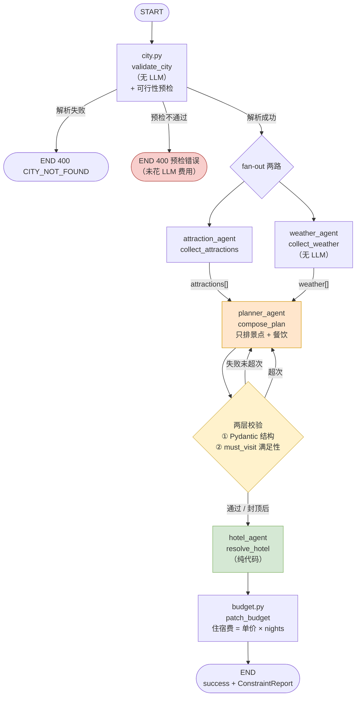
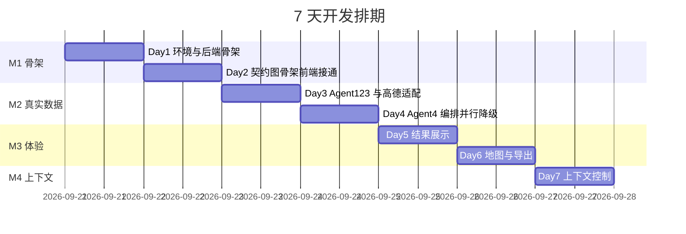

# 多智能体旅行规划助手 — 开发计划（5~7 天）

| 项目 | 内容 |
|---|---|
| 计划版本 | v2.0（重写：明确「你写什么」，并单列四个 Agent 的实现） |
| 制定日期 | 2026-09-20 |
| 目标周期 | 5~7 天（推荐 7 天，预留缓冲） |
| 总投入估算 | 约 22 小时，**约 2200 行代码（全部由你写）** |
| 前置文档 | [`需求文档.md`](需求文档.md) |

---

## 1. 项目在哪

### 1.1 绝对路径

```
c:\Users\34397\CodeBuddy\week1\trip-planner-agent
```

**注意是 C 盘。** 不在你 D 盘那个 `helloagents-trip-planner` 旁边（那本是参考项目，只读对照用）。

打开方式任选：

- 资源管理器地址栏粘贴上面这行，回车
- PyCharm / VS Code → 打开文件夹 → 选它
- PowerShell：`cd c:\Users\34397\CodeBuddy\week1\trip-planner-agent`

### 1.2 目录树（当前状态）

```
trip-planner-agent/
├── README.md                      # 项目说明
├── .gitignore
├── docs/
│   ├── 需求文档.md                 # 需求与设计 v0.1
│   └── 开发计划.md                 # 本文件
├── backend/
│   ├── .env.example               # 配置模板 → 复制为 .env
│   ├── requirements.txt           # 依赖清单
│   ├── run.py                     # 启动入口
│   └── app/
│       ├── __init__.py
│       ├── config.py              # 配置加载 + 三层 Key 校验
│       ├── api/
│       │   ├── __init__.py
│       │   ├── main.py            # FastAPI 装配 + /health
│       │   └── routes/
│       │       ├── __init__.py
│       │       └── trip.py        # POST /api/trip/plan
│       ├── models/
│       │   ├── __init__.py
│       │   ├── schemas.py         # 请求/响应数据契约
│       │   └── state.py           # LangGraph 图状态 TripState
│       ├── services/
│       │   ├── __init__.py
│       │   ├── amap.py            # 高德 REST 适配器
│       │   └── llm.py             # DeepSeek 客户端
│       └── agents/
│           ├── __init__.py
│           ├── prompts.py         # ★ 四个 Agent 的 system prompt
│           ├── city.py            # 辅助节点：城市解析（无 LLM）
│           ├── attraction_agent.py# ★ Agent 1 景点搜集
│           ├── weather_agent.py   # ★ Agent 2 天气查询
│           ├── hotel_agent.py     # ★ resolve_hotel 住宿解析/选址（v0.2：纯代码、后置）
│           ├── planner_agent.py   # ★ Agent 4 行程编排
│           ├── budget.py          # 辅助节点：预算加总（无 LLM）
│           └── graph.py           # 图装配
└── frontend/
    ├── .env.example               # 前端配置模板 → 复制为 .env.local
    ├── package.json
    ├── index.html
    ├── vite.config.ts
    ├── tsconfig.json
    └── src/
        ├── main.ts                # 入口样板
        ├── App.vue                # 根组件样板
        ├── env.d.ts               # 环境变量类型
        ├── router/
        │   └── index.ts           # 路由配置
        ├── services/
        │   └── api.ts             # 后端接口封装
        ├── types/
        │   └── trip.ts            # 与后端 schemas.py 对应的类型
        └── views/
            └── HomeView.vue       # 行程规划首页
```

**★ 标记的是四个 Agent 的实现文件**——它们目前只有说明文字的 docstring，等你填。

当前能直接跑起来的只有前端：

```powershell
cd c:\Users\34397\CodeBuddy\week1\trip-planner-agent\frontend
npm install
npm run dev     # http://localhost:5173，会看到占位页
```

后端要等 Day 1 写完 `config.py` / `main.py` / `run.py` 才能启动。

---

## 2. 怎么协作：我讲什么、你写什么

### 2.1 基本约定

| 角色 | 职责 |
|---|---|
| **你** | **写全部业务代码**。骨架里每个文件的 docstring 都写明了「第几天、写什么函数、注意什么」 |
| **我** | 讲原理 → 给出该写什么 → 你写 → 你把报错或结果贴回来 → 我帮你改到跑通 |

我不代写业务代码。需要我代写的场合（比如样板配置、你明确要求的），你直接说。

### 2.2 每个模块的固定流程

```
1. 我先讲：这个模块要解决什么问题、为什么这么设计（3~8 分钟）
2. 我给出：对应文件的 docstring 已有说明 + 关键 API 用法
3. 你写代码
4. 你贴报错或运行结果给我
5. 我帮你定位、修正，直到 DoD 全绿
6. 停下来等你说「继续」
```

### 2.3 每天结束时

你在 `docs/开发计划.md` 最后一节的「进度记录」表里填一行（实际耗时 / 卡点），方便回头看哪一步最费劲。

### 2.4 代码量预估

| Day | 主题 | 你要写的行数（估） |
|---|---|---|
| 1 | 配置与后端骨架 | ~120 |
| 2 | 数据契约 + 图骨架 + 前端接通 | ~480 |
| 3 | 高德适配层 + 景点/天气两路 | ~480 |
| 4 | Agent 4 + 预算 + 并行 + 降级 | ~230 |
| 5 | 前端结果展示 | ~500 |
| 6 | 地图与导出 | ~230 |
| 7 | 上下文控制 | ~120 |
| | **合计** | **约 2200 行** |

---

## 3. 各节点的实现（本计划的核心）

你选的方案是「一开始就多智能体：景点搜索 / 天气 两个执行节点 + 1 个规划节点 + 1 个住宿求解节点」。
**注意：v0.2 已改**：酒店不再是「和景点并行的 LLM Agent」，而是**编排之后的纯代码节点 `resolve_hotel`**（方案 D，理由见 3.4）。这一章把四个节点逐个说清：**它是谁、拿什么、干什么、输出什么、代码落在哪、怎么验收。**

### 3.1 总览（v0.2：酒店节点已改写）

| # | 节点 | 文件 | 节点函数 | 绑定工具 | 用 LLM | 实现于 |
|---|---|---|---|---|---|---|
| 1 | 景点搜集专家 | `agents/attraction_agent.py` | `collect_attractions` | `search_poi` | 是 | **Day 3** |
| 2 | 天气查询专家 | `agents/weather_agent.py` | `collect_weather` | `get_weather` | 否（纯工具） | **Day 3** |
| 3 | 行程编排专家 | `agents/planner_agent.py` | `compose_plan` | 无（纯生成） | 是 | **Day 4** |
| 4 | 住宿解析/选址 | `agents/hotel_agent.py` | `resolve_hotel` | `search_poi`、`measure_distance` | **否（纯代码）** | **Day 4** |

辅助节点：

| 节点 | 文件 | 用 LLM | 说明 |
|---|---|---|---|
| 城市解析 + 预检 | `agents/city.py` | 否 | 拿 adcode；顺手做可行性预检（花钱之前拦） |
| 预算加总 | `agents/budget.py` | 否 | 加法不让模型做；住宿费 = 单价 × nights |
| 图装配 | `agents/graph.py` | — | 把上面六个节点连成图 |

**v0.2 的两处结构变化（对比旧版）**：

1. **酒店从「LLM Agent」变成「纯代码节点」，且从并行改成后置**。顺序是 `compose_plan → resolve_hotel → patch_budget`。
   理由：选址必须基于**实际行程**（候选池一半景点不会去），且选址是「`Σ 距离 × 停留时长` 取最小」的确定性问题 —— 和预算一样，**不给模型**。
2. **`collect_weather` 也不调用 LLM**（旧版表格里写的是「是」，实现时按纯工具节点写）。

四个节点全部是「输入结构化字段 → 输出结构化字段」，**没有任何一个节点的输出是丢给下一个节点当自然语言用的**。这是与参考项目最大的区别。

### 3.2 Agent 1 · 景点搜集专家

**文件**：`backend/app/agents/attraction_agent.py`
**节点函数**：`collect_attractions(state: TripState) -> dict`
**绑定工具**：`search_poi(keywords, city, offset, page)`
**输入**：`request.city`、`request.preferences`、`request.travel_days`
**输出**：`{"attractions": [Attraction, ...]}`（目标条数 ≥ `travel_days × 3`）

**它的 system prompt 草案**（你自己誊到 `prompts.py`，想改就改）：

```
你是景点搜集专家。你的任务是根据城市和用户偏好，调用高德 POI 搜索工具取回候选景点。

规则：
1. 必须调用工具，不要凭记忆编造景点名称、地址或坐标。
2. 每个偏好标签单独调用一次工具，全部查完再汇总，不要只查第一个标签。
3. 只保留风景名胜、公园广场、博物馆类的结果，过滤掉餐饮和住宿。
4. 如果某个标签没有搜到结果，如实说明"该标签无结果"，不要编造替代项。
5. 最终列出你实际取到的景点清单。
```

**必须做对的三个实现细节**：

1. **每个偏好标签各查一次再合并。** 参考项目 `_build_attraction_query()` 里写的是 `keywords = request.preferences[0]`，也就是用户勾了「自然风光 + 美食」，它只搜了自然风光。这是它的缺陷。
2. **按 `poi_id` 去重**，不要按 `name` 去重。高德会返回「西湖」和「西湖风景区」这类近重复项。
3. **过滤掉餐饮与住宿类结果**（按 `typecode` 判断）。用「美食」当关键词搜，会搜出一堆餐馆。

**降级要求**：工具调用失败不抛异常向上冒，而是写 `errors` + `warnings` 并返回空列表，让 Agent 4 照常执行。

**验收**：搜「杭州 + 自然风光」，返回的景点名逐个能在高德上搜到，且没有重复项，条数 ≥ 9。

### 3.3 Agent 2 · 天气查询专家

**文件**：`backend/app/agents/weather_agent.py`
**节点函数**：`collect_weather(state: TripState) -> dict`
**绑定工具**：`get_weather(adcode, extensions="all")`
**输入**：`adcode`、`request.start_date`、`request.travel_days`
**输出**：`{"weather": [WeatherInfo, ...]}`

**它的 system prompt 草案**：

```
你是天气查询专家。你的任务是根据给定的行政区划编码与出行日期，取回天气预报。

规则：
1. 必须调用天气工具，不要编造天气。
2. city 参数必须使用给定的 adcode，不要替换成城市名。
3. 只保留出行日期范围内的天数。
4. 如果出行日期超出预报范围，如实说明"超出预报窗口"，不要编造。
5. 温度只输出数字，不要带 °C 等单位。
```

**必须做对的两个实现细节**：

1. **`city` 参数传 `adcode`，不是城市名。** 高德天气接口不接受城市名，传「杭州」会返回空或报错。这是硬约束，也是为什么需要 `city.py` 这个前置节点。
2. **`extensions=all` 只返回「今天起 4 天」的预报。** 行程 6 天时只能填前 4 天，第 5~6 天留空并写 warning，**绝不编造**。

**可选实验（Day 4 之后做，不是必须）**：把这个节点改成**不用 LLM 的纯工具节点** —— 因为它本质是「adcode + 日期 → 天气数组」的确定性搬运。改完对比一下：

- 耗时差多少
- 多花了几次 LLM 调用、多少 token

代价是：先按 4 个 Agent 实现并跑通，再动手删，你能亲眼看到「不必要的智能体化」会多花多少钱。这个实验本身比结论有价值。

**验收**：6 天行程时只返回 4 条天气，且 `warnings` 里有说明。

### 3.4 住宿节点 · `resolve_hotel`（v0.2：从 LLM Agent 改成纯代码节点）

**文件**：`backend/app/agents/hotel_agent.py`
**节点函数**：`resolve_hotel(state: TripState) -> dict`
**绑定工具**：`search_poi`、`measure_distance`（都不经过模型，直接调用）
**输入**：`request.fixed_hotel`、`request.fixed_hotel_address`、`request.accommodation`、`request.city`、`plan.days[].attractions`（**实际行程**）、`nights`
**输出**：`{"hotels": [...候选池], "hotel": Hotel, "hotel_source": "user"|"agent"}`

**这个节点为什么不用 LLM**（面试要能讲）：

> `cost(h) = Σ(酒店 到 景点 i 的距离 × 景点 i 的停留时长)`，取 `cost` 最小的那家。
> 这是一个**有唯一正确答案**的选址问题，和预算加法同一性质 —— **确定性的事不给模型**。

**内部两个分支**：

```
resolve_hotel(state):
    if request.fixed_hotel:                      # 分支 1：用户已定
        anchor = 解析用户给的酒店名（必须结合 city，见下）
        校验几何一致性：anchor 到 city_center ≤ 100 km
        return {"hotel": anchor, "hotel_source": "user", "hotels": [anchor]}
    else:                                        # 分支 2：系统选址
        candidates = 搜索候选酒店（关键词映射 + typecode 过滤 + Top-K=5）
        for h in candidates: 算 cost(h)          # 距离用 measure_distance，结果要缓存
        return {"hotel": argmin(cost), "hotel_source": "agent", "hotels": candidates}
```

**必须做对的四个实现细节**：

1. **关键词要从 `accommodation` 映射**，不能把「经济型酒店」原样丢给高德：

   | 住宿偏好 | 搜索关键词 |
   |---|---|
   | 经济型酒店 | 快捷酒店 |
   | 舒适型酒店 | 精品酒店 / 商务酒店 |
   | 豪华酒店 | 五星级酒店 |
   | 民宿 | 民宿 |

2. **只保留 `typecode` 属于住宿服务类的结果。**
3. **距离必须真实测量且要缓存**：`N 家候选 × M 个景点`，3 天行程约 3×8 = 24 次调用；**只对 Top-K（默认 5 家）候选算，并按 (酒店坐标, 景点坐标) 缓存**，否则会打爆高德配额。
4. **用户输入的酒店名必须和 `city` 一起解析**：只给「如家酒店」全国有几千家。解析不到 → `HOTEL_NOT_FOUND`；命中多个无法确定 → `HOTEL_AMBIGUOUS`；离 `city_center` > 100 km → `CITY_MISMATCH`。

**关于 `distance` 字段（v0.2 语义）**：不再是「距市中心」的近似说明，而是「本酒店到行程中各景点的加权距离」的说明，例如
`"距行程重心 2.4 km；到 6 个景点加权平均 3.1 km（最远 7.8 km）"`。

**住宿是行程级，不是天级**：返回的是**一家**酒店，写进 `TripPlan.hotel`，`hotel_nights = nights`。
**没有「每天一个酒店」这回事** —— 3 天 2 晚住一家是常态。跨区域分段住宿是 V1（`hotel_segments` 字段已预留，V0 恒为空）。

**降级路径（上游空了怎么办）**：

| 情况 | 处置 |
|---|---|
| `plan.days[].attractions` 为空（景点那一路降级） | 退回用 `city_center` 算距离，**并写 warning**（把「近似」变成用户可见） |
| 候选酒店池为空 | `hotel = None` + warning「未找到符合住宿偏好的酒店，建议自行预订」 |
| 用户指定酒店离景点都很远（最大单程 > 90 分钟） | **照常使用**用户的酒店，但算总通勤时长并写入 warning，附上系统选址结果做对比建议 |

**验收**：
- [ ] 不给 `fixed_hotel`：返回 1 家酒店，`hotel_source == "agent"`，`distance` 里能看到加权平均距离
- [ ] 给一个真实酒店名：`hotel_source == "user"`，且 `sources["hotel"] == "user"`
- [ ] 给「如家酒店」不带地址：返回 `HOTEL_AMBIGUOUS`
- [ ] 给一个上海的酒店 + 杭州行程：返回 `CITY_MISMATCH`
- [ ] 日志能看到「候选 N 家 → 测距 M 次 → 缓存命中 K 次」，证明配额没被打爆

### 3.5 行程编排专家 · `compose_plan`

**文件**：`backend/app/agents/planner_agent.py`
**节点函数**：`compose_plan(state: TripState) -> dict`
**绑定工具**：无（纯生成）
**输入**：`request`（含 `must_visit`）、`attractions[]`、`weather[]` —— **全是结构化列表，不是上一段自然语言输出**；**v0.2 起不含酒店**（住宿在它之后由 `resolve_hotel` 决定）
**输出**：`{"plan": TripPlan}`（此时 `plan.hotel` 为空，由后续节点填）

**它的 system prompt 草案（v0.2）**：

```
你是行程规划专家。请根据给定的数据，生成逐日行程。

【硬约束 —— 必须满足】
1. 用户指定必去的景点（must_visit）必须全部安排进行程，一个都不能漏。
   如果确实排不进去，在输出里如实说明原因（容量不足 / 距离过远），不要静默丢掉。
2. 每天安排 2~3 个景点，且必须来自给定的景点候选列表，不得编造未出现过的景点。
3. 日期从 start_date 起连续，不得有缺口，天数必须等于 travel_days。

【软偏好 —— 尽量满足】
4. 先把必去景点按地理聚类分配到各天（同一片区的排同一天），再用其他候选景点把每天填满。
5. 同一天的景点要在空间上聚集（按坐标判断距离），不要把城区两端的景点排在同一天。
6. 每天必须包含早、中、晚三餐。
7. 遇雨雪或极端温度，优先安排室内景点。

【住宿】
住宿由系统在你之后决定，你不需要、也不允许指定酒店。

【关于价格】
景点门票与餐饮价格不在你的数据源里。你可以按常识估算，
但不要声称这些是查询到的真实价格——系统会统一标注为预估。

【输出格式】
只输出 JSON，不要输出解释文字，不要用 markdown 代码块包裹。
```

**v0.2 的三处变化**：
1. **删掉了旧规则「每天指定 1 个酒店」** —— 住宿是行程级决策，且发生在编排之后（方案 D）。
2. **新增硬约束第 1 条**（必去景点不许漏），并配**第 2 层校验**兜底（见 3.5.1）。
3. **排序策略明确成分两步：硬约束先落位，软偏好再填充** —— 这是「约束优先调度」，也是这个节点最值钱的设计。

#### 3.5.1 两层校验与重试（v0.2 新增第 2 层）

```
compose_plan 内部：
    第 1 层  Pydantic 结构校验（字段类型 / 必填 / 日期连续 / 天数一致）
    第 2 层  约束满足性校验：
             required    = request.must_visit
             satisfied   = 出现在 days[].attractions 里的
             unsatisfied = required - satisfied
             若 unsatisfied 非空 → 把「你没排进 X」这个**具体事实**回喂重试
             retries >= 2  → 不再重试，把 unsatisfied + reasons 写进 ConstraintReport
```

**原理**：约束越结构化越可靠，靠 prompt 表达的约束遵守率会掉 —— **所以硬约束必须配校验代码**。
两层校验共用同一个 `retries` 计数（封顶 2），不额外加计数器。

**这个节点是整个项目的技术难点**，集中在三件事：

1. **Prompt 由代码生成，不是字符串拼接（CC-3）。**
   把两路数据格式化成紧凑的表格/清单。参考项目是把 `attraction_response`（一整段自然语言）整段塞给下一个 agent 的。

2. **结构化输出 + 两层校验 + 错误回喂重试。**
   优先试 `response_format={"type":"json_object"}`。
   校验失败时，把**具体的错误信息**（不是「格式不对」这种笼统说法）回喂给模型重试，最多 2 次。

3. **`budget` 不在这里算**，交给 `budget.py`；**酒店也不在这里定**，交给 `resolve_hotel`。

**验收**：
- [ ] 返回的 `TripPlan.days` 能通过 Pydantic 校验，`len(days) == travel_days`
- [ ] `must_visit` 里的每一个景点，都能在 `days[].attractions` 里找到（P0 硬指标）
- [ ] 无解时（如必去 12 个但只有 2 天）：`ConstraintReport.unsatisfied` 非空，且 `reasons` 写了原因，**不是静默丢弃**
- [ ] 输出 JSON 里搜不到任何酒店字段（住宿由后置节点负责）

### 3.6 节点之间怎么连（v0.2：方案 D）



**关键点（v0.2）**：

1. **并行的是两路**（景点 ∥ 天气），不是三路。天气节点是纯工具节点（adcode + 日期 → 天气数组），不需要模型。
2. **酒店被移到编排之后**：`resolve_hotel` 读的是 `plan.days[].attractions`（**实际行程**），而不是候选池。这是「选址必须基于真实行程」的直接体现。
3. **`compose_plan` 看不到酒店**：它只排景点与餐饮，输出的 JSON 里没有酒店字段。整个项目里**没有任何一个节点让模型决定住哪**。
4. **两层校验共用同一个重试环**：结构校验失败和约束校验失败都回 `A4` 重试，`retries` 封顶 2 次；封顶后不丢弃请求，继续走 `resolve_hotel`，把未满足项写进 `ConstraintReport`。
5. **所有采集节点的产出都是结构化字段**，没有任何节点的输出被当作自然语言丢给下一个节点。

---

## 4. 排期总览

| 天 | 里程碑 | 主题 | 预估 | 交付物 | 你会写到 |
|---|---|---|---|---|---|
| Day 1 | M1-a | 环境验证 + 后端能跑 | 2h | `GET /health` 返回 ok | 3 个文件 / ~120 行 |
| Day 2 | M1-b | 数据契约 + 图骨架 + 前端接通 | 3h | 提交表单 → 拿到结构合法的假行程 | 9 个文件 / ~480 行 |
| Day 3 | M2-a | 高德适配 + **景点/天气两路采集** | 3h | 两路各自取到真实数据；预检能拦下不可行请求 | 6 个文件 / ~480 行 |
| Day 4 | M2-b | **编排 + 两层校验 + 住宿后置 + 预算** | 4h | 真实杭州 3 天行程，≤60s，硬约束可对账 | 5 个文件 / ~370 行 |
| Day 5 | M3-a | 前端结果展示 | 3h | 时间轴 + 天气条 + 预算卡 | 3 个文件 / ~500 行 |
| Day 6 | M3-b | 地图与导出 | 4h | 地图按天打点 + 导出 PDF | 2 个文件 / ~230 行 |
| Day 7 | M4 | 上下文控制 | 3h | Checkpointer + token 计量 | 3 个文件 / ~120 行 |



**Day 4 是最危险的一天**：全项目 80% 的技术不确定性在这天（校验重试、并行 reducer、降级完整性）。如果超时，**不要硬推 Day 5**，停下来先解决它 —— 后面的 UI 都建立在这之上。

---

## 5. 每日详情

### Day 1 · 环境验证 + 后端骨架（2h）

**目标**：后端跑起来，`GET /health` 能返回。**不接任何外部 API，不花钱。**

**你要写的文件**

| 文件 | 写什么 | 约行数 |
|---|---|---|
| `backend/app/config.py` | `Settings`（pydantic-settings 读 `.env`）+ `validate_config()` 三层校验 | ~60 |
| `backend/app/api/main.py` | FastAPI 实例 + CORS + `GET /health` + startup 事件调校验 | ~40 |
| `backend/run.py` | 读配置 → `uvicorn.run("app.api.main:app", ...)` | ~20 |

**第一步先做风险验证（别跳）**

```powershell
cd c:\Users\34397\CodeBuddy\week1\trip-planner-agent\backend
python -m venv .venv
.\.venv\Scripts\Activate.ps1
pip install -r requirements.txt -i https://pypi.tuna.tsinghua.edu.cn/simple
python -c "import langgraph, langchain_core, langchain_openai; print('ok')"
```

**这是风险 R-1**：你机器上只有 Python 3.13.2，没有 3.11/3.12 备选。装不上或 import 失败就**立即停下来**告诉我，先讨论是否补装 3.12（需要先清磁盘）。

装成功后，把 `requirements.txt` 的裸包名回填成实际版本号。

**三层校验要写成什么**（对应踩过的坑 4）：

1. 非空
2. 格式合理（高德 Key 是 32 位十六进制）
3. **真实探测**：调一次地理编码查「北京」，检查 `infocode == "10000"`

只做第 1 层的话，`.env` 里的占位符 `your_amap_api_key_here` 是非空字符串，会骗过校验，启动显示「配置验证通过」，实际调用才报 `INVALID_USER_KEY`。

**DoD**

- [ ] `import langgraph` 成功
- [ ] `requirements.txt` 已固定版本号
- [ ] `python run.py` 起来，`GET /health` 返回 200
- [ ] 故意改错 `AMAP_API_KEY` → 启动时有明确告警，而不是静默通过
- [ ] 日志里**没有**任何 emoji（坑 3）

**卡点**：装不上 → 停下讨论；下载慢 → 确认用的是清华源。

---

### Day 2 · 数据契约 + 图骨架 + 前端接通（3h）

**目标**：用**占位数据**把整条链路打通：前端 → FastAPI → LangGraph → 返回。**仍不接外部 API。**

**这一步的价值**是把「调通环境」和「接真实数据」拆开。两件事一起调，出错时你分不清是图写错了还是接口挂了。

**你要写的文件**

| 文件 | 写什么 | 约行数 |
|---|---|---|
| `backend/app/models/schemas.py` | 全部 Pydantic 模型（字段清单见需求文档 8.1 / 8.2） | ~150 |
| `backend/app/models/state.py` | `TripState` | ~40 |
| `backend/app/agents/*.py` | 每个 Agent 先写**返回硬编码假数据的占位版** | ~80 |
| `backend/app/agents/graph.py` | **串行**图（五个节点依次串），并行留到 Day 4 | ~50 |
| `backend/app/api/routes/trip.py` | `POST /api/trip/plan` | ~40 |
| `frontend/src/types/trip.ts` | 与 `schemas.py` 一一对应的 TS 类型 | ~80 |
| `frontend/src/services/api.ts` | axios 封装 + `planTrip()` | ~40 |
| `frontend/src/views/HomeView.vue` | 最简表单 + `<pre>` 打印 JSON | ~90 |
| `frontend/src/router/index.ts` | 路由表（基本已就绪，微调） | ~10 |

**最容易写错的一处**（`state.py`）：

```python
errors: Annotated[list[str], operator.add]
warnings: Annotated[list[str], operator.add]
trace: Annotated[list[dict], operator.add]
```

三个采集 Agent 是并行的，会同时往同一字段写。**不声明 `operator.add` reducer，Day 4 会直接报并发写冲突。** 这是并行 fan-out 的必要配置。

**第二处容易写错**：`TripState` 里**不要加 `messages` 字段**。消息历史只活在节点局部变量里，只把结构化结果写回 State（CC-1）。加了后面必然返工。

**DoD**

- [ ] `npm run dev` 打开 5173，表单能提交
- [ ] 返回的 JSON 被 TS 类型约束住（不是 `any`）
- [ ] 后端日志有逐节点的 start / end / 耗时（NFR-2 骨架）
- [ ] 全程无外部 API 调用

---

### Day 3 · 高德适配层 + 两路采集（3h）

**目标**：把假数据换成真实数据。景点与天气两路**各自能单独跑通**。（v0.2：酒店节点移到 Day 4，因为它在编排之后。）

**你要写的文件**

| 文件 | 写什么 | 约行数 |
|---|---|---|
| `backend/app/services/amap.py` | `geocode` / `search_poi` / `get_weather` / `measure_distance` + 原始 JSON → Pydantic 映射 + 错误映射 | ~200 |
| `backend/app/services/llm.py` | `ChatOpenAI(model, base_url, api_key, timeout=60)` | ~20 |
| `backend/app/agents/prompts.py` | 三个 LLM 节点的 system prompt（草案见第 3 章） | ~90 |
| `backend/app/agents/city.py` | `validate_city` + **可行性预检**（无 LLM，见 FR-05c） | ~60 |
| `backend/app/agents/attraction_agent.py` | **景点搜集** —— 见 3.2（含 `must_visit` 注入候选池） | ~70 |
| `backend/app/agents/weather_agent.py` | **天气查询** —— 见 3.3（纯工具，无 LLM） | ~40 |

**`amap.py` 的核心职责**（CC-2 的落地点）：**把高德原始 JSON 立刻映射成 Pydantic，原始响应不进入任何上下文。** 一条 POI 含 `photos` 数组，20 条能到几十 KB，直接塞进 Prompt 就是自找麻烦。

**DoD**

- [ ] `validate_city` 拿到杭州真实 `adcode`，并把 `travel_days` / `nights` / `end_date` 一次算好
- [ ] 预检生效：`must_visit` 12 个 + 2 天 → 返回 `CONSTRAINT_INFEASIBLE`，**且日志里没有任何 LLM 调用**
- [ ] 景点路返回 ≥ 9 个真实杭州景点，无重复（按 `poi_id` 去重）
- [ ] **用户指定的 `must_visit` 出现在候选池里**（哪怕偏好标签搜不到它）
- [ ] 天气条数 = 预报窗口（≤4），超出的天 `beyond_window=True` 且留空 + warning
- [ ] 故意传错 Key → 抛 `AMAP_KEY_INVALID`，不是返回空数组
- [ ] 日志能看到「原始响应字符数」与「进 Prompt 字符数」对比

**卡点**

| 卡点 | 应对 |
|---|---|
| 天气返回空 | **八成是把城市名当 adcode 传了** |
| 景点是「美食」标签搜出餐馆 | typecode 过滤没做 |
| 景点有重复 | 按 `poi_id` 去重，不能只按 `name` |
| `must_visit` 里的景点没进候选池 | 注入逻辑漏了：候选池 = 偏好搜索 ∪ must_visit 解析结果 |
| 高德配额告警 | 单次规划约 5~12 次调用；Day 6 再加缓存 |

---

### Day 4 · 编排 + 两层校验 + 住宿后置 + 预算（4h）

**目标**：拿到第一份**真实可用**的完整行程，且硬约束可对账。（v0.2：住宿在后置节点求解。）

**你要写的文件**

| 文件 | 写什么 | 约行数 |
|---|---|---|
| `backend/app/agents/planner_agent.py` | `compose_plan` —— 见 3.5（Prompt 生成 + 结构化输出 + **两层校验** + 重试） | ~110 |
| `backend/app/agents/hotel_agent.py` | `resolve_hotel` —— 见 3.4（**纯代码**：锚点解析 / 加权选址 / 距离缓存） | ~90 |
| `backend/app/agents/budget.py` | `patch_budget`（无 LLM，代码加总；住宿费 = 单价 × nights） | ~40 |
| `backend/app/agents/graph.py` | 串行改**两路并行** + 条件边 + 降级边 + 重试环 + **酒店后置连边** | ~90 |
| `backend/app/api/routes/trip.py` | 补 `warnings` / `sources` / `constraint_report` 的填充与返回 | ~40 |

**DoD**

- [ ] 返回的景点名逐个能在高德上搜到（不是「杭州景点1」这类占位名）
- [ ] `len(days) == travel_days`，日期连续无缺口
- [ ] **`must_visit` 里的每个景点都出现在 `days[].attractions` 里**（P0 硬指标）
- [ ] 无解场景（必去 12 个 / 2 天）：`ConstraintReport.unsatisfied` 非空且 `reasons` 有原因，**不是静默丢弃**
- [ ] `hotel_source == "agent"` 时返回 1 家酒店；给 `fixed_hotel` 时 `hotel_source == "user"` 且 `sources["hotel"] == "user"`
- [ ] `budget.total_hotels == hotel.estimated_cost × nights`（**不是 × 天数**）
- [ ] 端到端 ≤ 60 秒
- [ ] 故意改错 Key → 明确的 `AMAP_KEY_INVALID`，**不是假数据**
- [ ] 故意断网 → 行程仍返回，但带降级标注
- [ ] 日志能回答「两路各花了多久」+「住宿节点测距 M 次、缓存命中 K 次」

**卡点**

| 卡点 | 应对 |
|---|---|
| `InvalidUpdateError` / 并发写冲突 | `errors` / `warnings` / `trace` 漏了 `operator.add`，回 Day 2 |
| JSON 老校验失败 | 先调 Prompt；重试时把**具体字段错误**原文回喂；最后才考虑放宽模型 |
| 并行没生效（耗时没降） | 检查两条边是不是真的从同一个节点分出；中间夹了节点就退化成串行 |
| 必去景点排不进去 | 两层校验的第 2 层没接上；或注入候选池那一步漏了 |
| 住宿节点打爆高德配额 | 只对 Top-K（5 家）算距离，并按坐标对缓存 |
| 某条降级把异常吞了 | 降级必须写 `warnings`。静默降级算 bug |

---

### Day 5 · 前端结果展示（3h）

**目标**：把 JSON 变成人看得懂的东西。

**你要写的文件**

| 文件 | 写什么 | 约行数 |
|---|---|---|
| `frontend/src/views/HomeView.vue` | 完整表单（ant-design-vue Form / DatePicker / Select / Input）+ 即时校验 + 日期天数联动 + 加载态 + 错误态 | ~300 |
| `frontend/src/components/DayTimeline.vue` | 逐日时间轴卡片 | ~120 |
| `frontend/src/components/TripSummary.vue` | 顶部概览：天气条 + 预算卡 + 数据来源图例 | ~120 |

**必须做到**：

- 门票/住宿费用旁有「预估」标注（消费 `sources` 字段）
- `warnings` 在页面上可见（降级不能静默）
- 某天无景点时显示「当日无景点安排」，不是空卡片

**DoD**：行程卡片完整可读；预估项有标注；`warnings` 可见；失败有明确原因和重试按钮。

---

### Day 6 · 地图与导出（4h）

**你要写的文件**

| 文件 | 写什么 | 约行数 |
|---|---|---|
| `frontend/src/components/TripMap.vue` | 接入 `@amap/amap-jsapi-loader`，按天打点、点击联动、`setFitView` | ~150 |
| `frontend/src/services/export.ts` | `html2canvas` + `jspdf` 导出 | ~80 |

**必须记住**：地图要用「**Web 端 (JS API)**」类型的 Key，不是后端那个 Web 服务 Key。用错不会报错，只会白屏（坑 5）。

**DoD**

- [ ] 地图正确渲染（不是白屏）
- [ ] 点击时间轴卡片能定位到地图标记
- [ ] 导出的 PDF/长图内容完整且含估算标注
- [ ] 地图抓取失败时有兜底（提供「不含地图」的导出选项）

---

### Day 7 · 上下文控制（3h）

**你要写的文件**

| 文件 | 写什么 | 约行数 |
|---|---|---|
| `backend/app/agents/graph.py` | `compile(checkpointer=MemorySaver())` | ~10 |
| `backend/app/api/routes/trip.py` | 传 `thread_id`；新增 `GET /api/trip/{thread_id}` | ~40 |
| 各 Agent | 累加 `usage`（`prompt_tokens` / `completion_tokens` / `llm_calls`）+ 超限裁剪 | ~70 |

**DoD**

- [ ] 同一 `thread_id` 二次请求能读到历史状态
- [ ] 日志里每次 LLM 调用都有 `prompt_tokens`
- [ ] 人为灌入超长 POI 列表能触发裁剪，而不是请求失败
- [ ] **落盘的 State 里搜不到任何 API Key**（Checkpointer 会把它序列化落盘）

---

## 6. 如果只有 5 天：压缩方案

| 原计划 | 压缩后 |
|---|---|
| Day 1 + Day 2 | 合并为 1 天（后端骨架 + 图骨架一次做完，共 5h，会偏累） |
| Day 3 + Day 4 | 保持 2 天（**不能压**，是核心） |
| Day 5 + Day 6 | 合并为 1 天（结果展示 + 地图，只做基本样式，导出砍掉） |
| Day 7 | 保持 1 天（上下文控制是目标之一） |
| 合计 | 5 天 |

**砍的优先级（先砍 → 后砍）**：导出 → 地图联动动画 → 天气条样式 → 表单即时校验 → 缓存。

**不建议砍**：Day 4 的降级与 `warnings`/`sources`（「不说假话」的底线）；Day 7 的上下文控制（你点名要学的）。

---

## 7. 节奏约定

1. **一次只推进一个小模块**（不是一整天），讲完停下等你确认再继续。
2. 每个模块按固定顺序：**要解决什么 → 放在哪个文件 → 关键 API → 你写 → 一起验**。
3. 每完成一个模块立刻给验证命令与预期输出，不攒到最后一起验。
4. 遇到概念卡点（比如「调用藏在表达式里认不出来」），改用拆行写法演示。
5. 卡住了直接说，不要硬推下一天 —— 后面都建立在前一天之上。

---

## 8. 进度记录

> **本节以代码实际状态为准，2026-10-10 重写。** 之前的"Day 3/4 未开始"已经过时。

| 阶段 | 内容 | 状态 | 备注 |
|---|---|---|---|
| Day 1 | 环境验证 + 后端骨架 | **已完成** | `config.py`（三层校验、`probe_amap`）/ `api/main.py` / `run.py`；`.venv` Python 3.13.2 |
| Day 2 | 数据契约 + 图骨架 + 前端接通 | **已完成** | `schemas.py`（v0.2 契约）/ `state.py` / `graph.py`（6 节点 + 条件边 + 重试环）/ 前端可跑通 |
| Day 3-a | 高德适配层 `services/amap.py` | **已完成** | 4 个接口 + infocode→项目错误码 + 空数组 `[]` 清洗；错误分"拦住/降级"两类 |
| Day 3-b | `city.py` 预检 + 锚点解析 | **已完成** | 4 条预检规则 + `must_visit` 解析 + 自写相关性判定（0.6）；错误码经 state 透传到响应 |
| Day 3-c | 景点采集 | **已完成** | v0.3 起改为 Agent + `search_attractions` 工具；规则（去重/类目过滤/收集箱）在工具里 |
| Day 3-d | 天气 | **已完成** | 4 天窗口对齐 + `beyond_window` 占位 + 两个缺失原因分开；v0.3 起默认 Agent，可用开关关回纯工具 |
| Day 4 | 编排 + 两层校验 + 住宿 + 预算 | **已完成** | `compose_plan` 两层校验 + 回喂重试 + `_enrich` 字段回填；`resolve_hotel` Agent + 4 工具；`patch_budget` 加法（住宿费 = 单价 × `nights`） |
| Day 4 附加 | **v0.3 架构改版** | **已完成** | 4 Agent + 2 代码节点；新增 `services/tools.py`（6 工具）与 `agents/react_loop.py`（共用 ReAct 循环）；端到端跑通（41 秒） |
| Day 5 | 前端结果展示 | **已完成**（v0.2 时） | `TripSummary` / `DayTimeline` / 预算卡 / 对账卡 / 来源标签 |
| Day 6 | 地图与导出 | **已完成** | `TripMap.vue`（高德静态地图，坏 Key 自动降级自绘 SVG）+ `ExportPanel.vue`（Markdown 下载 + 打印） |
| Day 7 | 上下文控制（trace / usage） | **部分完成** | `usage` 按 reducer 累加、`tool_calls` 已记录、v0.5 又补了 SSE 逐节点进度与 journal；**`trace` 字段仍为空** |
| 实验 | 对照实验 A / B / C | **已完成** | v0.3 口径，共 **21 次运行**（约束满足 21/21、降级 0/21）；数据见 `backend/experiments/` |
| v0.4 | **行程库 + 相似请求复用** | **已完成** | `services/store.py`（SQLite，零新依赖）+ `GET /api/trip/stats`；指纹不含日期、命中后重取天气、只缓存"完整且无降级"的行程。实测 45.2 秒 → 3.7 秒（命中）/ 2.4 秒（只改日期） |
| v0.5 | **上下文压缩 + 后台任务与 SSE + journal 续跑 + 独立评估者 + 工具并发** | **已完成** | 压缩省 38% token（约束满足率不变）；SSE 让 `resolve_hotel` 的 98.2 秒瓶颈第一次可见并修到 13.1 秒；断点续跑 22.8 秒出完整行程；`verify_plan` 成为第 7 个节点 |
| 实验 | 实验 D（压缩 A/B）+ 实验 E（逐节点耗时） | **已完成** | v0.5 口径，见 §11.5 与 §11.6 |
| 待办 | 能交付/上线的工程配套 | **未开始** | 自动化测试（仓库里 `test_*.py` 一个都没有）、CI、容器化、鉴权限流、任务状态外置、监控告警 |

**当前实测数字（v0.5，2026-10-10）**：

- 端到端 3 天行程：中位 **29 秒**；平均 **10.5 次 LLM 调用 / 12.8 次工具调用 / 18,161 token**（v0.3 的 21 次运行）
- 逐节点 p50：`resolve_hotel` **13.1 秒 (46%)** > `compose_plan` 7.2 秒 (25%) > 采集阶段 ~5.7 秒 (20%) > `validate_city` 2.3 秒 (8%) > `verify_plan`/`patch_budget` ≈ 0
- 上下文压缩 A/B：**21,755 → 13,549 token（省 38%）**，两臂约束满足率都是 100%
- 行程库命中：生成平均 40.3 秒 vs 命中平均 2.2 秒（约 **18 倍**），命中时 **0 次 LLM 调用**
- 天气诚实性：**编造 0 天**（18 个"超窗口天次"零编造）
- 硬约束满足：**15/16（94%）** —— 有 1 次波动，不是压缩导致，对外不要讲"100%"

## 9. 第 8 天起 · M5 进阶（可选）

| 能力 | 说明 |
|---|---|
| `verify_plan` 反思节点 | 检查动线合理性、时间冲突、预算异常 |
| CC-6 多轮修改 | 同一 `thread_id` 下「第 2 天太赶了」，只重算受影响的天 + 晚数 + 预算 |
| SSE 流式进度 | `POST /api/trip/plan/stream`，前端看到逐节点推进 |
| 分段住宿 | 行程跨远端区域（景点聚成两簇且簇间 > 60 km）时允许换一次酒店，写进 `hotel_segments` |
| 锚点直输 | 除「名字 + 城市」外，支持用户直接给坐标或高德 POI ID，绕开消歧 |
| 消歧交互 | `*_AMBIGUOUS` 时返回候选列表让用户点选，而不是直接报错 |
| ~~方案 C 两段并行~~ | **v0.2 已被方案 D 取代**（酒店后置而非两段并行），见 3.6 与需求文档 5.5 |

### 9.1 改进列表（小改动，随手可做）

| # | 改进 | 触发场景 | 做法 | 状态 |
|---|---|---|---|---|
| 1 | `ATTRACTION_NOT_FOUND` 的报错文案 | 现在把高德返回的无关结果（如「丰盛九玺」）塞进错误信息，反而误导用户 | 错误信息只写「可能原因：名字不完整 / 该景点不在本城市」；原始候选只写日志 | 待改 |
| 2 | `must_visit` 上限的前端提示 | 超过 `MAX_MUST_VISIT = 10` | 目前只截断 + warning，可让前端在输入时就限制 | 待改 |
| 3 | `_is_relevant` 阈值可配 | 现在 0.6 硬编码 | 提到 config，按城市/场景可调 | 待改 |
| 4 | 高德 `place/detail` | 需要更准的分类、营业时间 | 只在必要时调，**不要每个 POI 都调**（配额） | 待评估 |

### 9.2 V1 想法池（都需要**持久化**）

> **前置条件：本项目现在没有数据库。** 会话状态在内存里，业务数据全部来自高德实时调用。
> 下面两件事都要「自己存数据」，所以 V1 第一步是引入 SQLite（或 Postgres）+ 一张 `place` 表。

**想法 A · UGC 地点库（用户去过的景区/酒店进入我们自己的数据）**

- 想解决什么：高德**不提供房价**、分类粗糙、小众民宿/景点缺失
- 需要什么：用户体系（谁去过）+ 打卡记录 + 审核流程
- **真正的难点（面试点）：多源 POI 的实体对齐**
  - 高德的 `poi_id` 与自建 id 怎么判定是「同一个地方」？
  - 规则草案：坐标距离 < 100m **且** 名字重叠率 ≥ 阈值 → 合并为同一实体；否则新建
  - 这是「实体消歧 / 多源数据融合」，比 CRUD 有含量得多
- 风险：冷启动（没用户就没数据）、审核成本、数据来源合规

**想法 B · 线路评价（评价对象是「行程」而不是「地点」）**

- 洞察：**行程才是可复用的单位** —— 别人能照抄一条线路，但抄不了一个景点
- 数据模型：`itinerary`（规范化后的行程）+ `review`（评分 / 文本 / 标签）
- **真正的难点（面试点）：生成物的 identity**
  - 同一批输入，每次生成的行程都略有不同 → 什么算「同一条线路」？
  - 需要「行程指纹」：景点 `poi_id` 集合 + 天数 + 住宿区域，规范化后 hash
  - **定不出 identity，评价就无法聚合** —— 这是这个功能真正的门槛，不是 UI
- 依赖：想法 A 的 `place` 表（按 `poi_id` 关联）+ 用户体系

### 9.3 V2 想法池（依赖 V1 累积的数据）

**想法 C · 线路排行**

- 排序**不能直接用平均分**：1 条 5 星会排到 200 条 4.5 星前面
- 正确做法：贝叶斯平滑（先验均值 + 观测）/ Wilson 下界 / 置信区间排序
- 还要防刷：同一用户限一次、异常流量检测
- 面试点：**少样本下的排序**

**想法 D · AI 总结（每条线路自动生成简介）**

- 输入：结构化行程（days / 景点 / 天气 / 预算）+ 已有评价
- 输出：一句话卖点 / 适合谁 / 亮点 / 注意事项
- **为什么这里是 LLM 的正确位置**：它是「生成」，而且输入是结构化的 ——
  不是让模型判断事实（那类判断必须问高德 POI 库）
- 必须沿用诚实性约束：不得编造未提供的价格、不得虚构不在行程里的地点
- 可以直接复用**实验二**的口径测「AI 总结的编造率」

> 以上都不属于 V0 范围。**先把 V0（Day 1~7 + 四臂对照实验）做完再评估 V1。**

---

## 10. 与需求文档的对应关系

| 本计划 | 需求文档章节 |
|---|---|
| Day 1~2 | 10.3（M1）、7.3（六个坑）、8.1 / 8.2（数据契约） |
| Day 3~4 | 10.4（M2）、4.3~4.7（FR-03~FR-07）、5.1~5.7（架构）、6.3 CC-2 / CC-3 |
| Day 5~6 | 10.5（M3）、4.8~4.10（FR-08~FR-10）、4.11（FR-11） |
| Day 7 | 10.6（M4）、6.3 CC-4 / CC-5、NFR-2 |
| 第 8 天起 | 10.7（M5）、6.3 CC-6 |

---

## 11. 对照实验设计（v0.5 重写，2026-10-10）

> 这一章是**简历上那几个数字的唯一来源**。
> v0.2 版的「B / C / D / D' 四臂」依赖当时存在的「并行方案差异」，v0.3 架构改版后（全 Agent + 工具驱动）
> 那些臂已经不复存在，因此按新架构重写为 A / B / C 三个实验。
>
> **跑批脚本**：`backend/scripts/experiment_v03.py`
> 为什么在**进程内 invoke 图**而不是打 HTTP：响应体里只有对外的 `TripPlan`，
> 而实验要的 `usage`（token / 调用次数）、`tool_calls`、各节点 `sources` 只活在 graph 的**最终 state** 里。
> 产出：`backend/experiments/raw_runs.csv`（逐次原始指标）+ `summary.md`（汇总表）。

### 11.1 实验 A · Agent 化的代价（新架构的核心实验）

**为什么要做**：v0.3 把「搜景点 / 查天气 / 找酒店」从代码节点改成了 **Agent + 工具**。
这是多智能体的固有代价 —— 拿到自主性，就要付 token 与延迟。
**这个代价必须量化，否则「多智能体」只是一句口号。**

**两臂**（同一批输入，只切一个开关 `WEATHER_USE_AGENT`）：

| 臂 | 配置 | 说明 |
|---|---|---|
| **A1 全 Agent** | 景点 Agent + 天气 Agent + 住宿 Agent | v0.3 默认形态 |
| **A2 天气走纯工具** | 同上，但天气节点直接调一次工具 | 0 token、1 次 HTTP，产出完全相同的 `weather` |

**固定变量**：同一请求（杭州 3 天、偏好=自然风光+博物馆、`must_visit`=西湖），每臂跑 3 次取中位数。

**要产出的表**：

| 指标 | A1 全 Agent | A2 天气纯工具 | 差值 |
|---|---|---|---|
| 端到端延迟（秒） | 41.5（单次实测） | ? | ? |
| LLM 调用次数 | 11（单次实测） | ? | ? |
| 总 token | 17,960（单次实测） | ? | ? |
| 工具调用次数 | 14（单次实测） | ? | ? |
| 预算总额 / 景点数 / 约束满足率 | 1050 / 41 / 1-of-1 | ? | **应当一致** |

**指标口径（必须写清，否则面试会翻车）**：

- **端到端延迟**：进程内 `graph.invoke()` 的墙上时间，含全部外部调用（高德 + 模型）；剔除首次冷启动。
- **token**：`state["usage"]` 的**累加值**（4 个 Agent 的用量之和）。它是靠 `_merge_usage` reducer 累加的 ——
  默认行为是覆盖，那样只剩最后一个节点的用量，量不出总成本。
- **两臂的行程质量必须可比**：如果关掉天气 Agent 导致预算/景点数/约束满足率变化，
  那就不是「省了成本」，而是「漏了功能」。这张表**必须同时给出质量列**。

### 11.2 实验 B · 天数作为自变量（诚实性 / 编造率）

高德天气接口 `extensions=all` **只返回今天起 4 天**预报 —— 这个硬约束就是「诚实性」实验的天然开关。

| `travel_days` | 预报覆盖 | 预期 |
|---|---|---|
| 2 | 全覆盖 | 无缺口，作为基线 |
| 4 | 刚好吃满窗口 | 无缺口 |
| **6** | **只覆盖 4 天** | 第 5~6 天是主战场 |
| **8** | **只覆盖 4 天** | 降级面更大 |

**核心指标：`编造天数`** = 「标记为 `beyond_window=True`、却仍然填了天气内容」的天数。
**正确实现必须恒为 0** —— 这个数不需要人工抽检，代码就能算（见脚本里的 `_fabricated()`），
比 v0.2 版「人工抽检 20 条」的口径**更硬、可复现**。

**另外记**：`beyond_window` 天数、`warnings` 触发率、端到端延迟。

**这组能回答面试题**：「你说降低幻觉，具体治的是哪一类？」—— 答案是"预报窗口外的天气编造"，且有数字。

### 11.3 实验 C · 用户指定「非最优」酒店的代价

**动机**：产品上「你已经订好酒店了」是硬约束，但用户订的位置未必是最优解。
**这个代价要能量化**，否则没法回答"为什么系统推荐的位置更好"。

| 臂 | 配置 |
|---|---|
| C 用户指定 | `fixed_hotel` 给一家真实存在、但排序靠后的酒店（如武林广场那家，加权距离约 4 km） |
| A1 系统选址（对照） | 同一请求不指定酒店，由 `rank_hotels` 选出（加权距离约 2.3 km） |

**指标**：酒店→行程景点的**加权平均距离**（权重 = 建议游览时长，由坐标事后计算，不依赖 Agent 自述）、
端到端延迟、预算总额。

### 11.4 产出物清单

- [x] 一张「Agent 化代价」对照表（11.1）→ `experiments/summary.md`
- [x] 一张「天数 vs 编造天数」表（11.2）→ **编造天数恒为 0**（共 18 个"超窗口天次"零编造）
- [x] 一组「用户选址 vs 系统选址」距离对比（11.3）→ 4.3 km vs 2.2 km
- [x] `backend/experiments/`：跑批脚本 + `raw_runs.csv` + `summary.md`（**可复现才算数**）
- [x] 一张「上下文压缩 A/B」对照表（11.5）→ `experiments/summary_v05.md`
- [x] 一张「逐节点耗时分布」表（11.6）→ 定位出住宿 Agent 是最大头
- [ ] 一段 200 字的实验结论，写进 README（面试官会先看 README）

### 11.5 实验 D · 上下文压缩 A/B（v0.5 新增）

**问题**：把候选景点清单裁到上限条数，是**省了 token**，还是**也把行程做差了**？

| 臂 | 配置 | 说明 |
|---|---|---|
| D1 | `PROMPT_COMPACT=false` | 全部候选进 prompt（v0.3 行为） |
| D2 | `PROMPT_COMPACT=true` | 锚点必留 + 其余按高德评分降序取到上限（v0.5 默认） |

**固定变量**：只切这一个开关，其余输入完全相同；每臂跑 3 次取中位数。

**实测**：

| 臂 | token(中位) | LLM 调用 | 端到端 | 天数 | 景点数 | 预算 | **约束满足** |
|---|---|---|---|---|---|---|---|
| D1 压缩关闭 | 21,755 | 11 | 38 秒 | 3 | 10 | 1090 | **100%** |
| **D2 压缩开启** | **13,549** | 10 | **28 秒** | 3 | 9 | 1040 | **100%** |

**结论**：省 **38%** token，而**质量列没有变差**。

**口径提醒**：这张表必须同时给"省了多少"和"质量有没有掉"两列 —— 只报 token 下降是不完整的结论
（省 token 很容易，难的是省了还不掉质量）。

### 11.6 实验 E · 逐节点耗时分布（v0.5 新增）

**问题**：同步接口只能看到"总共多久"，看不出**是谁慢** —— 到底哪个节点是瓶颈？

**做法**：进程内 `graph.stream(stream_mode=["updates", "values"])`，每收到一个节点完成事件打一次时间戳，
相邻两次的差即该节点的耗时；采样 10 次，报 p50 / p95。
脚本：`backend/scripts/experiment_v05.py`；数据：`backend/experiments/raw_v05.csv`。

| 节点 | p50 | p95 | 占总耗时 |
|---|---|---|---|
| `resolve_hotel` | 13,098 ms | 14,116 ms | **46%** |
| `compose_plan` | 7,221 ms | 8,815 ms | 25% |
| `collect_weather` | 5,496 ms | 5,683 ms | 19% |
| `collect_attractions` | 174 ms | 5,737 ms | 1% |
| `validate_city` | 2,329 ms | 3,347 ms | 8% |
| `verify_plan` | 0 ms | 1 ms | 0% |
| `patch_budget` | 0 ms | 1 ms | 0% |

**三条结论**：

1. **住宿 Agent 是最大头（近一半）** —— 这就是下一轮优化的目标。
2. **`verify_plan` 是 0 成本** —— 独立复核用纯代码实现，几乎不花时间；这是"能用代码就别用模型"的又一例。
3. **两路采集是并行的**，它们的时间会相互重叠，统计时应合并看作"采集阶段"（约 5.7 秒 / 20%）。

**这一项真正的价值是可观测性**：正是接了逐节点进度之后才发现 `resolve_hotel` 曾经花 **98.2 秒**
（而最贵的编排只有 18.7 秒）；修完 prompt 与步数上限后降到 **13.1 秒**，端到端 **116.4 → 31.1 秒**。

> **同步接口看不到的东西，加了逐节点进度就看见了。** 这条结论比数字本身更值得写进交付报告。

### 11.7 已知的局限（要主动写出来，别等面试官挑）

| # | 局限 | 说明 |
|---|---|---|
| 1 | 样本小 | 每个条件 3 次、单城市（杭州）；结论只能当"趋势"不能当"统计显著" |
| 2 | 温度 0 但仍非确定 | LLM 即便 `temperature=0` 也不是逐位可复现，所以取中位数而不是单次 |
| 3 | 加权距离是直线距离 | 观测指标用 haversine（0 配额）；真实驾车距离只对选定酒店测一次 |
| 4 | 延迟含网络抖动 | 高德与模型都是外部服务，跨天跑同一批条件会有差异，报告里要注明采集时段 |
| 5 | 实验 D 每臂仅 3 次 | 只能说趋势；要下统计结论需要更大样本量 |
| 6 | 实验 E 的逐节点耗时含重叠 | 并行分支的耗时无法用"相邻事件差值"完全分离，见 11.7 的说明 |
| 7 | 硬约束满足率是 15/16（94%） | 10 次采样里有 1 次必去景点没排上，是 LLM 输出波动；**不要对外说"100%"** |
