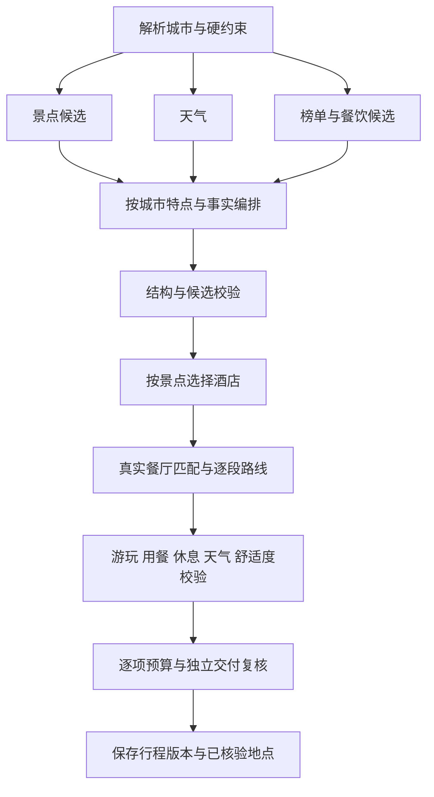

# 美食、局部修改与舒适度升级

本次在原旅游 Agent 上接入真实美食候选、公开高德美食榜数据、局部修改、逐段交通时间，以及餐饮、游玩、天气和预算的联合校验。

## 怎么体验

1. 重启后端与前端，进入 `/chat` 登录或注册。
2. 填目的地、日期、天数、交通和住宿要求，可把兴趣设为“美食”。确认后生成行程。
3. 行程下方的“修改这份行程”可以选择一顿餐饮、一个景点、某天的景点安排或全程酒店，查询真实候选并预览。
4. 点击“确认这次局部修改”才保存新版本；撤销会保留原版。景点或餐厅修改只重新计算受影响日期的路线、时间和预算，酒店修改重新计算各天与住宿有关的路线。不会重新运行整张规划图。
5. 也可以自然语言明确说“换第二天的午餐”等要求。目标不明确时会追问，模型只能从已核验候选中选择编号。
6. 表单页支持“保存并局部修改”：需要先登录，再生成这份表单行程。旧的匿名行程不自动认领到账号。

局部预览是草稿，尚未完成路线复核，返回 `EDIT_PENDING`；不会冒充已经通过最终校验。确认失败时显示具体原因，原有效行程继续保留。修改、确认、重试和导入都保留版本与请求幂等校验。

## 行程如何生成

编排和预算的修改次数都有上限。路线最多发送48次实际查询，重试同样计入上限，并复用相同坐标、模式的查询结果。接口限流沿用共享请求门控；查询失败时使用明确标记的规则估算及缓冲，不将直线距离声称为实际道路路线。

时间表包含三餐、景点建议游玩时间、每段交通、交通缓冲和休息。默认一天从08:30开始，完整安排上限660分钟；超限会返回具体原因并限次重排。暴雨、雷暴、高温等与户外景点冲突时不通过校验。超出预报窗口会说明天气未知，保留出发前复查提示。

城市特点来自项目维护的静态指南，覆盖杭州、北京、成都、重庆、西安、上海、广州，其余城市使用通用片区与饮食建议；没有把静态文字包装成实时城市数据。开放时间、预约、排队、实时交通和用户身体状态目前没有完整实时模型，仍需要出发前确认。

## 高德美食榜与数据库

实际采集了北京、杭州各10条公开美食榜记录。原页面标题为“2025高德状元榜·美食”，保留原年份、来源URL、榜内位次和采集时间，不宣传为2026实时榜。页面没有坐标和人均消费，这些字段在运行时通过高德餐饮查询补齐，只有 POI ID 完全匹配才能附加榜单标签。

详细来源、爬虫命令和限制见 [美食榜单与资料库.md](美食榜单与资料库.md)。没有榜单证据的城市仍可使用普通高德餐饮候选，并向用户说明来源。

共享数据库新增：

- `food_ranking`：公开榜单及出处，30天有效。
- `place_catalog`：按城市、种类、POI ID去重的餐厅、酒店和景点，7天有效。保存的是与工具候选匹配的原始事实，不保存模型编造的实体。
- `price_observation`：有出处、适用日期、金额单位和失效时间的价格观察；通过维护者本地命令导入。
- `conversation_edit`：待确认局部修改，刷新页面或重启后仍能恢复预览。

真实榜单导出位于 `outputs/food-ranking-beijing.json` 和 `outputs/food-ranking-hangzhou.json`；独立种子库位于 `backend/data/food_catalog_seed.sqlite`。测试数据不导入真实数据库。

## 预算口径

门票、三餐、酒店入住晚数和市内交通均逐项核算，界面可展开具体费用和说明。默认门票与餐饮按一人、酒店按一间房计算；没有新增多人报价能力。

高德普通POI不是实时订票或订房接口。查不到价格时保留待查，餐厅没有人均消费时按明确的每餐规则预留并标为估算。酒店模型估算不等于可购买报价。带出处的价格必须覆盖本次游玩日期或住宿夜晚，过期或改日期后会失效并重新汇总。未知金额不会按零元通过预算，尚未查明的价格会进入未知项目列表。

本次真实采集的数据不包含虚构的门票、房价或餐饮报价；离线测试中的数字只用于验证计算与失败处理。

## 验证方式

后端完整回归、前端类型检查与生产构建，以及 `backend/scripts/eval_integrated.py` 的离线场景评测。覆盖真实图接线、断点恢复、多轮确认、局部修改、候选幻觉、费用超限、天气冲突、48次路线查询上限、过期价格和账号隔离。外部地图与模型调用在回归中使用夹具，不将测试通过率当成真实用户推荐质量。

2026-10-18 最终版本验证：后端完整回归570项通过，扩展离线场景评测131项通过（属于完整回归的子集，不能相加）；前端4项测试、Vue类型检查、Vite生产构建和后端Ruff检查通过。额外覆盖了同一家店安排三餐时仍能拦截过晚午餐，以及缓存行程读取后来导入的新价格。Windows的前端测试命令已改为目录模式，避免Node 20把通配符当成字面文件名。

同步时逐文件比对隔离副本建立前的哈希，只更新本批变更；原有改动和删除不回滚，环境配置保留，原SQLite先备份再追加真实榜单数据，不使用种子库覆盖原行程库。

仍采用单进程部署；SQLite、会话执行锁和请求门控不提供多进程分布式协调。
