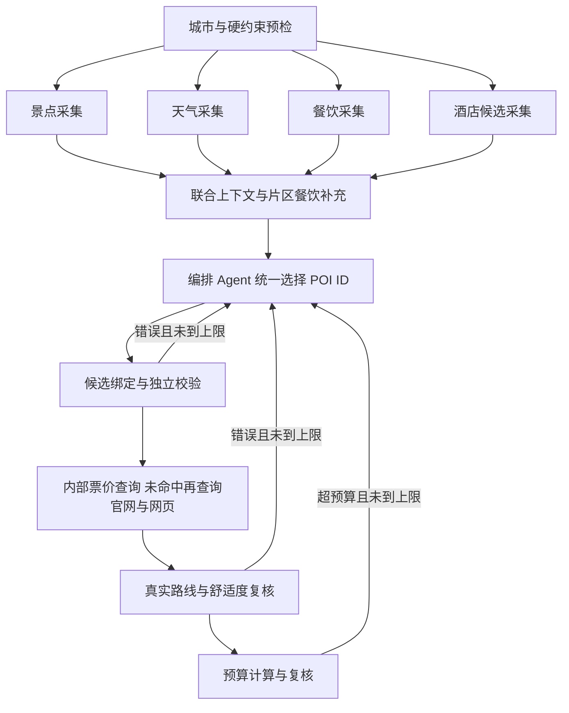

# 联合编排与门票检索（契约 v9）

默认生成链路现在由同一个编排 Agent 决定景点、三餐餐厅和整段酒店。旧的独立住宿选择节点仅保留用于旧运行日志的恢复，不在新规划主路径中。

## 谁决定什么

- 景点、餐厅、酒店：模型选择已核验候选的 ID，并解释片区、特色、用餐和住宿选择。
- 名称、坐标、类目、照片、时长建议和价格：按 ID 从候选回填，模型不能覆盖。
- 路线时长、三餐和休息时间、预算求和：工具与代码计算，失败原因回馈模型限次修改。
- 餐厅与酒店不会被后处理另选。全程有附近适配的未用餐厅时，重复选择会被校验拒绝；候选不足可以复用，但保留提示。
- 景点候选按现有策略压缩，必去点保留；餐饮和酒店会展示本轮候选池的全部条目。这不等于数据库里全国所有 POI 都进入上下文。
- 用户固定酒店不可更换；无住宿晚数不选酒店。住宿价格未知时，普通自选酒店使用明确标注的预算预留，固定酒店沿用其未知状态。
- 局部修改仍走局部修改流程，保留无关模块；酒店改动复核所有日期的通勤，单餐改动复核当日路线及整份预算。

## 提示词

参考 [Hello-Agents 第 13 章](https://github.com/datawhalechina/hello-agents/blob/36f583c233ea5cee4537ef93455702b55053af18/code/chapter13/helloagents-trip-planner/backend/app/agents/trip_planner_agent.py) 的角色、任务和输出契约组织方式，针对本项目补充证据边界、硬约束、失败处理和统一 ID 输出。

`agents/prompts.py` 集中维护景点、天气、旧住宿对照实验、联合编排、意图提取和局部修改的提示词。确定性的酒店/餐饮采集、地图测距、费用计算和校验节点直接执行代码，不为它们额外添加无决策价值的 LLM 调用。

## 门票先内部，再联网

1. 查询内部 `price_observation`：精确匹配城市、POI ID、适用日期、证据有效期；过期数据不会阻止联网补充，真实 0 元也不会当作缺失。
2. 未命中时查询已维护的官网解析器（故宫、成都熊猫基地）。
3. 仍无票价时通过公开网页搜索发现来源。先必应，再补充搜狗政府页面检索；只读取搜索结果条目，排除页脚备案链接和政府首页。
4. 抓取搜索结果对应的 HTTPS 来源页面，校验域名、重定向、公共网络地址、地点及城市、成人入场产品和政策时效。搜索摘要不直接作为票价。
5. 搜索得到的公开政策作为有来源的**估计参考价**写回内部价格库，保存原文、URL、观察时间、失效时间和目标日期，不冒充日期/票种明确的订单报价。
6. 无唯一成人入场价格、只有儿童票/套票/起价、历史政策、季节或有效期无法解析、HTTP 错误等都保留具体原因。后续预算预留不改变“实际票价尚未确认”的结论。

普通商场按普通进入规则不预留门票；这不是官方免费报价，购物、餐饮和收费展览另计。酒吧/KTV 等消费场所不套用景区门票预留。收费子场馆不能因为位于商场里就被推定免费。

### 有界查询与可观测性

默认每次图运行最多搜索 6 个地点/日期，共享 10 秒查询预算；修复重排保留查询记录和具体失败原因，避免重复搜索。成功证据缓存 24 小时，失败缓存 15 分钟。网页实际 HTTP 请求数（含跳转）写进工具记录；429 进入公共搜索请求节流等待。

设置：`TICKET_WEB_SEARCH_ENABLED`、`TICKET_WEB_QUERY_LIMIT`、`TICKET_WEB_BUDGET_SECONDS`。`TICKET_OFFICIAL_HOSTS` 可补充人工核实的景区官方域名；默认信任政府域名和代码维护的少数景区官网。

这是一条真实的网络回退链路，但不是全国景点的完整票务接口。动态 JavaScript 票务页面、反爬、复杂票种和跨季政策可能无法自动确认；这些情况显示具体原因，不能用模型记忆填写金额。提高覆盖率需要继续维护官网适配器或接入有授权的票务数据。

## 恢复与兼容

四路采集必须汇齐后才能编排。新日志保存契约版本并支持准备上下文、编排、校验、预算节点的断点恢复；旧日志仍能沿原住宿节点恢复。完整行程缓存指纹升级到 9，历史已存行程不被自动改写。

## 验证方式

离线测试隔离外网和真实数据库，覆盖 ID 绑定、全部候选可见、模型价格无法覆盖事实、重复反馈、模型选择不被后处理替换、内部价格命中/过期、网页发现与来源抓取、政策歧义、防止私网访问、查询缓存及检查点故障恢复。公开网络探测使用无密钥的合成景点案例，不能代替真实模型的端到端质量评测。
