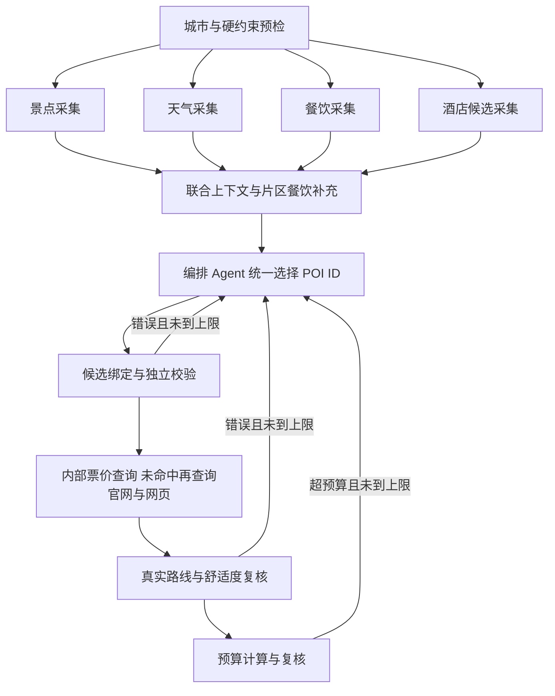

# 联合编排与门票检索（每晚住宿契约 v11）

默认生成链路由同一个编排 Agent 决定景点、三餐餐厅和每晚酒店；住宿绑定入住日期，市内优先连住，周边活动可分段。旧的独立住宿选择节点仅保留用于旧运行日志恢复。具体产品范围见《PRD-自适应行程与分段住宿-20261019》。

显式晚到/早离的首末日由代码派生可用时间和实际餐次，允许受限边界日仅接驳与住宿，其他日仍遵守完整餐次。`planner_draft`只保存被拒绝的内部ID决策供同一模型有限修复；餐次补丁合并后仍重新绑定全部事实和独立校验，草稿不能作为成功行程交付。

## 谁决定什么

- 景点、餐厅、酒店：模型选择已核验候选的 ID，并解释片区、特色、用餐和住宿选择。
- 名称、坐标、类目、照片、时长建议和价格：按 ID 从候选回填，模型不能覆盖。
- 路线时长、三餐和休息时间、预算求和：工具与代码计算，失败原因回馈模型限次修改。
- 餐厅与酒店不会被后处理另选。全程有附近适配的未用餐厅时，重复选择会被校验拒绝；候选不足可以复用，但保留提示。
- 景点候选按现有策略压缩，必去点保留；餐饮和酒店会展示本轮候选池的全部条目。这不等于数据库里全国所有 POI 都进入上下文。
- 用户固定酒店不可更换；无住宿晚数不选酒店。住宿价格未知时，普通自选酒店使用明确标注的预算预留，固定酒店沿用其未知状态。
- 每晚事实存于 `TripPlan.stays`；`hotel`仅在整程同酒店时提供兼容摘要，不能用它给多酒店行程计费。
- 每日起终点从前一晚/当晚住宿派生；首末日没有用户起终点时注明交通覆盖边界。换住包含60分钟估算预留，实际入住/退房窗口有证据才作为已核验条件。
- 局部修改可选单晚、连续住宿段或全部未锁定夜晚。修改某晚至少重算该日终点及次日起点，保留无关选择并复核整程预算；失败不覆盖原版本。
- 区域酒店按坐标有界搜索；区域餐饮先读区域目录再补采。市区天气不能冒充山区天气，行政区预报只作参考，恶劣预报不能忽略。
- 编排可提出有界资料请求；对少量不合法餐厅，同一编排模型可输出明确餐次补丁，代码合并后完整绑定并独立校验，不另起一套餐饮决策 Agent。

## 提示词

参考 [Hello-Agents 第 13 章](https://github.com/datawhalechina/hello-agents/blob/36f583c233ea5cee4537ef93455702b55053af18/code/chapter13/helloagents-trip-planner/backend/app/agents/trip_planner_agent.py) 的角色、任务和输出契约组织方式，针对本项目补充证据边界、硬约束、失败处理和统一 ID 输出。

`agents/prompts.py` 集中维护景点、天气、旧住宿对照实验、联合编排、意图提取和局部修改的提示词。确定性的酒店/餐饮采集、地图测距、费用计算和校验节点直接执行代码，不为它们额外添加无决策价值的 LLM 调用。

## 门票先内部，再联网

1. 查询内部 `price_observation`：精确匹配城市、POI ID、适用日期、证据有效期；过期数据不会阻止联网补充，真实 0 元也不会当作缺失。
2. 未命中时查询已维护的官网解析器（故宫、成都熊猫基地）。
3. 仍无票价时通过公开网页搜索发现来源。先必应，再补充搜狗政府页面检索；只读取搜索结果条目，排除页脚备案链接和政府首页。
4. 抓取搜索结果对应的 HTTPS 来源页面，校验域名、重定向、公共网络地址、地点及城市、成人入场产品和政策时效。搜索摘要不直接作为票价。
5. 搜索得到的公开政策作为有来源的**估计参考价**写回内部价格库，保存原文、URL、观察时间、失效时间和目标日期，不冒充日期/票种明确的订单报价。
6. 无唯一成人入场价格、只有儿童票/套票/起价、历史政策、季节或有效期无法解析、HTTP 错误等都保留具体原因。
7. 根据用户已授权的产品要求，内部数据和网页均未获得票价后，可限次使用模型给日常参考价；始终标注 `llm_estimated`，说明未核验官方报价。失败或无依据仍为未知，不假装官方免费或确定票价。

普通商场按普通进入规则不预留门票；这不是官方免费报价，购物、餐饮和收费展览另计。酒吧/KTV 等消费场所不套用景区门票预留。收费子场馆不能因为位于商场里就被推定免费。

### 有界查询与可观测性

默认每次图运行最多搜索 6 个地点/日期，共享 10 秒查询预算；修复重排保留查询记录和具体失败原因，避免重复搜索。成功证据缓存 24 小时，失败缓存 15 分钟。网页实际 HTTP 请求数（含跳转）写进工具记录；429 进入公共搜索请求节流等待。

设置：`TICKET_WEB_SEARCH_ENABLED`、`TICKET_WEB_QUERY_LIMIT`、`TICKET_WEB_BUDGET_SECONDS`。`TICKET_OFFICIAL_HOSTS` 可补充人工核实的景区官方域名；默认信任政府域名和代码维护的少数景区官网。

这是真实网络回退链路，尚非全国完整票务接口。动态页面、反爬、复杂票种和跨季政策可能无法自动确认；模型参考可补预算数值，但不能作为官方证据。提高可靠覆盖率仍需要官网适配器或有授权的票务数据。

## 恢复与兼容

四路采集汇齐后编排。每晚住宿使用独立 `accommodation_version=11`，缓存指纹版本为11；旧日志仍按旧契约恢复，历史单酒店只读适配。跨日期复用时住宿日期同步平移，区域旧天气重置待查询；日期锁、起终点与时间进入指纹，失败草稿不进入成功缓存。

## 验证方式

离线测试隔离外网和真实数据库，覆盖 ID 绑定、全部候选可见、模型价格无法覆盖事实、重复反馈、模型选择不被后处理替换、内部价格命中/过期、网页发现与来源抓取、政策歧义、防止私网访问、查询缓存及检查点故障恢复。公开网络探测使用无密钥的合成景点案例，不能代替真实模型的端到端质量评测。
