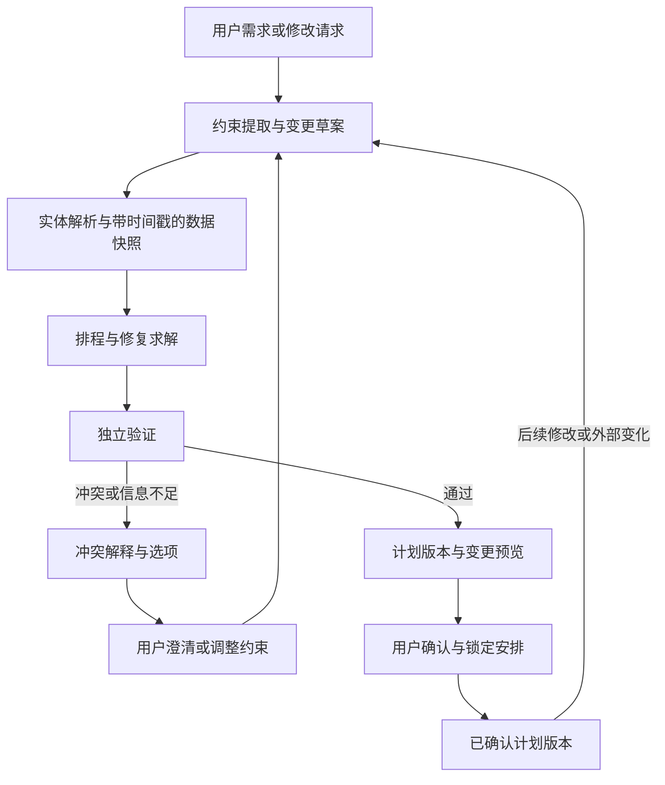

# 从行程生成 Demo 到可验证、可交互的规划系统

调研日期：2026-10-11。

本次在线检索并阅读了下列论文的摘要、相关方法、评测与局限部分，以及官方工程指南，随后对照当前仓库核查。没有复现论文实验，没有启动外部服务或消耗模型 API。2026 年的新工作中包含预印本，其结论只适用于文中评测设定。本文件是升级方案，不表示其中能力已经实现。

## 1. 重新定位

目前是有一定工程基础的旅行规划原型：有确定性工具、结构化输出、独立复核、后台任务、SSE、SQLite journal 和少量实验。但产品中心仍是“一次输入，生成一份逐日列表”。复杂度主要集中在组件协作，尚未形成用户持续使用时需要的约束协商、执行恢复和结果可信度闭环。

建议定位为：**支持约束协商与增量修改的旅行规划助手，能追踪已确认安排、验证时间可行性，并解释无法满足的要求。**

工程深度来自有明确成功标准的能力，以及失败、变更和恢复语义。增加 Agent 数量、向量库、MCP 接口或微服务数量本身不能证明能力提升。

需要修正之前的建议：“结构化诊断 + 局部修复”值得实现，但不能直接作为新颖性声明。2026 年 9 月的 Replan, Repair, or Edit? 已经比较了全量重规划、经典计划修复和 LLM 局部编辑。要做研究，需要进一步限定问题和对照条件；要做求职项目，可以诚实定位为研究方法的工程实现与独立评测。

## 2. 阅读材料及对应启示

| 材料 | 原文支持的认识 | 本项目应借鉴的内容 |
|---|---|---|
| [TravelPlanner（2024）](https://arxiv.org/abs/2402.01622) | 旅游规划需要同时满足多种约束；工具使用和看起来合理的计划不等于任务成功 | 评测完整行程的联合正确性，而不只检查输出 JSON 与必去覆盖 |
| [Large Language Models Can Solve Real-World Planning Rigorously with Formal Verification Tools](https://arxiv.org/abs/2404.11891)；本次读取 v2 | 将需求形式化并交给求解器；不可满足时利用冲突信息支持交互修改 | 让模型理解语义，让求解器处理建模后的组合约束；说明保证范围 |
| [TRIP-PAL（2024）](https://arxiv.org/abs/2406.10196) | LLM 与自动规划器分工：获取、转换信息和严格规划分别处理 | 用声明式约束替代不断扩大的纠错 Prompt |
| [TREK（2026-07 起，预印本）](https://arxiv.org/abs/2607.26977) | 同时评估约束、数据依据、时空可执行性、预算和用户需求；包含有标签的不可行任务 | 固定数据沙箱、确定性评分、可行与不可行用例、可达到的参考解 |
| [Replan, Repair, or Edit?（2026-09，预印本）](https://arxiv.org/abs/2609.19654) | 评估修复时同时考虑可行性恢复、已接受安排的保留和成本；文中不存在全面占优的方法 | 将保留率和修改代价作为一等指标；不预设局部修复更快或更省 token |
| [AcCoRD（2026-08，预印本）](https://arxiv.org/abs/2608.27818) | 偏好可能未说明、可协商、不可实现或在交互中才出现；单靠提示策略不足以解决 | 建立可修改的约束状态，支持澄清与协商，而不是只追加聊天文本 |
| [How Constraints and Preferences Shape Travel Planning（2026-09，预印本）](https://arxiv.org/abs/2609.26968) | 访谈指出，真实旅行规划中的约束和偏好会在探索中演变 | 让约束、优先级和取舍对用户可见、可调整 |
| [τ-bench（2024）](https://arxiv.org/abs/2406.12045) / [τ²-bench（2025）](https://arxiv.org/abs/2506.07982) | 检查最终环境状态与多次运行可靠性；后者强调用户和 Agent 共同改变环境 | 评测实际计划版本及确认状态，区分推理错误、沟通错误、执行错误 |
| [Building effective agents（2024）](https://www.anthropic.com/engineering/building-effective-agents) | 区分固定工作流和动态 Agent；用收益证明复杂度 | 固定天气查询可以是工具节点，只有需要动态决策的部分使用 Agent |
| [Writing effective tools（2025-09）](https://www.anthropic.com/engineering/writing-tools-for-agents) | 工具边界、返回信息、参数和任务级评测会影响 Agent 成功率 | 设计面向规划意图的检索工具，支持精简摘要与按需详情 |
| [Effective context engineering（2025-09）](https://www.anthropic.com/engineering/effective-context-engineering-for-ai-agents) | 按需加载、压缩与结构化记录需要保留关键上下文 | 将约束和已确认安排持久化；候选压缩要评估覆盖和方案可行性 |
| [Demystifying evals（2026-01）](https://www.anthropic.com/engineering/demystifying-evals-for-ai-agents) | 区分轨迹与最终结果、能力与回归测试、pass@k 与 pass^k | 记录最终产物及关键状态，测试重复可靠性和真实失败回归 |
| [LangGraph Checkpointers](https://docs.langchain.com/oss/python/langgraph/checkpointers)、[Fault tolerance](https://docs.langchain.com/oss/python/langgraph/fault-tolerance)、[Interrupts](https://docs.langchain.com/oss/python/langgraph/interrupts) | 检查点保存图执行状态；支持并行部分完成恢复、人工中断；重放前的副作用必须幂等 | 用持久检查点恢复执行位置；持久任务调度和业务幂等仍需另外实现 |

不同论文的任务、模型、数据、预算和评分规则不同，不能把论文成功率与仓库当前“约束满足率”直接比较。近期修复论文也明确指出其方法间存在实现与预算等混杂因素，因此不能把其结论理解为某个修复范式普遍胜出。

## 3. 当前代码揭示的核心缺口

### 3.1 成功不等于约束有效，且错误可能被缓存

`backend/app/api/routes/trip.py::_finalize` 使用 `bool(days) and not degraded` 判定成功，没有把最终 `validate_error`、必去要求未满足或最终验证状态纳入判据。`graph.py` 在重试用尽后继续选酒店和算预算；因此有数据、没有 degraded 的不合格计划仍可能被标为成功并存入行程缓存。

这是比“再增加一种验证规则”更优先的基础问题。先定义任务状态和结果状态：生成完成、验证通过、返回部分结果、无法验证、已证明建模内无解等，不要用一个 success 混合表达。只有最终报告允许的计划才能进入可复用缓存；缓存命中也需要针对新日期重验。

### 3.2 约束模型过薄

`TripRequest` 没有结构化预算上限、人数、每日起止时间、预约窗口、开放时间、步行上限或用户锁定的安排。只有城市、天数、偏好和必去列表时，真实排程难度尚未进入问题定义。

预算目前主要是事后估算。`verify_plan` 读取 `plan.budget.total` 的时候，`patch_budget` 还没执行，所以正常生成链路中的费用占比检查通常不会触发。未知门票等以 0 参与汇总也不能用于证明预算可行。

建议先支持小范围但明确的约束：每日时间窗、必去、固定酒店、预算上限、用户锁定的日期与活动。对价格使用已知、估算、未知的区分；估算可给区间，未知不等于免费。人数、货币、按人或按房等计费口径要一致。

### 3.3 模型输出与外部事实的边界不完整

`planner_agent.py::_enrich` 补充 POI ID、图片、评分等，却没有用候选实体的坐标覆盖模型输出坐标。模型可输出候选名字并附上错误坐标，而地理复核仍使用这些坐标。按名字或 ID 任一匹配通过的规则，也需要处理 ID 与名字相互冲突的情况。

建议 LLM 输出 `poi_id`、日期、顺序和必要的语义选择，服务端用唯一实体解析完整字段。坐标来自数据快照；游览时长可以估算，但应有范围、来源与约束。验证针对规范化实体和已选估计进行，而不是对模型复述的事实进行。

### 3.4 journal 不等于可靠执行恢复

`runner.py::can_resume_from` 只要看到历史里有 `compose_plan` 就返回 `resolve_hotel`。如果在编排后、复核前崩溃，恢复会绕过 `verify_plan`；若复核已经要求重试，当前基于节点名称的判断也无法可靠识别应走的分支。重试循环中“节点出现过”不代表该阶段已经完成。

后台任务由 daemon 线程执行。落盘能保留状态，但进程退出会停止实际工作；重新读取一个 running 状态不会自动重启计算。内存中的任务对象也可能缓存过时状态。共享 SQLite 文件和任务落盘本身，不能证明多副本执行正确。

建议用持久 checkpointer 保存当前状态和待执行节点；另用任务表与有界 worker 管理执行。任务领取需要租约或同类互斥机制、超时回收和幂等键。SSE 是任务事件的观察界面，不承担任务调度。测试要覆盖并行分支部分完成、重试中断和重复续跑。

### 3.5 评测可能漏掉最重要的失败

`eval_gate.py` 只在 report 存在且有 unsatisfied 时报告硬约束失败；report 缺失时可能通过。它也没有直接检查最终独立复核错误。full 模式阈值为 0.85，现有 7 个用例允许 1 个失败后仍通过，且没有为关键安全性质单列必过项。

改为：最终报告必须存在；所有硬约束分别给出状态；关键项必须通过；可协商的质量指标单独统计。预检无后续调用、必去不丢失、已锁定安排不被无声修改、错误结果不缓存，应成为确定性回归门禁。

### 3.6 现有两个正确性问题仍应先修

`city.py` 的总容量检查与 10 个必去解析上限不一致；`graph.py` 的预检条件边与直连天气边冲突。它们应通过图级测试与边界输入测试先处理，再扩展能力。

## 4. 推荐架构：语言理解 + 约束求解 + 有状态交互

**LLM 的职责**：识别“带老人、下午不赶路”等语义，提出约束解释；决策需要补查什么；给出有依据的取舍解释。模型提取的新增硬约束在适当界面让用户确认，不能将推测当成用户承诺。

**求解器的职责**：决定景点选择、日期、顺序与时间；满足必去、时间窗、交通、预算以及用户锁定的安排。优先采用固定模型与经校验的声明式输入，避免把执行任意模型生成 Python 当成 MVP 前置能力。

**运行时的职责**：持久执行状态、计划版本、人工中断、任务取消、资源预算、故障恢复和幂等提交。

对于当前单城市、有限 POI 集合与时间窗问题，建议优先评估 OR-Tools CP-SAT。若重点转向逻辑约束及不可满足核心解释，可评估 Z3。选择由问题建模与基准表现决定，MVP 不需要同时接两套求解器。

在硬约束满足的前提下，按优先级优化：先保留用户已确认的安排，再减少不必要修改，随后改善偏好覆盖与交通开销。锁定项与普通已有安排必须区分：前者是硬限制，后者可以被修改但需要在 diff 中说明。

“只改第三天”不一定可以只复核第三天。移动一个活动可能影响另一日、酒店出发时间和总预算。局部搜索可以从较小范围开始，再按依赖扩大；最终必须检查完整计划。找不到局部修复只能说明当前策略未成功，不能据此宣布整个请求无解。

求解器保证只针对建模约束与输入数据成立。候选池有限、道路时长是估算、开放时间缺失时，需要明确报告范围和未知项。一次 unsat 也可能只是检索到的候选不足；timeout 更不能当作无解证明。即使获得 unsat core，也不应未经额外最小化就称为“最小冲突集”。

## 5. 首个完整用户场景

用户生成杭州 3 天计划，确认第一天，并锁定酒店。之后提出：“第二天下午不去室外了，预算不超过 2500 元，其他尽量别动。”

交付行为：

1. 将修改转为可见的约束变更，明确预算计费口径与估算范围。
2. 读取原计划版本与锁定项，按需获取第二天的室内替代活动和路线信息。
3. 求解局部修改；若必须影响其他日期，给出原因及变更预览。
4. 显示 POI、日期、顺序和预算等语义差异，原版本可恢复。
5. 独立复核完整计划，保留未验证项；不把缺失价格当作 0 来声称预算满足。
6. 请求确有冲突时，展示可放宽的要求与备选方案，等待用户调整；不能擅自修改锁定的第一天。
7. 中途刷新或服务重启后可以查询任务并恢复；重复提交同一修改不会生成重复版本。

这条场景同时检验规划、交互、事实依据、版本管理和运行可靠性，比新增一个榜单或自由聊天窗口更能证明主线价值。

## 6. 分阶段交付及验收

| 阶段 | 交付内容 | 必须能展示的证据 |
|---|---|---|
| A：可信基线 | 修预检路由、必去截断、最终成功与缓存判据；实体规范化；固定离线数据集 | 失败用例可复现；硬失败不被包装成成功或缓存；关键不变量全通过 |
| B：可验证规划 | 约束模型、时间窗、交通时间矩阵、价格状态、一个确定性求解器、独立复核报告 | 已知可行任务能给出可执行方案；不可行或信息不足能正确区分 |
| C：可交互修改 | plan/version、锁定项、修改 API、结构化补丁、变更预览、确认与回滚 | 修改第二天能保留第一天的锁定安排；冲突时明确协商 |
| D：可靠执行与评测 | 持久检查点、有界 worker、幂等、租约、取消、SSE 事件重放、故障注入 | 重启继续执行、重复提交不重复生效；对照实验可离线复跑 |

优先完成 A—C 的一条端到端能力，再扩大城市、POI 和部署规模。数据库迁移或分布式中间件由持久调度、并发与多实例需求决定，不应单独作为完成度指标。

## 7. 实验应怎样升级

先建设约 30—50 个小而可审查的离线任务，按能力分组，包含已知参考解和明确不可行样例。数据快照、时钟、模型配置、Prompt、求解器配置和代码版本都固定记录。任务要包含多日多片区、开放时间冲突、固定酒店、预算紧张、候选不足、未知价格以及连续修改。按任务模板与实体划分开发集和留出集，避免只适配见过的题目。

比较至少四组，在相同数据、工具与资源上限下运行：

1. 单次 LLM 排程。
2. LLM 排程 + 结构化验证 + 全量重试。
3. LLM 约束提取 + 确定性求解。
4. 第三组 + 版本化交互 + 保留安排的增量修复。

第四组的修改任务与前三组的初始生成任务不能混为同一分母；应分别比较生成质量，以及相同已接受计划、相同变更事件下的修复质量。选定一套简单规则启发式作为额外基线，可判断收益究竟来自 LLM 还是排程算法。

主要指标：联合硬约束通过率；无解判定正确率；未知信息被诚实报告的比例；必去与已锁定安排保持率；成功修复的语义编辑数；全部任务失败率与超时率；用户澄清次数；端到端 p50/p95；调用、token 与工具费用。保留率须同时报告成功样例数，不能只挑修复成功的漂亮案例隐藏失败。

对同一任务重复运行，区分 pass@k（多次中至少成功一次）和 pass^k（多次全部成功）。样本与重复数应按预算逐步增加，报告置信区间或分布，不把 3 次中位数当成稳健结论。

硬规则用代码评测；描述质量、解释是否易懂和偏好体验可以辅以人工或 LLM judge。生成代码的校验通过不应直接成为最终成功证明；最终计划需要根据规范化数据独立检查。

## 8. 研究主张与工程主张的边界

已有文献覆盖了 LLM + 求解器、不可满足约束解释、局部修复和偏好协商。本项目不应把简单组合重新命名后声称原创。

可以考虑的进一步研究问题是：**连续的用户偏好变更与数据不完整同时存在时，如何在固定成本预算内恢复可行性，同时保留用户确认过的安排，并正确区分无解与信息不足？** 这只是研究候选，需要进一步检索和实验证明差异。

若面向求职，目标可以更直接：把既有研究思想实现成端到端系统，明确保证边界，提供失败案例、恢复演示与可复现基准。完成这一点已经有足够工程价值，不必承诺训练模型或发表论文。

## 9. 社区服务的取舍

Java 社区可以作为独立业务模块保留，但暂不继续扩大点赞与榜单功能。若要以生产工程能力作为亮点，先补真实可靠性：`LikeService` 的待落库流水在进程内 `LinkedBlockingQueue` 中，崩溃会丢失；队列满时 Redis 已接受点赞，流水可能未进入数据库。失败重入队也没有可靠投递保证。因此目前不能将其称为有保障的“至少一次交付”。

可选路径是持久事件队列 + 幂等消费 + 对账，或回到数据库事务作为事实来源。选哪条应基于目标吞吐与复杂度；短时 QPS 压测不能替代崩溃恢复与一致性测试。身份、计划访问与修改权限也应绑定真实用户，不能依赖可伪造的 X-User-Id 或只知道 thread_id。

当前最值得投入的主线仍然是：可信生成 → 约束协商 → 增量修改 → 持久恢复 → 可复现评测。

## 10. 执行状态表（每项：状态 / 验收条件 / 证据 / 保证范围）

本表由实现方维护。**没有证据的项不许标完成**；标完成时"保证范围"必须写清结论在哪里成立、在哪里不成立。

### 10.1 Phase A（可信基线）

| 项 | 状态 | 验收条件 | 证据 | 保证范围 |
|---|---|---|---|---|
| 预检失败不产生下游动作 | **完成** | 预检失败时 0 次 LLM、0 次工具、无任何下游产出 | 提交 `4c18498`；`tests/test_completion_invariants.py::TestBlockedRequestsStayBlocked` + `TestGraphWiring::test_fail_path_runs_nothing_but_preflight`；运行时：`eval_gate --mode fast` 日志里原先的 `Agent(hotels) 到达步数上限` 已消失 | 只保证"图不再触发下游节点"；不保证上游（高德地理编码）自身不消耗配额 |
| 成功判据纳入校验结论 | **完成** | 有未解决 `validate_error` 或未满足硬约束 → `success=False`，且文案说明原因 | `tests/test_completion_invariants.py::TestSuccessRequiresValidation`（4 个用例，含"合格仍要入库"的正面控制） | 判据覆盖两层校验与独立复核的结论；**不覆盖**"复核规则本身是否够全" |
| 不合格计划不入缓存 | **完成** | 未通过校验的行程 `store.find_itinerary(...)` 为空 | 同上（`test_unqualified_plan_is_not_cached`） | 只保证新写入路径；v0.7 之前已入库的历史数据不会被自动清理 |
| 缓存命中重新复核 | **完成** | 复用的历史行程若复核出问题 → `success=False` 且文案说明 | 端到端实测：塞入"同一景点排两天"的历史行程 → `cached=True, success=False`，文案报出重复排期 | 复核用的是 `verify_plan`（确定性规则）；天气仍按新日期重取，但**天气之外的外部变化（如景点关闭）无法检测** |
| 验证依据用快照坐标 | **完成** | 模型给的错误坐标会被候选池的规范化坐标覆盖 | `tests/test_completion_invariants.py::TestAuditUsesSnapshotFacts` | 坐标来自高德数据快照；**开放时间、票价不在快照覆盖范围内**（票价见 10.2） |
| 断点续跑不绕过复核 | **完成** | 复核未跑过 → 不续跑；复核要求重试 → 回到 `compose_plan` | `TestResumeDoesNotSkipAudit`（3 个用例）；`runner.can_resume_from(completed, state)` 现以状态为准 | 只解决"续跑起点"语义；**持久调度、租约、幂等提交仍未实现**（Phase D） |
| 评测门禁收紧 | **完成** | `report` 缺失 → 不算通过；有 `validate_error` → 不算通过；关键用例一票否决 | `backend/scripts/eval_gate.py`；`--mode fast` 实测 4/4 | fast 模式不花 LLM；full 模式的生成类用例仍需人工挑选时机运行 |
| 两个必去上限的意图 | **完成** | 物理容量用**原始个数**判定（拒绝不可行请求）；配额上限表现为"截断 + 如实告知" | `TestTwoLimitsHaveDifferentJobs`（2 个边界用例） | 保证的是"两个上限不被混用"；**不保证**这两个数值本身选得合理（需按真实用户行为校准） |

### 10.2 Phase B（可验证规划）

| 项 | 状态 | 验收条件 | 证据 | 保证范围 |
|---|---|---|---|---|
| 费用三态落到费用项 | **完成（后端契约）** | 每条费用项带 `amount/status/source`；`unknown` 时 `amount=None` 且有断言；未知项不进 `total` | 提交 `f1f7114`；`tests/test_budget.py::test_unknown_ticket_price_is_excluded_from_total`；`amap.py` 门票价由"恒为 0"改为 `None/unknown` | 只覆盖"我们已知来源"的费用项；**门票价依然没有真实数据源**（高德不提供），所以结论是"未知"而非"已核实" |
| 预算成为规划约束 | **完成（复核侧）** | `TripRequest.budget_limit` 进指纹；`verify_budget` 独立复核并给出五种结论之一 + 依据 | 提交 `f1f7114`；`app/agents/verify_budget.py`；图接线 `patch_budget → verify_budget → END` | "within" 只在**当前数据快照与估算口径**下成立；`estimated_exceeded` **不等于**实际不可行 |
| 预算结论被最终结果消费 | **完成** | `known_exceeded`/`estimated_exceeded` → 不算成功；`unverified` 阻止入库 | `trip.py::_budget_reasons` / `_cacheable_budget_status` | `unverified` 不判失败（只警告 + 不入库）——这是实现方选择，若要求更严需改判据 |
| 约束模型扩充（时间窗 / 预约 / 人数 / 锁定） | **未开始** | —— | —— | —— |
| 确定性求解器（CP-SAT）离线 spike | **完成（独立离线实验，未接主图）** | 支持 FEASIBLE / INFEASIBLE / UNKNOWN；UNKNOWN 不得当无解；未知价格不得当 0；不可行要有可核查诊断 | 提交 `b2556fb`；`backend/spikes/`（脚本 1412 行 + 11 任务 + 66 行原始结果 + README）；我独立复跑：`ruff` 全仓干净、196 主服务测试全过、假警报 0 条、臂间差异 2 条（T04/T11 均为设计差异） | **只在"固定候选池 + 已建模约束 + haversine 估算通勤 + 人工票价"下成立**。11 任务 × 3 次、单城市，**不能外推**；`UNKNOWN` 分支**无实测证据**（全部任务 0.2 秒内解完）；**约束抽取正确性完全未测**（约束是结构化输入）；通勤为直线估算，真实路网下边界题结论可能翻转；**不代表可以接入主图** |
| 预算在求解器里的取舍 | **已完成（需在接入主图前复核）** | known 超限算硬约束、estimated 只降为目标偏好、unknown 完全不进判断 | `spikes/README.md` + `cpsat_scheduling.py` | 理由：用估算值否决一个真实可行的行程，等于把估算误差当事实。**这条取舍会直接影响"预算紧时该不该删景点"，接入主图前必须重新确认** |
| 前端可见（上限输入 / 未知项 / 预算结论） | **进行中** | 表单可设上限；预算卡显示已知/估算/未知与结论依据；门票未知显示"待查"而非隐藏 | 待交付 | 仅展示契约已有字段，不新增判定 |

### 10.3 尚未开始的阶段

| 阶段 | 状态 | 说明 |
|---|---|---|
| C：可交互修改（版本 / 锁定 / 语义 diff / 回滚） | **未开始** | 需要先定交互形态（锁定粒度、回滚粒度） |
| D：可靠执行（持久检查点 / 有界 worker / 租约 / 幂等 / 崩溃恢复） | **未开始** | 现有 `can_resume_from` 只解决续跑起点语义 |
| 评测集 30–50 个可审查任务 + 四臂对照 | **未开始** | 任务模板与判据需用户参与制定 |

### 10.4 已知的诚实边界（不许在结论里省掉）

1. Java 社区服务的点赞落库**没有投递保证**（进程内队列，崩溃即丢）—— 已在 README 改正措辞。
2. 全链路**没有统一鉴权**（`X-User-Id` 可伪造）。
3. 预算结论依赖估算口径；门票价目前**恒为未知**，所以"预算满足"这句话的强度有限。
4. 压测是单机短跑，**不能**替代崩溃恢复与一致性测试。
5. 对照实验样本小（每条件 3 次、单城市），且 2026 年的部分参考工作是预印本。
