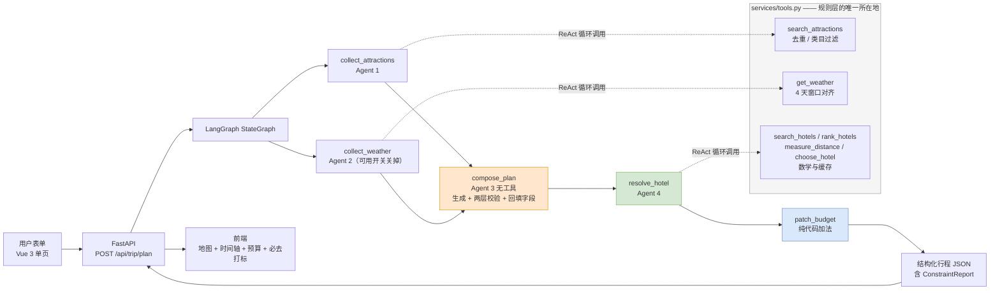
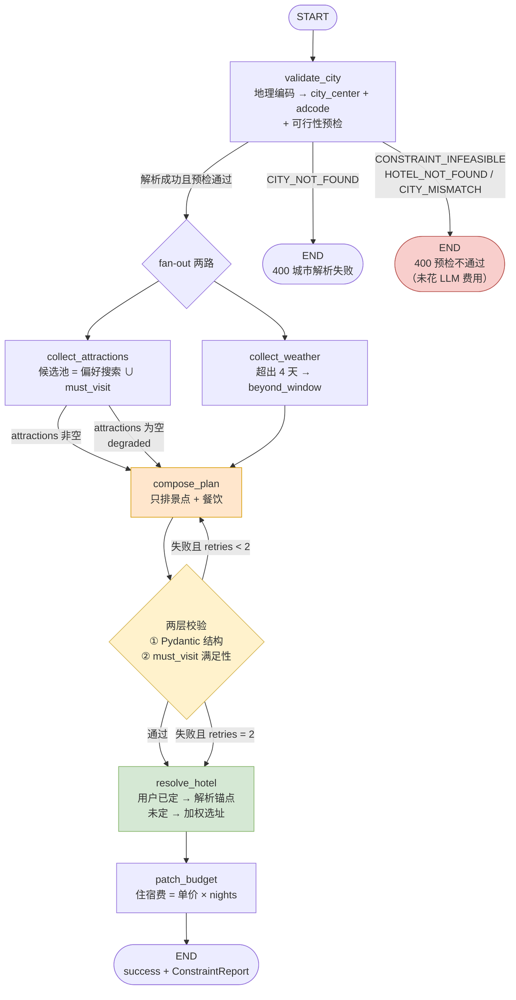
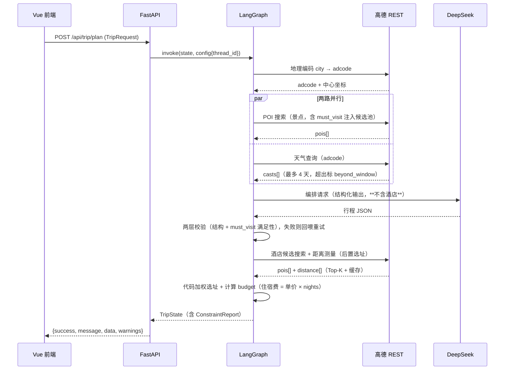
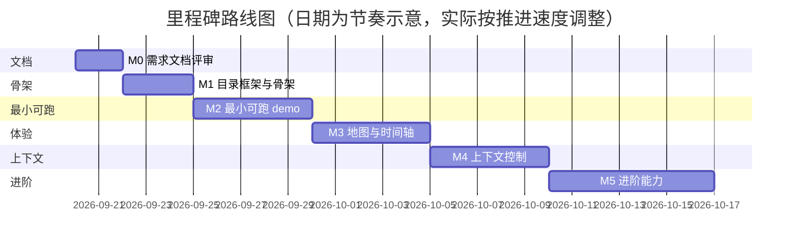

# 多智能体旅行规划助手 — 需求文档

| 项目 | 内容 |
|---|---|
| 文档版本 | v0.1（待评审） |
| 撰写日期 | 2026-09-20 |
| 文档状态 | 待评审 — 评审通过后才进入 M1 |
| 目标读者 | 本文档作者本人（学习者）、后续实现者 |
| 参考项目 | `datawhalechina/hello-agents` 第 13 章，本地路径 `D:\helloagents-trip-planner\code\chapter13\helloagents-trip-planner` |
| 相关文档 | `c:\Users\34397\CodeBuddy\week1\trip-planner-setup.md`（参考项目配置与踩坑记录）、`week1_交付_Agent内部发生了什么.md`（手写 agent 的基础认知） |

> **本轮交付边界**：本次只产出本文档，不写业务代码、不建工程、不装依赖、不改环境。
> 文档定稿后才进入 M1（目录框架），再逐步推进到 M2（最小可跑 demo）与之后的上下文控制等能力。

---

## 1. 项目概述

### 1.1 背景

用户已完成 week1 的手写 agent 练习（`simple_agent.py`、`week1_mini_agent.py`），完整理解单 agent 的循环骨架：**发消息给模型 → 模型返回 tool_call → 执行工具 → 结果回喂 → 循环**，以及三层停机条件（模型不再调工具 / 步数上限 / 连续请求失败）。也在本机跑通过 hello-agents 第 13 章的「智能旅行助手」，拿到过真实数据（杭州 3 天返回 9 个真实景点 + 3 条天气，端到端 26.3 秒）。

但第 13 章那套实现存在三个结构性问题（详见第 2 章）：

1. **不是真正的多智能体编排** —— `MultiAgentTripPlanner.plan_trip()` 里是写死的四段 `agent.run()` 顺序调用，没有状态图、没有条件分支、没有并行、没有中间结果校验。
2. **工具调用靠字符串约定** —— Prompt 里写 `[TOOL_CALL:amap_maps_text_search:keywords=..,city=..]` 让模型照着抄，而不是用原生 function calling。
3. **最终计划靠正则从自由文本里抠 JSON** —— 抠不出来就返回 `"{城市}景点1"` 这类假数据，且前端无法区分「真数据」与「降级假数据」。

同时 week1 暴露的可观测性硬伤（日志只有 `> 工具名: 前200字符`，**连步号都没有**）也需要在本项目根治。

因此本项目要做的是：**用 LangGraph 的显式状态图重写这套多智能体协作，把「顺序调用」升级为「有状态、可并行、可降级、可观测、可持久化」的编排**，并在之后逐个添加上下文控制能力。

### 1.2 目标

| 编号 | 目标 | 衡量方式 |
|---|---|---|
| G1 | 用 LangGraph 状态图实现四助手协作，而非硬编码顺序调用 | 编排逻辑全部由图节点与边表达，改流程不需要改 `plan_trip` 这类函数体 |
| G2 | 三个外部数据节点可并行执行，缩短端到端耗时 | 端到端 < 60 秒（参考基线 26.3 秒） |
| G3 | 工具调用使用原生 function calling + 结构化输出，不再正则抠 JSON | 编排节点输出通过 Pydantic 校验，失败可重试 |
| G4 | 任一路失败不阻塞全局，且前端能区分真数据与降级数据 | 三路各自独立降级；每个字段带 `source` 标记 |
| G5 | 建立可观测性：节点级 trace、步号、每节点耗时、token 用量 | 单次请求的完整日志可按节点切分查看 |
| G6 | 架构里为「上下文控制」预埋位置，后续逐个填充 | 第 6 章 CC-1 ~ CC-6 有明确落点，不返工重构 |
| G7 | 全过程可被用户逐模块理解 | 每个里程碑只引入一个新概念，可单独讲、单独验收 |

### 1.3 非目标（明确不做）

| 编号 | 非目标 | 原因 |
|---|---|---|
| N1 | 不做用户体系、登录注册、多用户权限 | 与「理解多智能体编排」这个学习目标无关 |
| N2 | 不做真实下单、支付、酒店/机票库存对接 | 需要商务资质，且超出学习范围 |
| N3 | 不做生产级高并发与集群部署 | 单机 demo，本地运行即可 |
| N4 | 不做移动端 App / 小程序 | 只做桌面 Web 单页 |
| N5 | 不做真实门票价、真实房价的抓取 | 见 4.7 节的诚实性约束：这类数据一律标注为「模型估算」 |
| N6 | M0~M5 阶段不做多语言（i18n） | 只用中文 |
| N7 | 不引入 hello-agents 库作为运行时依赖 | 避免其 `_auto_detect_provider()` 劫持 provider 的坑（见 7.3） |

### 1.4 术语表

| 术语 | 含义 |
|---|---|
| 助手 / Agent / 节点 | 本文档中三者等价，指状态图里的一个专职处理单元 |
| 编排图 / StateGraph | LangGraph 的状态图，节点是处理单元，边是流转条件 |
| TripState | 贯穿整张图的状态对象，LangGraph 在各节点间传递它 |
| 降级（degrade） | 某个数据源失败时，该路返回空结果或模型估算值，其余部分照常完成 |
| 真数据 / 估算数据 | 真数据来自高德 REST 接口；估算数据由 LLM 生成，前端必须标注 |
| fan-out / fan-in | 一个节点分裂成多个并行节点执行，再收敛回一个节点 |
| Checkpointer | LangGraph 的状态持久化机制，支持断点续跑与多会话隔离 |
| thread_id | 会话标识，Checkpointer 用它区分不同对话/任务的状态快照 |
| adcode | 高德行政区划编码，天气接口必须用它而不是城市名 |
| DoD | Definition of Done，里程碑验收标准 |

---

## 2. 与 hello-agents 第 13 章参考项目的逐项对照

### 2.1 参考项目是什么

参考项目由三部分组成，前端与后端完全解耦：

| 层 | 构成 | 说明 |
|---|---|---|
| 后端 | FastAPI，17 个 `.py` | `run.py` 启动 uvicorn（`host=0.0.0.0`, `port=8000`, `reload=True`） |
| 编排 | `app/agents/trip_planner_agent.py` | 4 个 `SimpleAgent` + 1 个共享 `MCPTool` |
| 外部数据 | `MCPTool(server_command=["uvx","amap-mcp-server"])` | 通过 MCP 协议调高德，`auto_expand=True` 展开成 16 个独立工具 |
| 前端 | Vue 3 + Vite + TS + ant-design-vue | 端口 5173，地图用 `@amap/amap-jsapi-loader` |

三个路由模块均以 `prefix="/api"` 注册，实际路径为 `/api/trip`、`/api/poi`、`/api/map`。

### 2.2 逐项对照表

| 维度 | 参考项目（第 13 章） | 本项目 | 为什么改 |
|---|---|---|---|
| **编排方式** | `plan_trip()` 里写死的四段 `agent.run()` 顺序调用 | LangGraph `StateGraph`，节点 + 边 + 条件边 | 参考实现改流程必须改函数体；我们要让流程由图定义 |
| **并行能力** | 无。景点→天气→酒店严格串行，约 26.3 秒 | **两路 fan-out 并行**（景点 ∥ 天气），fan-in 到编排；住宿在编排之后求解（v0.2 方案 D） | 景点与天气互不依赖，串行纯属浪费；住宿必须看到真实行程才能选址 |
| **中间结果校验** | 无。上一路返回什么就整段塞给下一路 | 每个节点出口用 Pydantic 校验，失败重试 | 参考实现把自由文本当数据传，脏数据会一路污染到最终计划 |
| **工具调用方式** | Prompt 里写字符串约定 `[TOOL_CALL:amap_maps_text_search:keywords=..,city=..]` | 原生 function calling（tool schema） | 字符串约定靠模型自觉，格式一错就整轮失效 |
| **工具绑定** | 4 个 agent 共享**同一个** `MCPTool` 实例 | 每个节点绑定各自所需的工具子集 | 共享导致每个 agent 都看到 16 个工具，选择面过大、易误选 |
| **外部数据接入** | MCP 子进程 `uvx amap-mcp-server` | 直连高德 REST（`restapi.amap.com/v3/...`） | 规避 `uvx` 不在 PATH 时**静默降级成假数据**的坑（见 7.3） |
| **服务层是否可用** | `app/services/amap_service.py` 的 `search_poi` / `get_weather` / `plan_route` / `geocode` **四个方法全部是空实现**（`# TODO: 解析实际的XXX数据` 后 `return []` / `{}` / `None`） | 服务层即真实实现，是唯一数据来源 | 参考项目实际走 MCP，`AmapService` 是一条死掉的代码路径。**所以 `/api/map/poi`、`/api/map/weather` 返回空数组是正常的，不是 bug** |
| **失败处理** | `plan_trip()` 整体 `try/except`，失败返回 `_create_fallback_plan()`，产出 `f"{city}景点{j+1}"` 假数据，且**前端无法区分** | 分路独立降级 + 每个字段带 `source` 标记 | 假数据必须对用户可见、可区分 |
| **结构化输出** | `_parse_response()` 用 `find("```json")` / `find("{")` 切片抠 JSON，失败即降级 | 编排节点输出经 Pydantic 校验，配重试 | 切片抠 JSON 在模型输出略有偏差时就整盘失败 |
| **图片数据源** | 额外依赖 Unsplash（需单独申请 Key，缺失则景点无图） | 用高德 POI 响应自带的 `photos[].url` | 高德 POI 本身返回图片 URL，可以省掉一个 Key 和一个故障点 |
| **可观测性** | `print` 到控制台，无步号、无耗时、无 token 统计 | 节点级结构化 trace | week1 已确认「日志连步号都没有」是硬伤 |
| **状态持久化** | 无，进程结束即失，不支持多会话 | LangGraph Checkpointer + `thread_id` | 为后续多轮对话改行程预留 |
| **LLM 接入** | `hello_agents.HelloAgentsLLM(provider="custom")` | `langchain_openai.ChatOpenAI` 指向 DeepSeek | 彻底绕开 `_auto_detect_provider()` 劫持（见 7.3） |
| **配置校验** | `validate_config()` 只判 `if not settings.amap_api_key`，占位符非空即「通过」 | 校验长度/前缀 + 一次真实连通性探测 | 避免「启动成功但实际调用 401」的假通过 |
| **地图渲染 Key** | 需区分 Web 服务 Key 与 Web 端(JS API) Key，用错则地图白屏 | 保留该区分并写进配置说明 | 这是真实踩过的坑 |

### 2.3 必须改的三个点（按重要性排序）

**① 顺序调用 → 状态图**

参考实现的核心问题不是「有 4 个 agent」，而是**这 4 个 agent 之间没有状态，只有函数调用**。`attraction_response`、`weather_response`、`hotel_response` 是三个局部字符串变量，出了函数就没了；无从知道哪一路失败、失败在哪一步、能不能重跑那一路。LangGraph 的状态图把这三个结果提升为**图级别的显式字段**，失败的那一路可以单独重试，其余结果不受影响。

**② 字符串约定 → 原生 function calling**

参考实现的 Prompt 里有大量这样的样板：

> `**注意:** 1. 必须使用工具,不要直接回答 2. 格式必须完全正确,包括方括号和冒号 3. 参数用逗号分隔`

这类 Prompt 的存在本身就是信号：**如果工具调用是可靠的，就不需要反复叮嘱格式**。改用原生 tool schema 后，模型返回的是结构化 `tool_calls`，参数由 JSON Schema 约束，不再需要「必须完全正确」这种祈使句。

**③ 正则抠 JSON → Pydantic 校验 + 重试**

`_parse_response()` 依次尝试 ` ```json ` 块、` ``` ` 块、首个 `{` 到最后一个 `}`。这三种策略在模型输出带注释、带尾逗号、或多输出一段解释时都会崩，崩了就返回假数据。正确做法是让模型以结构化输出模式返回，然后用 Pydantic 校验；校验失败时把**具体的校验错误**回喂给模型重试（这正是 week1 学到的「错误回喂」范式在结构化输出上的应用）。

---

## 3. 用户故事与使用场景

### 3.1 用户故事

| 编号 | 用户故事 | 关联功能 |
|---|---|---|
| US-1 | 作为旅行者，我想填入城市、日期、天数和偏好，一次拿到完整行程，不用自己逐个查景点 | FR-01 ~ FR-06 |
| US-2 | 作为旅行者，我想在地图上看到每天要去的地方，判断动线是否合理 | FR-08 |
| US-3 | 作为旅行者，我想按天看清楚「几点去哪、吃什么、住哪、花多少」 | FR-09 |
| US-4 | 作为旅行者，我想把行程导出成图片/PDF 发给同行的人 | FR-10 |
| US-5 | 作为旅行者，当某类数据拿不到时，我希望系统明确告诉我「这条是估算的」，而不是给我编的数据却不说 | FR-11 |
| US-6 | 作为旅行者，我想在等结果时知道系统正在干什么，而不是干等 30 秒 | FR-12 |
| US-7 | 作为学习者，我想看懂每一次规划里每个助手分别做了什么、花了多久、失败在哪里 | NFR-2 |
| US-8 | （M4 后）作为旅行者，我想说「第二天太赶了，换掉一个景点」，系统在原有行程上改而不是重来 | CC-6 |

### 3.2 主要场景

**场景 A：标准规划（主路径）**

> 用户打开页面 → 填「杭州 / 2026-10-01 至 2026-10-03 / 3 天 / 公共交通 / 经济型酒店 / 偏好：自然风光、美食 / 补充：想有一天去周边」→ 点「生成行程」→ 页面显示四路进度 → 约 20~40 秒后返回完整行程 → 地图打点 + 时间轴卡片 + 天气条 + 预算卡 → 用户点「导出 PDF」。

**场景 B：某一路降级**

> 同上，但天气接口触发限流。系统返回 `weather_info: []`，并在页面上以醒目标记显示「天气数据获取失败，已跳过」；行程其余部分完整，`overall_suggestions` 里提示「未获取到天气，请自行关注临近预报」。

**场景 C：行程天数超过天气预报窗口**

> 用户填 6 天。高德天气接口 `extensions=all` 只返回**今天起 4 天**的预报（见 8.5 约束）。系统只填前 4 天天气，后 2 天 `weather_info` 留空并在页面注明「超出预报范围」。

**场景 D（M4 后）：多轮修改**

> 用户在同一 `thread_id` 下说「第三天换成室内活动」。系统带着上一版行程作为上下文，只重跑受影响的那一天，保留其余内容。

### 3.3 非功能场景（学习者视角）

> 用户希望在 M2 跑通后，能指着日志说清：「这次请求里，景点节点做了什么、天气节点做了什么、编排节点做了什么、每步花了多久。」——这是 week1 遗留问题的直接回应。

---

## 4. 功能需求

> 优先级：**P0** = M2 必须；**P1** = M3；**P2** = M4/M5。

### FR-01 输入表单（P0）

| 项 | 内容 |
|---|---|
| 描述 | 单页表单，收集一次规划所需的全部参数 |
| 字段 | 城市（文本，必填）、开始日期（日期选择，必填）、结束日期（日期选择，必填）、天数（数值，必填，1~30）、交通方式（单选，必填）、住宿偏好（单选，必填）、旅行偏好标签（多选，选填）、额外要求（多行文本，选填） |
| 交通方式选项 | 公共交通 / 自驾 / 步行 / 混合 |
| 住宿偏好选项 | 经济型酒店 / 舒适型酒店 / 豪华酒店 / 民宿 |
| 偏好标签选项 | 自然风光 / 历史文化 / 美食 / 亲子 / 购物 / 夜生活 / 博物馆 / 摄影 |
| 输出 | 一个 `TripRequest` 对象 |
| 边界 | ① 天数由起止日期自动计算，两者冲突时以日期为准并回写天数；② 起止日期跨度为 N 天时 `travel_days = N`（含首尾）；③ 结束日期不得早于开始日期；④ 所有字段值必须能被后端 `TripRequest` 校验通过 |

### FR-02 参数校验（P0）

| 项 | 内容 |
|---|---|
| 描述 | 前端即时校验 + 后端 Pydantic 校验，两层一致 |
| 规则 | ① `travel_days` 范围 1~30；② 日期格式 `YYYY-MM-DD` 且可解析；③ `city` 去空白后非空；④ 城市需能通过高德地理编码解析出坐标，否则返回明确错误（而非静默产出假数据） |
| 异常分支 | 城市解析失败 → `400` + `error_code=CITY_NOT_FOUND`，前端在表单下方标红提示，不进入规划 |
| 输出 | 校验通过的 `TripRequest`，或带 `error_code` 的错误响应 |

### FR-03 景点搜集（P0）

| 项 | 内容 |
|---|---|
| 描述 | 专职助手：根据城市与偏好标签，取回候选景点列表 |
| 输入 | `city`、`preferences[]`、`travel_days` |
| 数据源 | 高德 POI 关键字搜索（见 8.5） |
| 输出 | `List[Attraction]`，含 `name / address / location / category / poi_id / image_url` |
| 数量要求 | 候选数 ≥ `travel_days × 3`，供编排节点择优；不足时如实返回实际数量 |
| 边界 | ① 偏好标签为空时用「景点」兜底；② 多个偏好标签时**每个标签各查一次再合并**（参考实现只取了 `preferences[0]`，是缺陷）；③ 需按 `poi_id` 去重；④ 需过滤明显无关结果（如 `typecode` 属于餐饮/住宿）；⑤ 需限制在城市范围内（`citylimit=true`） |
| 字段诚实性 | `ticket_price` 仅在高德返回 `biz_ext.cost` 时填真实值并标 `source="amap"`，否则由模型估算并标 `source="llm_estimated"` |
| 异常分支 | 接口失败/超限 → 该路返回空列表 + `errors` 追加记录，标记 `source="degraded"`，**不阻塞**后续节点 |

### FR-04 天气查询（P0）

| 项 | 内容 |
|---|---|
| 描述 | 专职助手：取回目的地出行期间的天气预报 |
| 输入 | `city`、`start_date`、`travel_days` |
| 数据源 | 高德天气查询（见 8.5） |
| 输出 | `List[WeatherInfo]` |
| 关键约束 | **高德天气接口的 `city` 参数必须是 adcode（行政区划编码），不是城市名**。因此本节点必须先地理编码拿到 `adcode`（见 8.5） |
| 关键约束 | 免费版 `extensions=all` 只返回**今天起 4 天**预报。6 天行程只能填前 4 天（见场景 C） |
| 边界 | ① 出行日期超出预报窗口 → 只返回窗口内天数，不编造；② 温度字符串需清洗（参考项目有 `parse_temperature` validator 移除 `°C`/`℃`/`°`，本项保留该做法）；③ 出行日期已过 → 返回实况 `lives` 并明确标注是实况非预报 |
| 异常分支 | 失败 → `weather_info=[]` + 页面提示，行程照常生成 |

### FR-05 住宿锚点解析与选址（P0，v0.2 重写）

| 项 | 内容 |
|---|---|
| 描述 | 决定「全程住哪一家」。两个分支：**用户已定** → 解析锚点并校验；**用户未定** → 按实际行程加权选址 |
| 输入 | `fixed_hotel` / `fixed_hotel_address`（用户锚点）、`city`、`accommodation`、**`plan.days[].attractions`（实际行程）**、`nights` |
| 数据源 | 高德 POI 关键字搜索（关键词由 `accommodation` 映射，如「经济型酒店」→「快捷酒店」）+ 距离测量接口 |
| 输出 | `hotel: Hotel`（**行程级一家**）、`hotel_source: "user"｜"agent"`、`hotels: List[Hotel]`（候选池，备用展示） |
| 选址算法 | `cost(h) = Σ(距离(h, 景点i) × 景点i 的 visit_duration)`，取最小。**纯代码，不经过模型** |
| 粒度 | **行程级**：3 天 2 晚住一家。没有「每天一个酒店」。跨区域分段住宿是 V1（`hotel_segments` 已留字段） |
| 边界 | ① **高德 POI 不提供房价**，`price_range` / `estimated_cost` 一律模型估算并标 `llm_estimated`；② `distance` 必须由距离测量接口真实计算，不让模型猜（见 8.5）；③ 需过滤出 `typecode` 属于住宿类的结果；④ 用户锚点必须结合 `city` 解析（重名），并做 `CITY_MISMATCH` 校验 |
| 异常分支 | ① 候选池为空 → `hotel=None` + warning，**不编造酒店名**；② 上游景点降级（`attractions` 为空）→ 退回用 `city_center` 算距离并写 warning；③ 用户酒店过远（最大单程 > 90 分钟）→ 照常使用，但算总通勤时长写入 warning，并附系统选址结果做对比建议 |

### FR-05b 用户锚点（P0，v0.2 新增）

| 项 | 内容 |
|---|---|
| 描述 | 用户可指定**必去景点**（`must_visit`）和**已定酒店**（`fixed_hotel`），两者都是**硬约束** |
| 必去景点的两个动作 | ① **注入候选池**：候选池 = 偏好多标签搜索 ∪ `must_visit` 解析结果，按 `poi_id` 去重；② **满足性校验**：必须出现在 `days[].attractions` 里 |
| 失败处置 | 解析失败/歧义 → `ATTRACTION_NOT_FOUND` / `ATTRACTION_AMBIGUOUS`；排不进去 → 回喂重试，封顶后写进 `ConstraintReport.unsatisfied + reasons` |
| 与软约束的区别 | `preferences` 是软的（可以让位）；`must_visit` / `fixed_hotel` 是硬的（必须满足或如实告知） |

### FR-05c 可行性预检（P0，v0.2 新增）

| 项 | 内容 |
|---|---|
| 描述 | 在**调用任何 LLM 之前**做静态可行性判断，避免「跑 20 秒、烧完 token 才报不可行」 |
| 预检项 | 日期↔天数一致、晚数范围、容量（`must_visit ≤ 天数 × 3`）、锚点可解析性、城市一致性、预报窗口（不拦但提前写 warning） |
| 产出 | 不通过 → 400（`DATE_RANGE_MISMATCH` / `CONSTRAINT_INFEASIBLE` / `HOTEL_NOT_FOUND` / `CITY_MISMATCH` 等）；通过 → 把 `travel_days` / `nights` / `end_date` 一次算好写进 State |

### FR-06 行程编排（P0）

| 项 | 内容 |
|---|---|
| 描述 | 汇总两路结果，产出逐日行程（**v0.2：不再汇总酒店，酒店在它之后才定**） |
| 输入 | `TripRequest`（含 `must_visit`）+ `attractions[]` + `weather[]` |
| 输出 | `TripPlan`（结构见 8.2，**此时 `hotel` 为空**） |
| 约束 | ① **`must_visit` 必须全部安排进行程（硬约束，配第 2 层校验）**；② 每天 2~3 个景点；③ 每天必须含早/中/晚三餐；④ 考虑景点间距离与游览时长，同一天的景点应在空间上聚集；⑤ 天气为雨天/高温时优先安排室内景点；⑥ 由 `start_date` 起逐日生成，`len(days) == travel_days`，日期连续无缺口；⑦ **不指定酒店**（住宿由 `resolve_hotel` 负责） |
| 结构化输出 | 模型必须以结构化输出模式返回可被 Pydantic 校验的 `TripPlan`；**两层校验**（结构 + 约束满足性）失败时把**具体错误**回喂重试，最多 2 次，仍失败则进入降级路径（部分结果 + `ConstraintReport`） |
| 边界 | ① 景点候选不足时按实际数量安排，不重复凑数；② 天气为空时不产出与天气相关的建议；③ 必去景点确实排不进去时，**如实说明原因**，不静默丢弃 |
| 异常分支 | 三次校验均失败 → 返回**部分行程**（`days` 有内容但 `budget=None`），响应 `success=false` + `message` 说明，前端展示部分结果并提示 |

### FR-07 预算计算（P0）

| 项 | 内容 |
|---|---|
| 描述 | 汇总各项预估费用 |
| 输出 | `Budget`：`total_attractions / total_hotels / total_meals / total_transportation / total` |
| 规则 | ① `total_attractions` = 各天 `Attraction.ticket_price` 求和；② `total_hotels` = 各天 `Hotel.estimated_cost` 求和；③ `total_meals` = 各天三餐 `estimated_cost` 求和；④ `total_transportation` 由模型按交通方式与天数估算；⑤ `total` = 四项之和，且**必须由代码计算而非模型生成** |
| 边界 | 任一项缺失按 0 计入，但 `Budget` 旁必须标注「含缺失项，实际费用可能更高」 |
| 诚实性 | 预算卡片必须显示「预估」字样；门票与住宿两项若为模型估算，需带 `source="llm_estimated"` 标记 |

### FR-08 结果展示 · 地图（P1）

| 项 | 内容 |
|---|---|
| 描述 | 页面顶部为高德 JS 地图，按天用不同颜色/编号打点 |
| 数据源 | `Attraction.location`、`Hotel.location` |
| 交互 | 点击标记弹出景点名 + 第几天 + 建议游览时长；点击时间轴卡片时对应标记高亮并居中 |
| 边界 | ① **地图必须用 Web 端(JS API) 类型的 Key**（用 Web 服务 Key 会白屏）；② 无坐标的点不在地图上显示但仍在时间轴出现；③ 坐标数量为 0 时展示占位提示而非空白地图 |
| 自动缩放 | 首次加载自动 `setFitView` 覆盖全部有效坐标 |

### FR-09 结果展示 · 时间轴（P1）

| 项 | 内容 |
|---|---|
| 描述 | 逐日卡片展示 |
| 卡片内容 | 日期 + 第 N 天 + 当日概述 + 交通方式 + 住宿类型 + 推荐酒店 + 景点列表（名称/地址/建议时长/描述/类别）+ 三餐（类型/名称/描述/预估费用）+ 当日小计 |
| 顶部概览 | 目的地、起止日期、天数、天气条（逐日：白天/夜间天气、温度、风向风力）、预算卡 |
| 边界 | ① 某天无景点时必须显式显示「当日无景点安排」而非空卡片；② 三餐缺失时显示「未安排」 |

### FR-10 导出（P1）

| 项 | 内容 |
|---|---|
| 描述 | 一键把行程导出为 PDF 或长图 |
| 实现 | `html2canvas` 截图 + `jspdf` 生成 PDF |
| 边界 | ① 导出前需等待地图瓦片加载完成，否则地图区域空白；② 地图为第三方 canvas，`html2canvas` 可能无法直接抓取，需先用 JS API 的静态图能力或提供「不含地图」的导出选项；③ 导出内容包含「数据来源与估算标记」 |

### FR-11 失败降级与来源标注（P0）

| 项 | 内容 |
|---|---|
| 描述 | 任一路失败不阻塞全局，且用户能区分真数据与估算数据 |
| 规则 | ① 每个数据字段带 `source` 标记，取值 `amap` / `llm_estimated` / `degraded`；② 降级的路线在页面上以醒目样式提示具体原因；③ 响应中 `success` 表示「是否拿到完整行程」，与「是否降级」分离，降级信息放 `warnings[]` |
| 边界 | 三路全失败 → 仍返回结构完整的行程骨架 + 全部标注为估算 + `warnings` 列出三项失败，`success=false` |
| 禁止 | **任何情况下不得把 `f"{city}景点1"` 这类无意义占位名当作真实结果返回**（参考项目 `_create_fallback_plan` 的做法）

### FR-12 规划过程可见（P1）

| 项 | 内容 |
|---|---|
| 描述 | 等待期间展示各节点进度 |
| 形态 | M3 前：单次请求，前端用假进度条 + 计时；M5：SSE 流式推送真实节点事件（`attraction_done` / `weather_done` / `hotel_done` / `plan_done`） |
| 边界 | 不做长连接超时自动断开后的静默失败，需给明确提示 |

### FR-13 错误态与重试（P0）

| 项 | 内容 |
|---|---|
| 描述 | 前端可重试、后端可重试，两层职责分开 |
| 后端重试 | 外部接口调用失败重试 1 次（指数退避）；编排节点结构化输出校验失败重试最多 2 次 |
| 前端重试 | 请求失败后展示错误原因 + 「重试」按钮，保留用户已填参数 |
| 边界 | 城市无法解析（`CITY_NOT_FOUND`）属**用户输入问题**，不自动重试，直接提示改输入 |

---

## 5. 多智能体架构与状态流转

### 5.1 助手（节点）角色定义 —— v0.3（多智能体 + 工具驱动）

**一句话**：图的节点分两类 —— **Agent**（LLM 决策）和**代码节点**（确定性执行）；
Agent 手上挂**工具**，工具内部装着全部业务规则。

| 节点 | 类型 | 角色 | 绑定工具 | 输出（写回 State） |
|---|---|---|---|---|
| `validate_city` | **代码** | 城市解析 + 可行性预检 + 锚点解析 | 直调 `services/amap.py` | `city_center`、`adcode`、`must_visit_resolved` |
| `collect_attractions` | **Agent 1** | 景点搜集专家 | `search_attractions` | `attractions`（含锚点，带 `required`） |
| `collect_weather` | **Agent 2** | 天气查询专家 | `get_weather` | `weather`（含 `beyond_window`） |
| `compose_plan` | **Agent 3** | 行程编排专家 | 无（纯生成） | `plan`（无酒店）、`constraint_report`、`validate_error` |
| `resolve_hotel` | **Agent 4** | 住宿顾问 | `search_hotels`、`rank_hotels`、`measure_distance`、`choose_hotel` | `hotel`、`hotels`、`hotel_source` |
| `patch_budget` | **代码** | 预算加总 | 无 | `plan.budget`、`plan.days[].day_total_cost` |
| `verify_plan` | Agent（V1） | 行程校验 | 无 | `plan`（修正后）、`warnings[]` |

**六个工具（`backend/app/services/tools.py`）—— 业务规则全部藏在这里**：

| 工具 | 可用角色 | 工具内部的确定性规则 |
|---|---|---|
| `search_attractions` | 景点 | `poi_id` 去重、排除餐饮/住宿（typecode 前缀 05/10）、结果写进收集箱 |
| `get_weather` | 天气 | 传 adcode、**按行程日期对齐 4 天预报窗口**、超窗口标 `beyond_window` |
| `search_hotels` | 住宿 | 偏好词映射（经济型→快捷酒店）、**只留住宿类目**、去重 |
| `rank_hotels` | 住宿 | **加权 1-median 数学**（权重 = 建议游览时长），坐标算距离不耗配额 |
| `measure_distance` | 住宿 | 高德真实驾车距离 + 缓存 |
| `choose_hotel` | 住宿 | 把 Agent 的**决定**落进收集箱（不让模型写在自然语言里再被解析） |

**四条设计说明（v0.3 核心）**：

1. **规则写在工具里，不写在 prompt 里。**
   去重、类目过滤、窗口对齐、选址数学都是代码；prompt 只写"什么时候该调哪个工具"。
   原因：写进 prompt 的规则是**建议**（遵守率会掉），写进工具的规则是**代码**（必然执行）。
   实测例证：prompt 里写了"每天 2~3 个景点"，模型仍会排到 5 个 —— 所以必须由第 1 层校验顶住。

2. **收集箱（`ToolContext`）：结构化数据不进对话。**
   工具把原始数据写进收集箱，**只把摘要回填给模型**（"取到 20 条，采纳 19 条，累计 19 条"）。
   好处三条：省 token（40 条 POI 约 12 KB 不进上下文）、不丢数据、**数据不经过模型的手就不可能被编造**。

3. **模型不复述数据，字段在代码里回填。**
   模型只负责"点出哪些景点排哪天、选哪家酒店"；图片、评分、`poi_id`、`required` 标记
   由 `compose_plan` 的 `_enrich()` 从候选池按 `poi_id`/名字补回来。
   实测教训：不回填时，行程里的景点**首图全丢、「必去」标全丢**（模型没有义务复述这些字段）。

4. **确定性逻辑仍然留在代码里，只是换了位置。**
   `validate_city`（预检）与 `patch_budget`（加法）仍是代码节点 —— 前者是"花钱之前拦"，
   后者是算术。**Agent 化的是"决策"，不是"计算"**：所以选址数学没进模型脑子，而是进了 `rank_hotels` 工具。

**关于天气节点的开关**（对照实验用）：
`collect_weather` 走不走 Agent 由 `config.py` 的 `weather_use_agent` 决定（`.env` 里加 `WEATHER_USE_AGENT=false` 即可关闭）。
两条路径调用**同一个工具**、产出**完全相同的 `weather`**，所以对照是干净的 ——
它能直接量化「把一个确定性节点 Agent 化，代价是多少 token / 多少秒」。

**v0.2 与 v0.3 的差别**（避免看旧章节时被误导）：

| | v0.2 | v0.3 |
|---|---|---|
| 节点性质 | 除 `compose_plan` 外都是代码 | 4 个 Agent（3 个带工具）+ 2 个代码节点 |
| 搜景点 | 代码里写死多标签循环 | Agent 决定搜哪些关键词，规则在工具里 |
| 找酒店 | 代码里算加权 1-median | Agent 决策 + `rank_hotels` 工具算数学 |
| 天气 | 纯代码（0 token） | 默认 Agent（可开关关回纯工具） |
| 成本量级 | 1 次 LLM 调用/请求 | 约 7 次/请求（实测端到端 41 秒） |

### 5.2 顶层架构（v0.3）



> 关键认知：**Agent 只决定"做什么"，工具决定"怎么做对"**。
> 所以"多智能体"并没有牺牲确定性 —— 确定性被下沉到工具层，而且因此**变得可单测**（Agent 不好测，工具好测）。

### 5.3 LangGraph 状态图（含并行与条件边）



要点（v0.2 更新）：

1. **`validate_city` 是全局前置，且它是唯一「花钱之前」的关卡**：`adcode` 是天气接口的必需参数，城市解析失败应尽早返回 400；同时把**可行性预检**（容量、地理跨度、锚点可解析性、城市一致性）放在这里，不通过就直接结束 —— **一次 LLM 调用都不花**。
2. **两路 fan-out 从同一个节点出发**，LangGraph 的 superstep 语义保证 `compose_plan` 会等待两路**全部**完成后再执行（这天然就是 fan-in，不需要额外的 join 节点）。
3. **`collect_attractions` 的两条出边都指向 `compose_plan`** —— 这是「降级不阻塞」的图表达：成功就是正常边，失败就走带 `degraded` 标记的边，编排节点照常执行，只是拿到空列表。
4. **酒店被移到 `compose_plan` 之后**（方案 D）。这不是拖慢流程，而是**唯一能让选址基于真实行程的位置**；代价是酒店那一路不能再与景点并行（见 5.5）。
5. **`CHK` 失败回到 `JOIN`** 构成重试环，由 `retries` 计数封顶。封顶后**不丢弃请求**，而是继续往下走并把未满足项写进 `ConstraintReport` —— 「部分结果 + 明确说明」永远优于 500。
6. **`PATCH` 单独成节点**，因为 `total` 必须由代码算（FR-07），且住宿费要按 `nights`（晚数）而不是天数算。

### 5.4 TripState 定义（v0.2）

> **权威版本是代码**：`backend/app/models/state.py`（已按 v0.2 改完）。本节只列字段清单与设计意图，避免两处不一致。

```python
class TripState(TypedDict):
    # ---- 输入 ----
    request: TripRequest

    # ---- validate_city 产出 ----
    city_center: Optional[Location]
    adcode: Optional[str]

    # ---- 行程骨架（v0.2：一次算好，后续节点只读）----
    travel_days: int        # 所有约束的「分母」，容量 = 天数 × 每天上限
    nights: int             # = request.nights 或 travel_days - 1；住宿费按它算
    end_date: str           # = start_date + travel_days - 1

    # ---- 锚点解析产物（v0.2）----
    must_visit_resolved: list[Attraction]   # 必去景点解析后的 POI，要注入候选池
    hotel_anchor: Optional[Hotel]           # 用户已定酒店的解析结果
    hotel_source: Literal["user", "agent"]

    # ---- 两路并行产出（彼此看不见对方）----
    attractions: list[Attraction]   # 候选池 = 偏好搜索 ∪ must_visit_resolved
    weather: list[WeatherInfo]      # 只覆盖预报窗口（≤4 天），超出 beyond_window=True

    # ---- resolve_hotel 产出（v0.2：后置）----
    hotels: list[Hotel]             # 候选池（选址用）
    hotel: Optional[Hotel]          # 最终住宿：行程级一家

    # ---- compose_plan 产出 ----
    plan: Optional[TripPlan]
    retries: int                    # 两层校验共用，封顶 2
    constraint_report: Optional[ConstraintReport]   # 硬约束对账

    # ---- 降级与诚实性 ----
    # errors / warnings 用 operator.add 作为 reducer：并行节点同时追加时不会互相覆盖
    errors: Annotated[list[str], operator.add]
    warnings: Annotated[list[str], operator.add]
    sources: dict[str, Literal["amap", "llm_estimated", "degraded", "user"]]   # v0.2 加 "user"

    # ---- 可观测性与上下文计量（见第 6 章）----
    trace: Annotated[list[dict], operator.add]
    usage: dict  # {"prompt_tokens": int, "completion_tokens": int, "llm_calls": int}
```

**关键设计点：`errors` 与 `warnings` 必须带 `operator.add` reducer。** 两路并行节点可能同时往同一个字段写，LangGraph 默认对同字段的并发写会报冲突错误；`Annotated[..., operator.add]` 把「覆盖」变成「追加」，这是并行 fan-out 的必要配置，也是最容易踩的坑。**注意 `sources` 是 dict，不能加 reducer** —— 所以纪律是各节点只写自己那几个 key。

**关键设计点：原始对话消息不进 TripState。** 状态里只放**结构化的结果字段**，不放消息历史。理由见 6.3 CC-3。

### 5.5 并行与收敛的取舍

| 方案 | 描述 | 优点 | 缺点 | 结论 |
|---|---|---|---|---|
| A. 全串行 | 景点 → 天气 → 酒店 → 编排（参考实现） | 酒店能看到真实景点坐标 | 最慢，约 26 秒；且参考实现根本没用上坐标 | 不采用 |
| B. 全并行 | 三路同时启动 | 最快 | 酒店的「靠近景点」判断只能退化为「靠近市中心」 | 备选（对照实验用） |
| C. 两段并行 | 景点 ∥ 天气 → 酒店 → 编排 | 酒店能看到**景点候选池** | 比 B 慢一轮；候选池一半景点不会去，仍有偏差 | 对照实验用 |
| **D. 后置选址** | 景点 ∥ 天气 → **编排** → `resolve_hotel` → 预算 | 选址基于**实际行程**（按停留时长加权的最优解）；住宿是行程级一家，符合真实行为 | 酒店不能再与景点并行，慢一次搜索 | **采用（v0.2）** |

**采用方案 D 的理由（v0.2 冻结）**：

1. **C 解决不了根本问题**：C 让酒店看到的是「候选池」，而候选池有 `travel_days × 3` 个景点、其中一半不会去。**只有先编排，才知道"真实要去哪些点"。**
2. **「今天玩完能就近住」是编排决定的，不是酒店搜索决定的**。酒店搜索阶段再准，它也不知道行程怎么排。D 把两者放在正确的位置：先定行程，再求最优锚点。
3. **住宿是行程级决策**：3 天 2 晚住一家，没有游客天天换酒店。旧设计里 `DayPlan.hotel`（每天一个酒店）是领域建模错误，已在 v0.2 删除。
4. **选址不给 LLM**：`Σ(酒店↔景点距离 × 停留时长)` 取最小，是有唯一正确答案的问题 —— 和预算一样，**确定性的事不给模型**。
5. **D 的延迟罚可能很小**：`resolve_hotel` 不用 LLM（关键词映射 + 距离计算都是确定的），且 `compose_plan` 的输入里不再有酒店列表（prompt 更短）。净效果由**对照实验**实测，不靠感觉。

| 方案 | 端到端延迟 | 酒店→实际景点的加权平均距离 | 总通勤时长 | 说明 |
|---|---|---|---|---|
| B 全并行 | 最快 | 最大（市中心近似） | 最大 | 对照臂 |
| C 两段并行 | 中 | 中（候选池近似） | 中 | 对照臂 |
| D 后置选址 | ? | **最小**（实际行程最优解） | **最小** | 采用 |
| D + 用户固定偏远酒店 | ? | 由用户决定 | 由用户决定 | 量化「用户订错的代价」 |

> 注：参考实现里 `collect_hotels` 的查询串是 `f"请搜索{request.city}的{request.accommodation}酒店"`，**根本没有用到景点位置** —— 也就是说它本来就没有做到「靠近景点」，却付出了串行的代价。这是「既慢又不准」的典型。**只改图的连边、不改提示词，会重犯同一个错误**：v0.2 必须同时做到 ① 酒店后置 ② 用真实行程坐标算距离 ③ 选址由代码求最优解。

### 5.6 请求时序



### 5.7 与参考实现的节点映射

| 参考实现 | 本项目 | 变化 |
|---|---|---|
| `MultiAgentTripPlanner.__init__` 里创建 4 个 `SimpleAgent` | 图节点的工厂函数 + 各自工具子集 | 从「对象堆积」变为「节点注册」 |
| `plan_trip()` 的步骤 1 硬编码 `attraction_agent.run(attraction_query)` | `collect_attractions` 节点 | 从函数体搬到图节点 |
| 步骤 2 天气（配了一个只做数据搬运的 Agent） | `collect_weather` 节点，**不用 LLM** | 去掉了不必要的智能体 |
| 步骤 3 住宿 | `resolve_hotel` 节点，**在编排之后**（v0.2 方案 D） | 从「与景点并行、用市中心近似」改为「后置、用真实行程坐标求最优解」 |
| 步骤 4 `planner_agent.run(...)` | `compose_plan` 节点 + 结构化输出 + 校验重试 | 从「抠 JSON」变为「校验 + 重试」 |
| `_parse_response()` | 删除，由 Pydantic 校验取代 | 消除正则解析 |
| `_create_fallback_plan()` 产出 `"{city}景点1"` | 删除，改为 partial plan + `warnings` + `source` 标记 | 假数据升级为**显式标注的部分结果** |

---

## 6. 上下文控制专题

> 本章是用户点名的「后续逐一添加」的核心能力。架构必须为它预埋位置，否则后面要返工。

### 6.1 为什么必须单独立章

week1 的实测给出了两个具体教训：

1. **上下文会线性堆积。** `simple_agent.py` 的消息列表只增不减，唯一的保护是「单个工具结果截断到 8000 字符」。跑一次研究任务 40 步后，光是工具返回正文就足以把上下文吃满。
2. **上下文满了之后的表现是「行为退化」而不是「报错」。** 参考项目里 Pi 的 session 文件到了 1.5 MB；一旦超出模型窗口，要么被服务端截断（最早的内容静默消失），要么请求直接失败。而 week1 的 agent 在连续失败时只会反复重试同一个动作 —— 这就是上下文过载的典型症状。

所以上下文控制不是「优化」，是**让多智能体系统在 N 轮之后还能正常工作**的必要条件。

### 6.2 约束前提

| 项 | 说明 |
|---|---|
| 模型上下文窗口 | 以 DeepSeek 官方文档为准（按 64K 量级规划）。设计时将**可用预算按窗口的 50% 计**，留一半余量给输出与波动 |
| 本项目的天然优势 | 旅行规划的上下文**天生是结构化的**：景点是一个列表、天气是一个列表、行程是一棵确定的树。这与「自由对话」类 agent 完全不同，可以大量规避文本堆叠 |
| 主要风险点 | ① 高德 POI 搜索返回的原始 JSON 很长（`pois[]` 每条含 `photos` 数组，20 条可达数十 KB）；② 编排节点要把三路结果全塞进 Prompt；③ 多轮修改时历史行程会累积 |

### 6.3 上下文控制能力清单

#### CC-1 助手级消息隔离（M2 起落地）

| 项 | 内容 |
|---|---|
| 要解决的问题 | 每个助手的中间推理过程若都堆进全局状态，上下文会以「助手数量 × 轮数」的速度膨胀 |
| 设计 | 每个节点的对话消息**只存在于该节点的局部变量中**，节点返回时只把**结构化结果**写回 `TripState`。`TripState` 里**没有** `messages` 字段 |
| 反例 | 参考实现把 `attraction_response`（一整段自然语言）直接拼进 `planner_query` 传给下一个 agent —— 这就是把「上一步的完整对话」当成了「下一步的输入」 |
| 验收 | `TripState` 的字段类型中不含任何自由文本消息列表；用日志可看到每个节点的消息条数在节点退出后归零 |

#### CC-2 工具结果截断与摘要（M2 起落地）

| 项 | 内容 |
|---|---|
| 要解决的问题 | 高德 POI 原始响应含 `photos` 数组等大量对规划无用的字段 |
| 设计 | **三层过滤，从源头消除而非事后截断**：① 在 adapter 层就把高德响应映射为 Pydantic 模型（只留 `name/address/location/typecode/biz_ext/photos[0]/poi_id`），原始 JSON 不进入任何上下文；② 若某字段仍需以文本进 Prompt，按字段设上限（如 `description` 200 字）；③ 兜底：单节点进 Prompt 的字符总量设上限，超限则按相关性排序取前 N 条 |
| 反例 | `simple_agent.py` 的「单个工具结果截断到 8000 字符」是**事后兜底**，此时 token 已经被工具返回正文消耗掉了 |
| 验收 | 日志中记录每个节点「进 Prompt 的字符数」与「原始响应字符数」，两者比值可控（目标 < 20%） |

#### CC-3 节点间只传结构化字段（M2 起落地）

| 项 | 内容 |
|---|---|
| 要解决的问题 | 自由文本在节点间传递会同时带来「信息丢失」与「上下文膨胀」两个问题 |
| 设计 | 节点间的唯一契约是 `TripState` 的结构化字段。每个节点从 State 读**它需要的字段**，而不是读「上一段话」 |
| 具体体现 | `compose_plan` 收到的不是三路助手的自然语言回复，而是 `attractions[]` / `weather[]` / `hotels[]` 三个列表；编排 Prompt 由代码格式化生成（表格化、紧凑），而不是字符串拼接 |
| 收益 | 上下文大小从「随轮数增长」变为「随数据量增长且可预测」 |
| 验收 | 编排节点的 Prompt 可以纯由代码生成，且长度与 `travel_days` 近似线性、有明确上限 |

#### CC-4 Checkpointer 持久化与 thread_id（M4 落地）

| 项 | 内容 |
|---|---|
| 要解决的问题 | 进程结束后状态全失；无法多会话；无法断点续跑；无法回看历史 |
| 设计 | 接入 LangGraph Checkpointer，用 `thread_id` 区分会话。M4 先用内存版（`MemorySaver`），M5 视需要升级为 SQLite 版 |
| 需要确认的点 | ① SQLite 文件放在项目目录（注意磁盘空间）；② `TripState` 要能被序列化（Pydantic 模型需可 dump/load）；③ 敏感信息（API Key）**绝不进 State** |
| 额外收益 | 断点续跑：若在 `compose_plan` 阶段崩溃，重跑时可跳过已完成的三路数据采集 |
| 验收 | 同一个 `thread_id` 两次请求能看到历史状态；进程重启后（SQLite 版）历史仍在 |

#### CC-5 上下文预算计量与超限策略（M4 落地）

| 项 | 内容 |
|---|---|
| 要解决的问题 | 不知道上下文用了多少，就只能等到出错才知道 |
| 设计 | ① `usage` 字段累计每次 LLM 调用的 `prompt_tokens` / `completion_tokens` / `llm_calls`；② 每次调用前估算本次输入大小，超过阈值时按优先级裁剪（先丢 `description` 类长文本，再减少候选数量，最后才截断列表长度）；③ 设置**硬上限**：任何一次 LLM 调用的输入超过预算直接拒绝并告警，而不是发出去等报错 |
| 阈值草案 | 单节点输入 ≤ 窗口的 25%；单次请求 LLM 调用总次数 ≤ 15；单次请求总 token ≤ 窗口的 80% |
| 超限行为 | 记录到 `warnings` 并降级（减少候选数量），不静默截断 |
| 验收 | 日志中每节点可见 `prompt_tokens`；人为构造超长 POI 列表时能触发裁剪而不是请求失败 |

#### CC-6 多轮修改行程（M5 落地）

| 项 | 内容 |
|---|---|
| 要解决的问题 | 用户只想改一天，系统却从零重算 |
| 设计 | 同一 `thread_id` 下，用户的新指令与**上一版 `TripPlan`** 一起进入上下文；先用一次轻量 LLM 调用判断「这次修改影响哪些天」，然后只对受影响的天重跑局部子图，其余天沿用旧值 |
| 上下文控制要点 | 上一版行程必须以**紧凑的中间表示**（如「第 N 天：景点A(2h) → 景点B(1.5h)，住酒店X」）注入，而不是把完整 JSON 塞进去 |
| 验收 | 改一天的请求，其 LLM 调用次数显著少于从零规划 |

### 6.4 上下文预算分配表（设计目标）

| 位置 | 内容 | 预算占比 | 控制手段 |
|---|---|---|---|
| `collect_attractions` | 偏好 + 城市 + 工具返回的精简 POI | ≤ 15% | CC-2 adapter 层映射 |
| `resolve_hotel` | 同上 | ≤ 15% | CC-2 |
| `collect_weather` | 无 LLM | 0 | — |
| `compose_plan` | 三路结构化数据 + 输出约束 | ≤ 35% | CC-3 表格化 Prompt |
| 输出预留 | 结构化 `TripPlan` | ≤ 25% | 限制每天景点数上限 |
| 波动余量 | — | ≥ 10% | — |

### 6.5 与里程碑的对应

| 能力 | 落地里程碑 | 前置依赖 |
|---|---|---|
| CC-1 助手级消息隔离 | M2 | 无（架构设计时就要求 `TripState` 不含 messages） |
| CC-2 工具结果截断与摘要 | M2 | adapter 层存在 |
| CC-3 节点间只传结构化字段 | M2 | Pydantic 数据契约 |
| CC-4 Checkpointer + thread_id | M4 | CC-3 |
| CC-5 预算计量与超限策略 | M4 | 可观测性（NFR-2） |
| CC-6 多轮修改行程 | M5 | CC-4 |

---

## 7. 技术选型与环境避坑方案

### 7.1 选型表

| 层 | 选型 | 版本/说明 | 选它的理由 |
|---|---|---|---|
| 编排 | **LangGraph** | 与 LangChain 生态配套，需 `langchain-core` | 用户已选；显式状态图最贴合「多智能体 + 上下文控制」的学习目标 |
| LLM 客户端 | **`langchain_openai.ChatOpenAI`** | 指向 DeepSeek 兼容端点 | 自己构造，不经过 hello-agents 的 provider 探测 |
| 模型 | **DeepSeek** | `base_url=https://api.deepseek.com`，`model=deepseek-chat`（可切 `deepseek-v4-flash`） | 复用用户已有的可用 Key 与额度 |
| 后端 | **FastAPI + Pydantic v2** | Python 3.13.2 | 与参考项目一致，便于对照 |
| 外部数据 | **高德开放平台 Web 服务 REST v3** | `https://restapi.amap.com/v3/...` | 直连，不走 MCP 子进程 |
| 前端 | **Vue 3 + Vite + TypeScript** | 与参考项目一致 | 沿用用户已跑通的栈 |
| UI 组件 | **ant-design-vue 4.x** | — | 与参考项目一致，表单/日期选择器开箱即用 |
| 地图 | **`@amap/amap-jsapi-loader`** | 需 Web 端(JS API) Key | 与参考项目一致 |
| 导出 | **`html2canvas` + `jspdf`** | — | 与参考项目一致 |
| 图渲染 | **Mermaid**（仅文档） | — | 架构图随文档走，可版本管理 |

### 7.2 环境事实（本机实测）

| 项 | 值 |
|---|---|
| OS / Shell | Windows / PowerShell |
| Python | **3.13.2（机器上唯一版本，无 3.11/3.12 备选）** |
| Node / npm | v22.23.2 / 10.9.8 |
| 工作区 | `c:\Users\34397\CodeBuddy\week1` |
| 磁盘 | C 盘剩约 22.1 GB；**D 盘仅剩约 4.1%** |
| pip 源 | 清华 `https://pypi.tuna.tsinghua.edu.cn/simple` |
| npm 源 | `https://registry.npmmirror.com` |
| GitHub 直连 | 会被 reset，需走 `gh-proxy.com` / `ghfast.top` 镜像 |
| 高德 Key | Web 服务 Key `689bb4df...`（后端 REST 用，已实测 `infocode=10000`）；Web 端(JS API) Key `76a12db1...`（前端地图用） |

### 7.3 已知坑与规避方案

> 以下六条全部来自本人已踩过的实际情况，不是猜测。每一条都给出「症状 → 根因 → 规避」。

#### 坑 1：`uvx` 不在 PATH 导致 MCP 静默降级为假数据

| 项 | 内容 |
|---|---|
| 症状 | 后端启动正常、接口返回 200，但景点名形如「杭州景点1」「北京景点2」，完全是编造的 |
| 根因 | `MCPTool` 用 subprocess 调 `uvx amap-mcp-server`，`uvx` 不在 PATH 时子进程启动失败，异常被吞掉，走降级路径返回假数据。**没有任何报错** |
| 规避 | **本项目直接用高德 REST，不引入 MCP 子进程。** 因此该坑从架构上消失；同时配置校验中增加一次真实连通性探测（见坑 4） |
| 附带收益 | 少一层子进程、少一条故障路径、启动更快 |

#### 坑 2：`OPENAI_API_KEY` 劫持 provider 导致 401

| 项 | 内容 |
|---|---|
| 症状 | `.env` 里配的是 DeepSeek，但请求报 401 |
| 根因 | `hello_agents/core/llm.py` 第 99 行 `_auto_detect_provider()`：只要环境变量 `OPENAI_API_KEY` **非空**就直接 `return "openai"`，完全忽略 `.env` 里的 `LLM_API_KEY`。用户系统里恰好有一个失效的中转 key（115 字符），于是必然 401 |
| 规避 | **不依赖 hello-agents 的 LLM 类**，自己构造 `ChatOpenAI(model=..., base_url="https://api.deepseek.com", api_key=...)`，Key 从项目自己的 `.env` 读。此外：项目启动时若检测到 `OPENAI_API_KEY` 存在，打印一条明确警告（不修改用户系统变量） |
| 注意 | 即使是参考项目，也已通过 `HelloAgentsLLM(provider="custom")` 修掉了；我们直接不复用该库即可 |

#### 坑 3：Windows GBK 控制台打 emoji 崩溃

| 项 | 内容 |
|---|---|
| 症状 | 后端启动即退出；只在 stdout 被重定向成非 tty 时触发（例如日志重定向到文件） |
| 根因 | 参考项目 `app/api/main.py` startup 事件里 `print("🚀 ...")`，中文控制台 GBK 编码不了 U+1F680，抛 `UnicodeEncodeError` 让 startup_event 失败 |
| 规避 | ① **本项目所有日志与打印不用 emoji**；② 补充 `PYTHONUTF8=1`（用户环境变量里已写入）；③ 日志统一走 `logging` 而非 `print` |

#### 坑 4：`.env` 占位符非空骗过「配置校验通过」

| 项 | 内容 |
|---|---|
| 症状 | 启动日志显示「✅ 配置验证通过」，但实际调用接口返回 `INVALID_USER_KEY` |
| 根因 | 参考项目 `validate_config()` 只判断 `if not settings.amap_api_key`，而 `.env` 里的占位符 `your_amap_api_key_here` 是**非空字符串**，于是校验通过 |
| 规避 | 三层校验：① 非空；② 前缀/长度合理性检查（高德 Key 为 32 位十六进制）；③ **启动时做一次真实探测**（调用地理编码查「北京」，检查 `infocode == "10000"`），失败则明确告警并说明该功能将降级 |

#### 坑 5：地图用错 Key 类型导致白屏

| 项 | 内容 |
|---|---|
| 症状 | 页面结构正常，地图区域一片空白，无报错 |
| 根因 | 高德 Key 分类型：Web 服务 Key 只能调 REST，Web 端(JS API) Key 才能加载 JS SDK。两者混用不报错，只是不出图 |
| 规避 | 前端 `VITE_AMAP_JS_KEY` 单独配置，与后端的 `AMAP_API_KEY` 分离命名；启动时前端打印实际使用的 Key 类型配置来源（不打印 Key 本身） |

#### 坑 6：把参考项目的空实现当成 bug 去查

| 项 | 内容 |
|---|---|
| 症状 | 参考项目 `/api/map/poi`、`/api/map/weather` 返回空数组，误以为是参数写错或 MCP 挂了 |
| 根因 | 这两个路由**本身是完整的**，但它们调用的 `AmapService.search_poi` / `get_weather` 内部是 `# TODO: 解析实际的XXX数据` 后 `return []`。全后端 4 处 TODO 全在 `app/services/amap_service.py` 第 86 / 115 / 181 / 212 行。参考项目实际走的是 MCP，`AmapService` 是一条死掉的代码路径 |
| 规避 | 本项目**服务层即唯一数据来源**，不存在并行的第二条路径，因此不会出现「看着像 bug 其实是空实现」的情况 |
| 价值 | 这条纠正了此前的错误记忆（原先记为「`/api/map/*` 路由是未完成的示例代码」，实际是**服务层**未完成） |

### 7.4 依赖体积与磁盘

| 项 | 估算 | 说明 |
|---|---|---|
| Python venv（含 langgraph + langchain-core + fastapi + httpx） | 约 300~500 MB | **放在 C 盘项目目录内**（C 盘剩 22.1 GB），不要放 D 盘 |
| `node_modules`（Vue 3 + ant-design-vue） | 约 200~400 MB | 同上 |
| 合计 | 约 0.5~1 GB | C 盘可容纳，但需留意 |

**行动项（M0 结束后、M1 开始前）**：

1. 建议先清理，避免重蹈 PyCharm 索引 OOM 的覆辙：Docker 镜像（约 15 GB）、WPS 缓存、`%LOCALAPPDATA%\Temp`。
2. 项目目录不要放在 `D:\code` 这类超大目录下（PyCharm 卡顿的根因就是打开了 9.22 GB / 14518 个文件的 `D:\code`）。
3. `.venv` 与 `node_modules` 在 IDE 里标记为 Excluded，避免被索引。

---

## 8. 数据契约

> 本章以参考项目 `app/models/schemas.py` 为基线。**保留**其字段设计（已验证可用、与前端已对齐），**新增** `source` 与 `warnings` 用于区分真数据与估算数据。

### 8.1 输入契约 `TripRequest`

| 字段 | 类型 | 必填 | 默认 | 约束 |
|---|---|---|---|---|
| `city` | `str` | 是 | — | 目的地城市，去空白后非空 |
| `start_date` | `str` | 是 | — | `YYYY-MM-DD` |
| **`travel_days`** | `int` | **是** | — | `1 ≤ travel_days ≤ 30`。**权威字段**：所有容量与天数都从它派生 |
| `end_date` | `str` | 否 | 由代码派生 | **v0.2 改为可选**。提供则必须等于 `start_date + travel_days - 1`，否则 422 `DATE_RANGE_MISMATCH` |
| `nights` | `int` | 否 | `travel_days - 1` | **v0.2 新增**。住几晚才决定住宿费；红眼航班可显式覆盖 |
| `transportation` | `str` | 是 | — | 公共交通 / 自驾 / 步行 / 混合 |
| `accommodation` | `str` | 是 | — | 经济型酒店 / 舒适型酒店 / 豪华酒店 / 民宿 |
| `preferences` | `List[str]` | 否 | `[]` | 偏好标签（**软约束**，可让位） |
| `free_text_input` | `Optional[str]` | 否 | `""` | 额外要求 |
| `must_visit` | `List[str]` | 否 | `[]` | **v0.2 新增，硬约束**：必须去的景点（城市内按名字解析）。要注入候选池，且必须真的排进行程 |
| `fixed_hotel` | `str` | 否 | `None` | **v0.2 新增，硬约束**：用户已订好的酒店名。解析必须与 `city` 一起用（重名问题） |
| `fixed_hotel_address` | `str` | 否 | `None` | 可选，用于消歧 |

**三者关系（v0.2 冻结，修掉了旧契约的 bug）**

> 旧契约里 `start_date` / `end_date` / `travel_days` 三个字段**都在说同一件事，且互相不校验** —— 用户传 `10-01 → 10-05` 加 `travel_days=3`，代码会照单全收：天气按 3 天查、日期按 5 天排、预算按 3 天算，**三个节点各自按不同的事实开工**。

```
权威输入：  start_date + travel_days
派生：      end_date = start_date + travel_days - 1      （代码算，不让用户直接给）
            nights   = request.nights 或 travel_days - 1
预检派生：  容量 = travel_days × 每天景点上限(3)          ← 决定 must_visit 可行性
            预报窗口 = 4 天（高德限制）                   ← travel_days > 4 必然降级
```

**软约束 vs 硬约束**：`preferences` 是软的（填不满可以让位）；`must_visit` / `fixed_hotel` 是硬的（必须满足，满足不了要如实告知原因）。**两档不能混为一谈**——混了就分不清「尽力而为」和「承诺」。这一区分贯穿 5.1（两层校验）与 12 章（约束对账）。

### 8.2 输出契约

**`TripPlan`**

| 字段 | 类型 | 说明 |
|---|---|---|
| `city` | `str` | 目的地城市 |
| `start_date` | `str` | 开始日期 |
| `end_date` | `str` | 结束日期 |
| `days` | `List[DayPlan]` | 每日行程 |
| `weather_info` | `List[WeatherInfo]` | 天气信息，默认 `[]` |
| `overall_suggestions` | `str` | 总体建议 |
| `budget` | `Optional[Budget]` | 预算，默认 `None` |
| `warnings` | `List[str]` | **新增**。降级/估算说明，如「天气数据获取失败，已跳过」 |
| `sources` | `Dict[str, str]` | **新增**。字段级来源标记：`amap` / `llm_estimated` / `degraded` |

**`DayPlan`**

| 字段 | 类型 | 说明 |
|---|---|---|
| `date` | `str` | `YYYY-MM-DD` |
| `day_index` | `int` | 第几天，从 0 开始 |
| `description` | `str` | 当日行程描述 |
| `transportation` | `str` | 交通方式 |
| `accommodation` | `str` | 住宿类型 |
| `hotel` | `Optional[Hotel]` | 推荐酒店，默认 `None` |
| `attractions` | `List[Attraction]` | 景点列表，默认 `[]` |
| `meals` | `List[Meal]` | 餐饮列表，默认 `[]` |
| `day_total_cost` | `int` | **新增**。当日小计，由代码计算 |

**`Attraction`**

| 字段 | 类型 | 默认 | 说明 |
|---|---|---|---|
| `name` | `str` | — | 景点名称 |
| `address` | `str` | — | 地址 |
| `location` | `Location` | — | 经纬度 |
| `visit_duration` | `int` | — | 建议游览时间（分钟） |
| `description` | `str` | — | 景点描述 |
| `category` | `Optional[str]` | `"景点"` | 类别 |
| `rating` | `Optional[float]` | `None` | 评分（高德 `biz_ext.rating` 有则用真值） |
| `photos` | `Optional[List[str]]` | `[]` | 图片 URL 列表（来自高德 POI 自带 `photos`） |
| `poi_id` | `Optional[str]` | `""` | 高德 POI ID |
| `image_url` | `Optional[str]` | `None` | 主图 URL |
| `ticket_price` | `int` | `0` | 门票价。`source=amap` 时为高德 `biz_ext.cost`，否则为模型估算 |

**`Hotel`**

| 字段 | 类型 | 默认 | 说明 |
|---|---|---|---|
| `name` | `str` | — | 酒店名称 |
| `address` | `str` | `""` | 地址 |
| `location` | `Optional[Location]` | `None` | 位置 |
| `price_range` | `str` | `""` | 价格范围（**模型估算**） |
| `rating` | `str` | `""` | 评分 |
| `distance` | `str` | `""` | 距景点距离（**由高德距离测量接口计算**） |
| `type` | `str` | `""` | 酒店类型 |
| `estimated_cost` | `int` | `0` | 预估费用（元/晚，**模型估算**） |

**`Meal`**

| 字段 | 类型 | 默认 | 说明 |
|---|---|---|---|
| `type` | `str` | — | `breakfast` / `lunch` / `dinner` / `snack` |
| `name` | `str` | — | 餐饮名称 |
| `address` | `Optional[str]` | `None` | 地址 |
| `location` | `Optional[Location]` | `None` | 经纬度 |
| `description` | `Optional[str]` | `None` | 描述 |
| `estimated_cost` | `int` | `0` | 预估费用（**模型估算**） |

**`WeatherInfo`**

| 字段 | 类型 | 默认 | 说明 |
|---|---|---|---|
| `date` | `str` | — | `YYYY-MM-DD` |
| `day_weather` | `str` | `""` | 白天天气 |
| `night_weather` | `str` | `""` | 夜间天气 |
| `day_temp` | `Union[int, str]` | `0` | 白天温度（需清洗 `°C`/`℃`/`°`） |
| `night_temp` | `Union[int, str]` | `0` | 夜间温度 |
| `wind_direction` | `str` | `""` | 风向 |
| `wind_power` | `str` | `""` | 风力 |
| `is_forecast` | `bool` | `True` | **新增**。`False` 表示该条是实况而非预报 |

**`Location`**：`longitude: float`、`latitude: float`

**`Budget`**：`total_attractions: int`、`total_hotels: int`、`total_meals: int`、`total_transportation: int`、`total: int`（**`total` 由代码计算，禁止由模型生成**）

**`TripPlanResponse`**：`success: bool`、`message: str`、`data: Optional[TripPlan]`、`warnings: List[str]`（**新增**）

### 8.3 API 契约

| 方法 | 路径 | 请求 | 响应 | 里程碑 |
|---|---|---|---|---|
| `GET` | `/health` | — | `{status, service, version}` | M2 |
| `POST` | `/api/trip/plan` | `TripRequest` | `TripPlanResponse` | M2 |
| `GET` | `/api/trip/{thread_id}` | — | 历史行程（需 Checkpointer） | M4 |
| `POST` | `/api/trip/plan/stream` | `TripRequest` | SSE 事件流 | M5 |

响应统一包装为 `{success, message, data, warnings}`，**真实数据在 `data` 字段下**（不在一层，这一点在参考项目上踩过）。

### 8.4 错误码

| `error_code` | HTTP | 触发条件 | 前端行为 |
|---|---|---|---|
| `CITY_NOT_FOUND` | 400 | 地理编码解析不出城市 | 表单标红，不重试 |
| `INVALID_REQUEST` | 422 | Pydantic 校验失败 | 展示具体字段错误 |
| `AMAP_KEY_INVALID` | 500 | 高德返回 `INVALID_USER_KEY` | 提示检查 Key 配置 |
| `AMAP_QUOTA_EXCEEDED` | 429 | 高德返回日调用量超限 | 提示明日再试 |
| `UPSTREAM_TIMEOUT` | 504 | 高德/LLM 超时 | 展示「重试」按钮 |
| `LLM_ERROR` | 502 | LLM 调用失败或结构化输出连续 2 次校验失败 | 展示部分结果 + 重试 |
| **`DATE_RANGE_MISMATCH`** | 422 | **v0.2**：`end_date` 与 `start_date + travel_days - 1` 不一致 | 高亮日期与天数两个字段，提示「二者矛盾」 |
| **`CONSTRAINT_INFEASIBLE`** | 400 | **v0.2**：预检不通过（如必去 12 个景点但只有 2 天，容量 = 6） | 明确告知上限，让用户减景点或加天数 |
| **`ATTRACTION_NOT_FOUND`** | 400 | **v0.2**：`must_visit` 里的景点在城市内搜不到 | 标红该景点名 |
| **`ATTRACTION_AMBIGUOUS`** | 400 | **v0.2**：同名景点多个（「西湖」vs「西湖风景区」），无法确定 | 让用户选具体哪一个 |
| **`HOTEL_NOT_FOUND`** | 400 | **v0.2**：`fixed_hotel` 搜不到 | 标红酒店名，提示补地址 |
| **`HOTEL_AMBIGUOUS`** | 400 | **v0.2**：酒店重名（「如家酒店」全国几千家） | 让用户补 `fixed_hotel_address` |
| **`CITY_MISMATCH`** | 400 | **v0.2**：锚点坐标离 `city_center` > 100 km（杭州行程订了上海酒店） | 提示「酒店与目的地不在同一城市」 |
| **`LLM_AUTH_ERROR`** | 200 | **v0.3**：模型 Key 无效（上游 HTTP 401） | 提示检查 `backend/.env` 的 `LLM_API_KEY` |
| **`LLM_QUOTA_EXCEEDED`** | 200 | **v0.3**：模型账户余额不足（上游 HTTP 402） | 提示充值后重试 |
| **`LLM_RATE_LIMITED`** | 200 | **v0.3**：模型接口限流（上游 HTTP 429） | 提示等几秒重试 |

**预检阶段（`validate_city`）产出的错误都不消耗 LLM 调用** —— 这是 NFR-5 成本控制的落点：**早失败比晚失败便宜得多。**

**HTTP 状态码口径（v0.3 统一，实现以此为准）**：

运行期失败一律返回 **HTTP 200 + `success=false` + `error_code`**，不用 4xx/5xx。
理由：前端先看 `data` 再看 `success` —— 有部分结果时要照常渲染；非 2xx 会让 axios 直接抛异常，
把已经算出来的内容丢掉。**4xx 只留给"请求本身不合法"（FastAPI/Pydantic 的 422）。**
（上表 v0.2 那几行写的 400 是早期设计，保留作对照。）

### 8.5 高德 REST 接口契约（本项目实际使用的接口）

> 设型号：所有接口都在 `restapi.amap.com`，公共响应信封为 `{status, info, infocode, count, ...}`。`status == "1"` 且 `infocode == "10000"` 表示成功。**实现时以高德官方文档为准。**

| 用途 | 接口 | 关键参数 | 取用字段 |
|---|---|---|---|
| 城市解析 | `GET /v3/geocode/geo` | `key`、`address=<city>` | `geocodes[0].location`（`"lng,lat"` 字符串）、`geocodes[0].adcode` |
| 景点/酒店搜索 | `GET /v3/place/text` | `key`、`keywords`、`city`、`citylimit=true`、`offset`、`page`、`extensions=all` | `pois[].id / name / type / typecode / location / address / tel / biz_ext{rating,cost} / photos[]{url} / adcode / cityname / adname` |
| POI 详情 | `GET /v3/place/detail` | `key`、`id=<poi_id>` | `pois[0].*` |
| 天气 | `GET /v3/weather/weatherInfo` | `key`、`city=<adcode>`、`extensions=all` | `forecasts[0].casts[]`，每项含 `date / dayweather / nightweather / daytemp / nighttemp / daywind / daypower / nightwind / nightpower` |
| 距离测量 | `GET /v3/distance` | `key`、`origins`、`destination`、`type=1`（驾车）或 `0`（直线） | `results[].distance`（米） |

**三条硬约束（写进实现，不要踩）**：

1. **天气接口的 `city` 参数必须是 adcode，不是城市名。** 所以 `validate_city` 节点必须先地理编码拿 `adcode`。
2. **`extensions=all` 只返回今天起 4 天的预报。** 行程超过 4 天时只能填前 4 天，剩余天数必须留空并提示（场景 C）。
3. **`extensions=base` 返回的是实况 `lives[]`，不是预报。** 出行日期已过时才用，并置 `is_forecast=False`。

**关于图片**：高德 POI 响应自带 `photos[]`，因此本项目**不需要 Unsplash**（省掉一个 Key、一个服务、一条故障路径）。

**关于价格**：高德 POI 的 `biz_ext.cost` 覆盖不稳定（部分 POI 返回人均消费或门票参考价，多数为空）。**缺失时一律由模型估算并标记 `source="llm_estimated"`，前端必须显示「预估」字样。** 住宿价格高德基本不提供，恒为估算。

### 8.6 与参考项目数据契约的差异汇总

| 变更 | 对象 | 原因 |
|---|---|---|
| 新增 `warnings: List[str]` | `TripPlan`、`TripPlanResponse` | 让降级对用户可见 |
| 新增 `sources: Dict[str, str]` | `TripPlan` | 区分真数据与估算数据 |
| 新增 `day_total_cost: int` | `DayPlan` | 便于前端展示当日小计 |
| 新增 `is_forecast: bool` | `WeatherInfo` | 区分预报与实况 |
| 保留但改变语义 | `Hotel.price_range`、`Hotel.estimated_cost` | 明确标注为模型估算 |
| 保留但改变来源 | `Attraction.ticket_price` | 优先取高德 `biz_ext.cost`，缺失才估算 |
| 删除 | `_create_fallback_plan` 产出的 `"{city}景点N"` 命名 | 禁止无意义占位名冒充真实结果 |
| 未采用 | `POISearchRequest` / `RouteRequest` / `POIInfo` / `RouteInfo` / `ErrorResponse` | 这些服务于参考项目那条**已死掉的 `AmapService` 路径**；本项目由内部 adapter 直接映射到 `Attraction` / `Hotel`，不对外暴露原始 POI |

---

## 9. 非功能需求

### NFR-1 性能

| 项 | 目标 | 说明 |
|---|---|---|
| 端到端耗时 | **≤ 60 秒**（正常路径目标 20~40 秒） | 参考基线 26.3 秒（串行）。并行三路后应更短 |
| 首屏 | 前端静态资源加载 ≤ 3 秒 | — |
| 单节点超时 | 高德接口 10 秒；LLM 调用 60 秒 | 超时即走降级，不无限等待 |
| 请求总超时 | 90 秒 | 超过则返回 504 并提示重试 |

### NFR-2 可观测性（重点）

> 这是对 week1 遗留问题的直接回应。week1 的日志只有 `> 工具名: 前200字符`，**连步号都没有**，导致无法判断哪些调用属于同一轮。

| 项 | 要求 |
|---|---|
| 节点级 trace | 每个节点开始/结束各一条日志，含：请求 ID、`thread_id`、节点名、步号、耗时（ms）、结果条数 |
| 结构化 | 优先输出 JSON lines，便于脚本分析；不要只靠 `print` 拼中文 |
| LLM 用量 | 每次 LLM 调用记录 `prompt_tokens` / `completion_tokens` / 累计值 |
| 降级可见 | 每次降级记录触发原因原文（如高德 `infocode`） |
| 前端进度 | M3 起展示节点级进度；M5 改为 SSE 真实事件 |
| 禁止 | 不用 emoji 打日志（坑 3）；敏感信息（Key）不得进日志 |

**验收**：给定一次真实请求，能从日志中回答「景点节点做了什么、花了多久、进 Prompt 多少字符、有没有降级」。

### NFR-3 可靠性

| 项 | 要求 |
|---|---|
| 外部接口失败 | 重试 1 次（指数退避），仍失败则降级并记录 |
| 结构化输出失败 | 校验失败回喂重试，最多 2 次 |
| 降级不阻塞 | 任一路失败不影响其余路径完成 |
| 禁止静默失败 | 任何降级必须出现在 `warnings` 中 |
| 禁止假数据冒充真数据 | 见 FR-11 禁止项 |

### NFR-4 安全与密钥

| 项 | 要求 |
|---|---|
| 密钥存放 | 只放 `.env`，`.env` 进 `.gitignore` |
| 密钥不进状态 | API Key **绝不写入 `TripState`**（会被 Checkpointer 序列化落盘） |
| 密钥不进日志 | 日志与错误信息中脱敏（只显示前 6 位 + `...`） |
| 前端只暴露该暴露的 | 前端只能用 JS API Key（天然可见），Web 服务 Key 只能在服务端 |

### NFR-5 成本与限流

| 项 | 说明 |
|---|---|
| 高德调用量 | 单次规划约 5~12 次调用（1 次地理编码 + 每偏好 1 次景点搜索 + 1 次天气 + 1~2 次酒店搜索 + 若干距离测量）。需留意免费额度，本地开发时考虑加短期缓存 |
| 缓存 | M3 起对「城市→adcode」「城市+偏好→POI」加内存缓存（TTL 1 小时），减少重复调用 |
| LLM 调用次数 | 单次规划目标 ≤ 6 次 LLM 调用（景点 1 + 酒店 1 + 编排 1~2 + 重试余量） |
| 参考 | 参考项目为「天气」也配了 LLM 调用，属纯浪费；本项目天气节点不用 LLM |

### NFR-6 可维护性

| 项 | 要求 |
|---|---|
| 分层清晰 | `adapters`（高德响应 → Pydantic）、`agents/nodes`（图节点）、`graph`（图装配）、`api`（路由）、`models`（契约）五层不互相越界 |
| 图配置化 | 节点顺序、并行与否、超时阈值、重试次数集中在配置文件，不散落在函数里 |
| 类型完整 | 全量类型注解，Pydantic 模型不使用 `Any` |
| 不依赖 hello-agents | 见 N7 |

### NFR-7 兼容性

| 项 | 要求 |
|---|---|
| Python | 3.13.2（机器唯一版本）。**在 M1 第一步就要验证 `langgraph` 及 `langchain-core` 在 3.13 上可正常安装与 import**；若有兼容问题，需评估是否补装 Python 3.12 |
| 浏览器 | Chrome / Edge 最新版 |
| 操作系统 | Windows（开发环境）；不要求 Linux 部署 |

---

## 10. 里程碑路线图

### 10.1 总览

设计原则：**每个里程碑只引入一个新概念，可单独运行、单独验收、单独讲解。**

| 里程碑 | 名称 | 新引入的概念 | 一句话验收 |
|---|---|---|---|
| **M0** | 需求文档（本次） | — | 本文档评审通过 |
| **M1** | 目录框架与骨架 | 工程分层 + 图装配 | 服务起得来、图跑得通（节点返回占位数据）、`/health` 与前端页面能打开 |
| **M2** | 最小可跑 demo | 真实数据接入 + 并行 fan-out | 终端/前端提交「杭州 3 天」，拿到**真实**景点、天气、酒店与逐日行程 |
| **M3** | 体验完善 | 地图与可视化 | 地图按天打点、时间轴卡片、天气条、预算卡、导出可用 |
| **M4** | 上下文控制 | Checkpointer + 预算计量 | 多会话隔离、断点续跑、日志可见 token 用量 |
| **M5** | 进阶能力 | 反思与增量修改 | 多轮改行程只重算受影响的天；SSE 进度可见 |



### 10.2 M0 · 需求文档（本次）

| 项 | 内容 |
|---|---|
| 目标 | 产出可评审、可迭代的需求文档 |
| 范围 | 本文档 |
| 交付物 | `trip-planner-agent/docs/需求文档.md` |
| **DoD** | ① 11 个章节齐全；② 与参考项目的差异有明确理由；③ 数据契约字段完整；④ 里程碑可执行；⑤ **用户逐章评审并给出修改意见** |
| 明确不做 | 不写任何 `.py` / `.vue` 文件，不装依赖，不改环境变量 |

### 10.3 M1 · 目录框架与骨架

| 项 | 内容 |
|---|---|
| 目标 | 把工程骨架搭起来，用**占位数据**把整条链路跑通，确认分层与图装配正确 |
| 新概念 | 工程分层 + LangGraph 图装配（节点、边、条件边） |
| 前置验证（第一步） | **验证 `langgraph` + `langchain-core` 在 Python 3.13.2 上可安装、可 import**（NFR-7）。若不可行，先停下来讨论 |
| 交付物 | 目录框架（见 10.7）；每个节点函数返回硬编码占位数据；`POST /api/trip/plan` 返回结构完整的假 `TripPlan`；前端极简页面能打开并显示返回的 JSON |
| **DoD** | ① `uvicorn` 起来，`/health` 返回正常；② `POST /api/trip/plan` 返回**结构合法**的 `TripPlan`（占位内容）；③ 前端页面能提交并显示该 JSON；④ 日志有节点级的「开始/结束/耗时」记录（NFR-2 的骨架）；⑤ 不调用任何外部 API、不花一分钱 |
| 关键点 | 这一步**故意不接外部服务**。先证明「图能跑、接口能通、前端能连」，再去解决数据源问题，避免同时调试三件事 |

### 10.4 M2 · 最小可跑 demo（关键里程碑）

| 项 | 内容 |
|---|---|
| 目标 | 接入真实数据，拿到第一份**真实可用**的旅行计划 |
| 新概念 | 真实外部数据接入 + 并行 fan-out / fan-in |
| 交付物 | ① `adapters/amap.py`（高德 REST → Pydantic，含 `infocode` 校验与错误映射）；② 六个节点真实实现（`validate_city`（含预检）/ `collect_attractions` / `collect_weather` / `compose_plan` / `resolve_hotel` / `patch_budget`）；③ **两路并行 + 酒店后置（v0.2 方案 D）**；④ 结构化输出 + **两层校验**（结构 + 约束满足性）重试；⑤ 简化的前端（**完整表单 + 结构化结果列表，先不做地图**） |
| **DoD** | ① 输入「杭州 / 3 天 / 自然风光」，返回的景点名全部是**真实存在的杭州景点**（可逐个在地图上验证）；② 端到端 ≤ 60 秒；③ 故意把高德 Key 改错，页面出现明确的 `AMAP_KEY_INVALID` 提示，而不是假数据；④ 故意断网，行程仍返回但标注降级；⑤ 日志可回答「每路花了多久」 |
| 反例对照 | 若返回「杭州景点1」，即为**参考项目坑 1 的重演**，必须停下来查原因 |
| 明确不做 | 不接地图、不做导出、不做持久化 |

### 10.5 M3 · 体验完善

| 项 | 内容 |
|---|---|
| 目标 | 让结果好看、好用、能带走 |
| 新概念 | 前端地图渲染与可视化 |
| 交付物 | 地图按天打点（不同颜色/编号）；时间轴卡片；天气条；预算卡（带「预估」标注）；`html2canvas` + `jspdf` 导出；「数据来源」图例（真数据 vs 估算） |
| **DoD** | ① 地图正确渲染（验证用的是 Web 端 JS API Key，见坑 5）；② 点击时间轴卡片能定位到地图标记；③ 导出的 PDF/长图内容完整且含估算标注；④ 降级数据在页面上有醒目提示 |

### 10.6 M4 · 上下文控制

| 项 | 内容 |
|---|---|
| 目标 | 让系统在长会话 / 多会话下依然稳定，且成本可见 |
| 新概念 | 状态持久化与上下文预算 |
| 交付物 | CC-4（Checkpointer + `thread_id`）、CC-5（`usage` 计量 + 超限裁剪）、NFR-2 的完整结构化日志 |
| **DoD** | ① 同一 `thread_id` 二次请求能读到历史状态；② 进程重启后（SQLite 版）历史仍在；③ 日志中每次 LLM 调用都有 `prompt_tokens`；④ 人为灌入超长 POI 列表能触发裁剪而非报错；⑤ **确认 API Key 未出现在任何落盘状态中** |

### 10.7 M5 · 进阶能力

| 项 | 内容 |
|---|---|
| 目标 | 从「一次性生成」升级为「可对话、可精修」 |
| 新概念 | 反思节点 + 增量重算 + 流式输出 |
| 交付物 | ① `verify_plan` 反思节点（检查动线合理性、时间冲突、预算异常）；② CC-6 多轮修改（只重算受影响的天）；③ SSE 流式进度；④ 内存缓存（城市→adcode、POI 查询，TTL 1 小时）；⑤ 可选：方案 C 的两段并行 |
| **DoD** | ① 提出「第 2 天太赶了」，系统只改动第 2 天；② 该请求的 LLM 调用次数显著少于从零规划；③ 前端能看到逐节点进度推进而不是干等 |

### 10.8 目标目录框架（M1 落地，此处仅作规划）

```
trip-planner-agent/
├── docs/
│   └── 需求文档.md                 # 本文档
├── backend/
│   ├── .env.example                # AMAP_API_KEY / LLM_API_KEY / LLM_BASE_URL / LLM_MODEL_ID
│   ├── requirements.txt
│   ├── run.py                      # uvicorn 启动
│   └── app/
│       ├── config.py               # 配置 + 三层 Key 校验（坑 4）
│       ├── models/
│       │   └── schemas.py          # 第 8 章的数据契约
│       ├── adapters/
│       │   └── amap.py             # 高德 REST → Pydantic（CC-2 的落点）
│       ├── llm/
│       │   └── client.py           # ChatOpenAI 指向 DeepSeek（坑 2 的规避点）
│       ├── agents/
│       │   └── nodes.py            # 各节点实现
│       ├── graph/
│       │   ├── state.py            # TripState
│       │   └── builder.py          # 图装配（节点/边/条件边）
│       └── api/
│           └── routes/
│               └── trip.py         # POST /api/trip/plan
└── frontend/
    ├── package.json
    ├── .env.local                  # VITE_AMAP_JS_KEY
    └── src/
        ├── api/                    # axios 封装
        ├── components/             # 表单 / 地图 / 时间轴 / 预算卡
        └── views/
```

### 10.9 推进节奏约定

结合已确认的讲解偏好（讲完一个模块停下等确认）：

1. **一次只推进一个里程碑的一个模块**，讲完停下来等确认，不连续推进。
2. 每个模块的讲解顺序固定：**这个模块要解决什么问题 → 放在哪个文件 → 关键代码逐行 → 怎么验证它真的生效**。
3. 每完成一个模块立刻给可运行的验证方式（命令 + 预期输出），不要攒到最后一起验证。
4. 遇到概念卡点（如 week1 的「调用藏在表达式里认不出来」），改用拆行写法演示。

---

## 11. 风险与待确认项

### 11.1 风险

| 编号 | 风险 | 影响 | 可能性 | 应对 |
|---|---|---|---|---|
| R-1 | **`langgraph` / `langchain-core` 在 Python 3.13.2 上不兼容** | 高（阻塞 M1） | 中 | M1 第一步就验证；若不行，评估补装 Python 3.12（磁盘紧张，需先清理） |
| R-2 | LangChain 依赖树庞大，安装慢或失败 | 中 | 中 | 用清华源；明确 `requirements.txt` 固定版本；必要时用 uv 加速 |
| R-3 | **高德免费额度/QPS 限制**，单次规划调用次数偏多 | 中 | 中 | M3 加缓存；单次规划控制在 12 次调用内；启动时探测额度 |
| R-4 | 天气预报只覆盖 4 天，长行程天气不全 | 低 | **必然发生** | 已在 FR-04 与场景 C 中定义：留空 + 提示，不编造 |
| R-5 | 酒店价格无真实数据源，用户可能误以为是真实报价 | 中 | **必然发生** | `source` 标记 + 页面「预估」字样（FR-05/FR-07） |
| R-6 | **DeepSeek 的结构化输出能力**：不一定支持 JSON Schema 严格模式 | 中 | 中 | 降级方案：用 `response_format={"type":"json_object"}` + Pydantic 校验 + 错误回喂重试（已在 FR-06 定义） |
| R-7 | `html2canvas` 抓不到高德地图 canvas | 低（仅影响导出） | 高 | 导出时提供「不含地图」选项；或改用高德静态图接口拼图 |
| R-8 | 磁盘空间（D 盘剩 4.1%） | 中 | 中 | 项目放 C 盘；开工前先清理 Docker/WPS 缓存/Temp |
| R-9 | DeepSeek 实际上下文窗口大小未确认 | 中 | 低 | 按 64K 量级规划、留 50% 余量；以官方文档为准（CC-5） |
| R-10 | **M2 范围仍偏大**（LangGraph + FastAPI + Vue + 真实 API 四项同时首次落地） | 高（影响学习体验） | 高 | M1 用占位数据先跑通链路，把「调通环境」和「接数据」拆成两个阶段；M2 前端刻意简化（不做地图） |
| R-11 | 参考项目接口路径是 `/api/trip/plan`，若我们改名则前端不能直接复用 | 低 | — | 保持路径一致（8.3 已定） |

### 11.2 待确认项（需用户拍板）

| 编号 | 待确认 | 建议方案 |
|---|---|---|
| Q1 | 项目目录名与位置 | `c:\Users\34397\CodeBuddy\week1\trip-planner-agent\`（C 盘空间充足） |
| Q2 | 是否接受删掉参考项目中的冗余设计：① 天气节点不用 LLM；② 不接 Unsplash（用高德 POI 自带图片）；③ 不采用 `AmapService` 那条死路径 | **建议全部接受**，理由见 2.2 与 8.5 |
| Q3 | 高德 Key 的免费额度是否充足（单次规划约 5~12 次调用） | 需用户确认账号额度；M2 首跑时观察 |
| Q4 | M2 前端简化程度 | 建议：**完整表单 + 结构化列表展示，不做地图**（地图放 M3） |
| Q5 | 是否接受数据契约新增 4 个字段（`warnings` / `sources` / `day_total_cost` / `is_forecast`） | **建议接受**，这是「降级可见」的实现基础 |
| Q6 | 是否需要与参考项目保持接口路径一致（`/api/trip/plan`、响应包 `{success, message, data}`） | **建议保持一致**，前端可复用、便于对照 |
| Q7 | 里程碑顺序是否认可（先骨架 → 再真实数据 → 再地图 → 再上下文控制） | 建议认可：把「上下文控制」放在数据与 UI 之后，避免过早抽象 |
| Q8 | 单次规划的 LLM 调用预算上限（建议 ≤ 6 次）与 token 上限（建议 ≤ 窗口 80%） | 待 M4 时按实测调整 |

---

## 12. V0.2 契约冻结点（2026-10-07）

> 本章是一次**契约冻结**：在这之前代码只写了 Day 1~2，改契约成本为零；在这之后所有节点按本章的形状写，不再回头改。
> 冻结的四项决策来自四个真实问题：**酒店串行 → 住宿是行程级 → 用户锚点（酒店 + 必去景点）→ 天数与晚数**。

### 12.1 四项冻结决策一览

| # | 问题 | 结论 | 影响的文件 |
|---|---|---|---|
| 1 | 酒店与景点串行还是并行 | **方案 D：酒店后置到编排之后**，由 `resolve_hotel` 求最优解 | `graph.py`、`hotel_agent.py`、5.5 |
| 2 | 住宿是天级还是行程级 | **行程级**：3 天 2 晚住一家；删掉 `DayPlan.hotel`，改成 `TripPlan.hotel` | `schemas.py` |
| 3 | 用户已定酒店 / 必去景点怎么处理 | **锚点模型**：两者都是硬约束，走解析 → 校验 → 对账 | `schemas.py`、`state.py`、8.1 |
| 4 | 天数、晚数、日期三个字段的关系 | **`start_date + travel_days` 是唯一权威**，`end_date` 派生、`nights` 默认 `天数-1` | `schemas.py`、8.1 |

### 12.2 输入与约束模型

```
软约束（可以让位）      preferences、accommodation、transportation、free_text_input
硬约束（必须满足）      must_visit、fixed_hotel
```

**为什么必须分成两档**：软约束填不满是正常的（写 warnings 即可）；硬约束填不满**必须如实告知具体是哪一个、为什么**。混在一起，就分不清「尽力而为」和「承诺过的」。

### 12.3 锚点模型（v0.2 新增）

| 锚点 | 用户输入 | 解析 | 生效位置 | 失败表现 |
|---|---|---|---|---|
| **酒店锚点** | `fixed_hotel` (+ `fixed_hotel_address`) | POI 搜索，必须结合 `city` 使用 | `resolve_hotel`（编排之后） | `HOTEL_NOT_FOUND` / `HOTEL_AMBIGUOUS` / `CITY_MISMATCH` |
| **景点锚点** | `must_visit: List[str]` | POI 搜索，城市内唯一化 | **采集阶段就注入候选池** + 编排硬约束 | `ATTRACTION_NOT_FOUND` / `ATTRACTION_AMBIGUOUS` |

**概念上统一叫「锚点」，V0 只实现这两类**——不做通用的 `anchors: List[Anchor]`，避免输入校验与错误码复杂化；V1 若有第三类（必吃餐厅 / 禁止区域）再泛化。

**景点锚点的两个动作缺一不可**：

1. **注入候选池**：候选池 = 偏好标签的多标签搜索 ∪ `must_visit` 解析结果，按 `poi_id` 去重（`poi_id` 去重规则见 3.2）。**偏好标签搜不到它，也必须强制解析进来。**
2. **满足性校验**：编排完成后，逐个检查 `must_visit` 是否出现在 `days[].attractions` 里（见 12.5）。

### 12.4 两层校验与重试（v0.2 新增第 2 层）

| 层 | 校验什么 | 不通过怎么办 |
|---|---|---|
| 第 1 层 结构校验 | Pydantic：字段类型 / 必填 / 日期连续无缺口 | 把**具体的字段错误**回喂 `compose_plan` 重试 |
| 第 2 层 约束校验 | 业务规则：`must_visit` 是否真的排进了行程 | 把「**你没排进 X**」这个具体事实回喂重试；`retries` 封顶 2 次后不再重试，但**必须**写进 `ConstraintReport.unsatisfied + reasons` |

**原理**：约束越结构化越可靠，靠 prompt 表达的约束遵守率会掉 —— 所以**硬约束必须配校验代码**。两层校验共用同一个 `retries` 计数与重试环（图见 5.3）。

`ConstraintReport` 的意义：**硬约束功能必须自带可验证性**。没有它，「必须去某个景点」就只是「尽力而为」；有了它，用户能对账：要求了几个、满足几个、没满足的是哪个、为什么。

### 12.5 可行性预检清单（`validate_city` 内，**不花 LLM 费用**）

| 预检项 | 判定 | 失败错误码 |
|---|---|---|
| 日期 ↔ 天数一致 | 若提供 `end_date`，须等于 `start_date + travel_days - 1` | `DATE_RANGE_MISMATCH` 422 |
| 晚数范围 | `0 ≤ nights ≤ travel_days` | `INVALID_REQUEST` 422 |
| 容量 | `len(must_visit) ≤ travel_days × 3` | `CONSTRAINT_INFEASIBLE` 400（回复「N 天最多安排 M 个」） |
| 锚点可解析性 | `must_visit` / `fixed_hotel` 都能唯一解析成 POI | 见 12.3 的四个错误码 |
| 城市一致性 | 锚点坐标到 `city_center` 距离 ≤ 100 km | `CITY_MISMATCH` 400 |
| 预报窗口 | `travel_days > 4` | **不拦**，但预检阶段就写入「第 5 天起无天气预报」的 warning（提前承诺降级） |
| 天数 = 1 | 晚数 0 | **不拦**，`resolve_hotel` 跳过选址并提示「1 天行程建议不住宿」 |

**为什么预检值得单独做**：跑完 20 秒、烧完 token 才报「必去景点装不下」，是最差的体验；**早失败（400）永远优于晚失败。**

### 12.6 住宿的粒度与计价

| 概念 | 规则 |
|---|---|
| 住宿粒度 | **行程级一家**（`TripPlan.hotel`）。跨区域分段住宿是 V1（`hotel_segments` 字段已预留，V0 恒为空） |
| 晚数 | `nights = request.nights or travel_days - 1`，显式写清「最后一晚通常返程」这个产品假设，且允许覆盖 |
| 住宿费 | `Budget.total_hotels = Hotel.estimated_cost × nights` —— **不是按天求和**（旧写法会多算一晚） |
| 选址算法 | `cost(h) = Σ distance(h, 景点i) × visit_duration(i)`，取最小。权重用编排给出的 `visit_duration` |
| 距离来源 | 高德距离测量接口真实计算；对候选酒店取 Top-K（默认 5 家）并缓存，避免打爆配额 |

### 12.7 对照实验（详见 `开发计划.md` 第 11 章）

> **v0.3 更新**：架构改版后，本节列的「B/C/D/D' 四臂」不再完全适用（B/C 两臂依赖已不存在的
> 「并行方案」差异）。**现行实验设计以 `开发计划.md` 第 11 章为准**（Agent 化对照 + 天数自变量）。
> 下表保留作历史记录。

契约冻结后，**同一个项目可以跑出四种配置**，这四种配置的差异就是简历上那几组数字：

| 配置 | 说明 |
|---|---|
| B 全并行 | 城市中心近似（旧设计） |
| C 两段并行 | 候选池近似 |
| D 后置选址 | 实际行程最优解（v0.2 采用） |
| D + 用户固定偏远酒店 | 量化「用户订错的代价」 |

指标：端到端延迟 p50/p95、酒店→实际景点的加权平均距离、总通勤时长、**约束满足率**、平均重试次数、**预检拦截率**、未满足原因分类。
另一个自变量是 **`travel_days`**（2 / 3 / 6 / 8 天）：`> 4` 会必然触发预报窗口降级，这是「诚实性实验」（编造率）的主战场。

---

## 13. V0.3 契约冻结点（2026-10-10）

> 这一版改的是**架构形态**，不是数据契约：`TripPlan` / `TripRequest` 的字段没有变，
> 前端类型文件不用改。改的是"每个节点内部是什么"。

### 13.1 改版动机与结论

| | 内容 |
|---|---|
| 动机 | 项目定位是**多智能体**系统；v0.2 里除 `compose_plan` 外都是代码节点，"多智能体"名不副实 |
| 结论 | 改成 **4 个 Agent（3 个带工具）+ 2 个代码节点**；搜景点/查天气/找酒店/测距全部**工具化** |
| 手法 | **确定性逻辑下沉到工具层** —— 去重、类目过滤、窗口对齐、选址数学都写在工具里，Agent 只做决策 |
| 好处 | 既拿到多智能体的自主性，又不丢确定性；而且规则进了工具之后**变得可单测**（Agent 难测，工具好测） |

### 13.2 新增与改造的文件

| 文件 | 性质 | 职责 |
|---|---|---|
| `services/tools.py` | **新增** | 6 个工具 + `ToolContext`（收集箱）+ 角色权限。规则层的唯一所在地 |
| `agents/react_loop.py` | **新增** | 共用的 ReAct 循环（`MAX_STEPS` 护栏、工具结果回填、异常不外抛） |
| `services/llm.py` | 重写 | httpx 直连 DeepSeek；`chat_json`（无工具）与 `chat_with_tools`（ReAct 用）两种形态 |
| `agents/attraction_agent.py` | 重写 | 薄壳：建收集箱 → 起循环 → 取结果 → 汇总 |
| `agents/weather_agent.py` | 重写 | 同上，带 `weather_use_agent` 开关（关掉则退化为"直接调一次工具"） |
| `agents/hotel_agent.py` | 重写 | Agent 4：搜候选 → 排序 → 实测 → 用 `choose_hotel` 落决定 |
| `agents/planner_agent.py` | 增强 | 编排不变，新增 `_enrich()` 字段回填 |
| `agents/budget.py` | 实现 | 真正的加法（住宿费 = 单价 × `nights`；每日小计之和 = 总额） |
| `agents/prompts.py` | 重写 | 4 个角色 prompt（只写决策规则，不写业务规则） |
| `models/state.py` | 微调 | 新增 `tool_calls`；删除多余的 `hotel_nights`（晚数只用 `nights`） |
| `graph.py` | **不动** | 节点位置与连边完全没变 —— 改的是节点内部 |

### 13.3 六条 v0.3 约定（后续改代码必须守）

1. **规则写在工具里，不写在 prompt 里。** prompt 只写"什么时候调哪个工具"。
2. **工具永不抛异常。** 失败返回一句人话，让 Agent 决定下一步（这对应 FR-03）。
3. **结构化数据进收集箱，不进对话。** 工具只把摘要回填给模型（省 token / 不丢数据 / 不可能被编造）。
4. **模型不复述数据。** 图片、评分、`poi_id`、`required` 由 `_enrich()` 从候选池回填；
   天气由边界 `_to_trip_plan()` 拼进响应。
5. **写进 `TripState` 的每个键都必须在 `state.py` 声明。** 未声明的键会被 LangGraph **静默丢弃**。
6. **Agent 必须有步数上限**（`MAX_STEPS`），到顶就用收集箱里已有的数据继续，不崩。

### 13.4 实测数字（2026-10-10，可用于实验章）

| 指标 | 实测 |
|---|---|
| 单个采集 Agent | 2 次 LLM 调用 / 约 1300 token / 9 秒（3 个偏好标签 → 3 次工具调用） |
| 端到端 3 天行程 | **41 秒**，约 7 次 LLM 调用 |
| 对比：v0.2 纯代码采集 | 0 token |
| 单条 POI 原始 → 裁剪后 | 1604 → 583 字节（省 64%） |
| `success` 判据 | 看 `sources` 里有没有 `degraded`（不再看 `warnings` 是否为空） |

### 13.5 这一版修掉的三个真 bug（都是"静默错误"，值得复盘）

1. **未声明的 state 键被静默丢弃**：`hotel_nights` 没声明 → `patch_budget` 读到 0 晚
   → 住宿费算成 `260 × 0 = 0`。**请求不报错、日志不告警，只有金额是错的。**
   教训：① 每个键都要声明；② 能不加字段就不加（晚数只留 `nights`）；
   ③ **金额类字段必须有对账**（"每日小计之和 = 总额"就是对账，靠它发现了差 1 元）。
2. **判定规则用错场景**：`is_relevant()`（逐字重叠 ≥ 0.6）被用到**类目关键词**搜索上，
   导致搜"自然风光"返回的 20 条正确结果**全部被误杀**。
   教训：它只适用于"按名字解析一个具体地点"，类目词和地名不该按字面比。
3. **`success` 口径过宽**：原来用"`warnings` 非空"判断，导致一条"必去景点已解析为…"的
   **正常说明**也会让整个响应变成"部分结果"。改成看 `sources` 里有没有 `degraded`。

### 13.6 未完成（V0.3 遗留）

| # | 事项 | 说明 |
|---|---|---|
| 1 | 前端进度反馈 | 后端仍是一次性返回，41 秒等待期页面只有 loading；要接 SSE |
| 2 | 前端地图 / 导出 | 进行中（静态地图 API 已验证可用） |
| 3 | 对照实验 | 一个都还没跑；简历数字全靠它 |
| 4 | `day_total_cost` 摊分口径 | 住宿与交通按天均摊（余数给最后一天），这只是一种口径，需在报告里写明 |

---

## 附录 A · 参考资料

| 资料 | 位置 |
|---|---|
| 参考项目（hello-agents 第 13 章） | `D:\helloagents-trip-planner\code\chapter13\helloagents-trip-planner` |
| 参考项目配置与踩坑记录 | `c:\Users\34397\CodeBuddy\week1\trip-planner-setup.md` |
| week1 手写 agent 交付文档 | `c:\Users\34397\CodeBuddy\week1\week1_交付_Agent内部发生了什么.md` |
| week1 手写 agent 代码 | `c:\Users\34397\CodeBuddy\week1\simple_agent.py`、`week1_mini_agent.py` |
| 编排框架 | LangGraph 官方文档（`langchain-ai/langgraph`） |
| 外部数据 | 高德开放平台 Web 服务 API 文档 |

## 附录 B · 关键事实速查（本文档的「实证部分」）

这些是本次盘点/实测确认的事实，不是推测，实现时可当结论用：

1. 参考项目的 `plan_trip()` 是写死的四段 `agent.run()` 顺序调用，**不是状态图编排**。
2. 参考项目的 `/api/map/*` 路由**本身是完整的**；返回空数组是因为它们调用的 `AmapService.search_poi` / `get_weather` / `plan_route` / `geocode` 四个方法内部是 `# TODO: 解析实际的XXX数据` + `return []` / `{}` / `None`（`amap_service.py` 第 86 / 115 / 181 / 212 行）。**全后端 4 处 TODO 全在这一个文件里。**
3. 参考项目**不直接调用任何高德 REST URL**，全程走 MCP 工具名（`maps_text_search` / `maps_weather` / `maps_geo` / `maps_search_detail` / `maps_direction_*_by_address`）。
4. 参考项目 `TripRequest` / `Attraction` / `Hotel` / `Meal` / `WeatherInfo` / `Budget` / `TripPlan` / `DayPlan` / `Location` 类名与字段与第 8 章所列一致；`WeatherInfo` 带一个移除 `°C`/`℃`/`°` 的 `parse_temperature` validator（本项目沿用该做法）。
5. 参考项目响应统一为 `{success, message, data}`，**真实数据在 `data` 字段下**。
6. 参考项目后端端口 **8000**，CORS 默认允许 `localhost:5173` / `localhost:3000`；前端端口 **5173**。
7. 参考项目 `llm_service.py` 已通过 `HelloAgentsLLM(provider="custom")` 修掉 provider 劫持问题（本项目不复用该库，从根上规避）。
8. 高德天气接口的 `city` 参数须为 **adcode**；`extensions=all` 只返回**今天起 4 天**预报。
9. 高德 POI 响应自带 `photos[].url`，因此**不需要 Unsplash**。
10. 高德 POI 的 `biz_ext.cost` 覆盖不稳定；住宿价格高德不提供 —— **门票与住宿价格默认是模型估算，必须醒目标注**。

## 附录 C · 需求评审清单

评审时按此逐条勾选，勾完即可进入 M1：

- [ ] 第 1.2 节的 7 个目标是否都是真正想要的
- [ ] 第 1.3 节的 7 条非目标是否有需要上调为目标的
- [ ] 第 2.2 节对照表中的每一项改动是否认可
- [ ] 第 4 章 FR 的优先级划分（P0/P1/P2）是否合理
- [ ] **FR-11 的诚实性要求**（真数据 / 估算数据必须可区分、禁止占位名）是否认同
- [ ] 第 5.5 节「全并行」的取舍是否接受（酒店不再精确靠近景点）
- [ ] 第 5.4 节 `TripState` 的字段设计是否合理，是否需要增加字段
- [ ] **第 6 章 6 项上下文控制能力**的顺序与范围是否符合预期（这是你最关心的后续部分）
- [ ] 第 8 章数据契约新增的 4 个字段是否接受
- [ ] 第 10 章里程碑的切分方式与 DoD 是否认可（尤其 M2 的范围）
- [ ] 第 11.2 节的 Q1~Q8 是否给出结论

---

*文档结束。评审意见请直接标注在对应章节，我会据此更新到 v0.2。*
