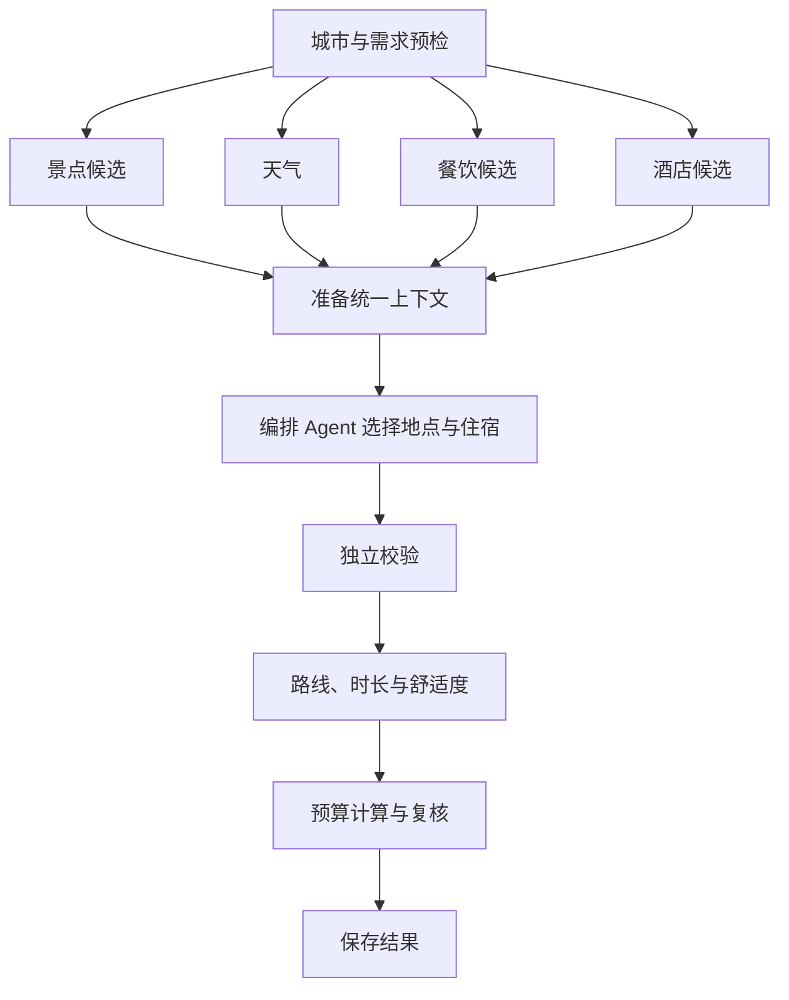

# 云程项目教学

从一份旅行需求开始，跟着代码走完检索、编排、校验、修改和保存。本教程参考 [Hello Agents](https://github.com/datawhalechina/hello-agents)“先理解概念、再读实现、最后动手”的学习顺序，示例和实现均对应本仓库。

先按 [README](../README.md#本地运行)启动项目。阅读时准备两个窗口：浏览器中的旅行工作台，以及编辑器中的源码。

## 学习路线

| 章节 | 主题 | 完成后能做什么 |
| --- | --- | --- |
| [第一章](#第一章跑通一次旅行规划) | 应用入口 | 跟踪一份需求如何成为行程 |
| [第二章](#第二章把语言变成结构化需求) | 意图与数据契约 | 区分新规划、修改与资料问答 |
| [第三章](#第三章让工具返回可用的事实) | 工具与 MCP | 理解候选池、错误码和调用边界 |
| [第四章](#第四章先检索本地再补充在线数据) | 本地检索与资料问答 | 判断哪些数据可以复用 |
| [第五章](#第五章统一编排吃住玩与交通) | LangGraph 与上下文 | 看懂并行采集和联合决策 |
| [第六章](#第六章用代码核算路线与预算) | 校验与重排 | 跟踪费用和时间的计算过程 |
| [第七章](#第七章让对话拥有记忆) | 会话与长期偏好 | 理解持久化和版本控制 |
| [第八章](#第八章只修改需要修改的部分) | 局部修改 | 追踪预览、确认和关联更新 |
| [第九章](#第九章把执行过程呈现在页面上) | 前端与任务运行时 | 理解进度、恢复和结果展示 |
| [第十章](#第十章加入分享与反馈) | Java 社区 | 追踪发布、点赞与排行 |
| [第十一章](#第十一章验证一次改动) | 测试与运行观测 | 为新功能增加验证依据 |
| [第十二章](#第十二章部署完整应用) | 容器与同源入口 | 启动完整服务并保存应用数据 |

## 第一章：跑通一次旅行规划

**本章目标：** 建立应用全貌，区分界面、API 和规划执行器。

在工作台注册账号，输入：

> 去杭州玩三天，喜欢美食和历史街区，公共交通出行，住经济型酒店，预算 2000 元。

先保存要求，再确认生成。观察酒店、天气、预算和每天的路线。接着提出“换第二天的午餐”，比较修改前后的结果。

阅读入口：

- [ChatView.vue](../frontend/src/views/ChatView.vue)：发送消息、保存要求、预览与确认。
- [dialog.py](../backend/app/api/routes/dialog.py)：会话接口。
- [conversation.py](../backend/app/services/conversation.py)：意图分发与会话处理。
- [planning.py](../backend/app/services/planning.py)：规划应用边界。

一次对话先经过 `conversation.turn()`。它读取当前会话与命令，判断是在补充需求、生成、解释还是修改，再进入相应服务。真正需要规划时才进入 `planning.plan()`。

```text
页面输入 → 会话命令 → 意图与槽位更新 → 规划服务
        → 采集与编排 → 校验 → 保存版本 → 页面展示
```

**动手：** 在浏览器 Network 面板找到 `/api/conversations/{id}/turns`，对比“保存要求”和“确认生成”两次请求的 `action`，记录 `conversation_id` 与 `revision`。

## 第二章：把语言变成结构化需求

**本章目标：** 知道模型输出哪些字段，程序如何检查它们。

阅读 [models/dialog.py](../backend/app/models/dialog.py)、[models/schemas.py](../backend/app/models/schemas.py) 和 [models/requirements.py](../backend/app/models/requirements.py)。

三组模型各有用途：

- `IntentDecision`：本轮要做什么，以及明确提及的槽位增量。
- `TripRequest`：完整规划请求，包括目的地、日期、人数、交通、预算和住宿。
- `Requirements`：细分到餐饮、景点、酒店、交通、节奏和天气的要求。

`conversation.extract()` 使用专门的意图提示词，返回六类意图：

| 意图 | 示例 |
| --- | --- |
| `new_plan` | 另外帮我安排一次成都旅行 |
| `modify_plan` | 这次改成四天，预算提高到 3000 |
| `edit_module` | 换第二天的午餐 |
| `explain_plan` | 为什么住这家酒店 |
| `knowledge` | 我保存的资料里，这个场馆怎么预约 |
| `clarify` | 需要继续明确要求的消息 |

槽位更新只包含本轮明确说出的内容，交给 `merge()` 与现有需求合并。结构化数据再经过 Pydantic 校验。各环节提示词集中在 [prompts.py](../backend/app/agents/prompts.py)，需求合并与约束辅助函数位于 [requirements.py](../backend/app/services/requirements.py)。

先手工构造一次需求，观察“喜欢雪山”和“必须安排两天雪山”的区别。在后端目录、激活虚拟环境后运行：

```python
from app.models.requirements import Requirements

requirements = Requirements.model_validate({
    "attractions": {
        "day_goals": [{"theme": "雪山", "days": 2, "scope": "surrounding"}]
    },
    "hotel": {"stay_policy": "auto"},
    "weather": {"avoid_rain_outdoors": True},
})
print(requirements.model_dump_json(indent=2))
```

主题天数、区域范围和住宿策略分别保存，后续采集与校验才能使用。这里没有指定 `day_indices`，具体安排在哪两天由编排决定。

**动手：** 阅读 `DayGoal`，对比 `days`、`scope` 和 `day_indices` 的作用，再查看 [day_goals.py](../backend/app/services/day_goals.py) 如何把主题要求带入编排。将示例中的 `days` 改成 `0`，观察输入校验。

## 第三章：让工具返回可用的事实

**本章目标：** 理解工具调用、候选池与 MCP 的分工。

从 [tools.py](../backend/app/services/tools.py) 的 `ToolContext` 开始。景点、餐厅、酒店、天气等事实保存在上下文中。工具执行后返回简短结果，编排阶段从上下文读取完整候选。

工具结果的契约位于 [tool_result.py](../backend/app/services/tool_result.py)：

```python
from app.services.tool_result import ToolResult, next_action

result = ToolResult.failure(
    "上游请求限流",
    "UPSTREAM_RATE_LIMITED",
    retryable=True,
    retry_after_seconds=2,
)
print(result.to_dict())
print(next_action(result))
```

可以在后端目录、激活虚拟环境后运行该示例。观察返回值中的 `error_code`、`retryable` 和下一步提示。运行时根据这些字段决定是否重试，并受尝试次数和时间预算约束。

继续阅读：

- [tool_retry.py](../backend/app/services/tool_retry.py)：受限重试和等待策略。
- [tool_scheduler.py](../backend/app/services/tool_scheduler.py)：批量调度。
- [request_gate.py](../backend/app/services/request_gate.py)：共享请求节奏。
- [map_gateway.py](../backend/app/services/map_gateway.py)：地图能力入口。

MCP 负责提供一致的工具接入方式。项目使用官方 SDK，通过 [mcp_adapter.py](../backend/app/services/mcp_adapter.py) 连接 stdio 或 Streamable HTTP 服务，校验工具白名单、参数与结果。可复用会话由 [mcp_pool.py](../backend/app/services/mcp_pool.py) 管理。本仓库也提供只读地图服务 [mcp_server.py](../backend/app/mcp_server.py)。

默认配置使用本地地图适配器。要用本仓库的地图 MCP 服务，在 `backend/.env` 中设置：

```dotenv
MAP_BACKEND=mcp
MCP_TRANSPORT=stdio
MCP_COMMAND=python
MCP_ARGS=["-m","app.mcp_server"]
MCP_REUSE_SESSION=true
```

从已激活的后端虚拟环境启动应用，让 `python` 指向安装了项目依赖的解释器。接入其他服务时，按服务端能力配置命令、参数或 Streamable HTTP 的 `MCP_URL`，并核对工具契约。

下面用模拟响应观察一次受限重试，不调用外部接口：

```python
from app.services.tool_result import ToolResult
from app.services.tool_retry import RetryPolicy, run

outcomes = iter([
    ToolResult.failure("请求限流", "UPSTREAM_RATE_LIMITED", retryable=True),
    ToolResult.success("获得三个候选", returned_count=3),
])
report = run(
    lambda: next(outcomes),
    safe=True,
    policy=RetryPolicy(max_attempts=2, budget_seconds=1, base_delay=0),
)
print(report.result.status, len(report.attempts), report.stop_reason)
# ok 2 success
```

**动手：** 为“正常返回空候选”和“请求超时”分别构造一个 `ToolResult`，比较 `next_action()`。把模拟示例的第二次响应也改为超时，观察最终错误和停止原因。验证代码见 [test_tool_retries.py](../backend/tests/test_tool_retries.py)。

## 第四章：先检索本地，再补充在线数据

**本章目标：** 区分地点候选检索、天气缓存和个人资料检索。

项目中的数据检索有三条路径：

| 数据 | 入口 | 使用方式 |
| --- | --- | --- |
| 景点、酒店、餐饮候选 | [candidate_search.py](../backend/app/services/candidate_search.py) | 本地召回后检查相关性、时效和约束，不足时在线补查 |
| 天气 | [weather_cache.py](../backend/app/services/weather_cache.py) | 按日期覆盖与缓存有效期读取 |
| 用户保存的资料 | [knowledge.py](../backend/app/services/knowledge.py) | 文本分块、多路召回、融合排序与来源引用 |

地点记录由 [catalog.py](../backend/app/services/catalog.py) 管理。`local_candidates()` 先检索，恢复为领域模型，再按日期价格与用户要求过滤。是否够用看有效候选数量，检索过程记录 `retrieval_decision` 和原因。新增地点与生成结果可回写本地资料库，[catalog_refresh.py](../backend/app/services/catalog_refresh.py) 按配置刷新城市数据。

个人资料走独立的检索流程：保存标题、来源、正文与有效期；正文分块；进行正文相关性与标题匹配两路排序；通过 RRF 融合候选；按相关性筛选后返回引用。实现采用词项检索，不依赖另行部署向量数据库。

**动手：** 在“旅行资料”保存两段自己编写的示例说明，分别写不同场馆的预约时间。提问其中一个场馆，观察引用的标题和正文是否来自对应资料，再沿 `retrieve()` 检查分块与排序。

## 第五章：统一编排吃住玩与交通

**本章目标：** 看懂 LangGraph 的并行节点、汇合点和条件路由。

打开 [agents/graph.py](../backend/app/agents/graph.py)，从 `build_graph()` 读起：



四路采集全部完成后才进入 `prepare_planning_context()`。上下文准备还会纳入平台酒店、城际班次、区域候选和住宿方案，详见 [unified_planning.py](../backend/app/services/unified_planning.py)。默认常规采集可直接调度工具；需要模型自主选择查询时，采集节点也可通过配置启用 [react_loop.py](../backend/app/agents/react_loop.py) 的工具循环。

上图省略了重排与恢复分支。可以在后端目录打印代码实际构建的完整执行图；这一步只构图，不执行规划或调用模型：

```python
from app.agents.graph import build_graph

print(build_graph().get_graph().draw_mermaid())
```

[unified_prompt.py](../backend/app/services/unified_prompt.py) 将候选、坐标、价格、天气、每日时间窗口和主题要求整理给编排模型。模型选择候选 ID，随后由代码恢复对应事实并检查身份。重点阅读 [planner_agent.py](../backend/app/agents/planner_agent.py)、[planner_json.py](../backend/app/services/planner_json.py) 和 [planner_patch.py](../backend/app/services/planner_patch.py)。

住宿按入住日期建模，[stays.py](../backend/app/services/stays.py) 和 [stay_options.py](../backend/app/services/stay_options.py) 组织逐晚安排和候选方案。城际班次由 [intercity.py](../backend/app/services/intercity.py) 纳入首末日时间窗口，酒店平台匹配见 [platform_hotels.py](../backend/app/services/platform_hotels.py)。

**动手：** 找到图中的四路汇合边，再跟踪 `route_after_budget()` 的返回值如何映射到重排或结束。比较“城市游览连续住宿”和“远郊活动换住”两类方案的输入事实。

## 第六章：用代码核算路线与预算

**本章目标：** 找出行程完成前必须经过的确定性计算。

编排输出先检查结构、日期、候选身份和必去要求，再做独立校验。入口分别在 [planner_agent.py](../backend/app/agents/planner_agent.py) 与 [verify_plan.py](../backend/app/agents/verify_plan.py)。

之后由 [itinerary_experience.py](../backend/app/services/itinerary_experience.py) 补充路线、游玩与休息时长、天气和用餐安排。路线查询与复用见 [route_batch.py](../backend/app/services/route_batch.py)，分段住宿处理见 [segmented_experience.py](../backend/app/services/segmented_experience.py)。

费用的事实层与汇总层分开：

- [ticket_pricing.py](../backend/app/services/ticket_pricing.py)：门票资料查询与价格补全。
- [ticket_estimates.py](../backend/app/services/ticket_estimates.py)：模型日常票价估算。
- [price_catalog.py](../backend/app/services/price_catalog.py)：按适用日期读取价格记录。
- [agents/budget.py](../backend/app/agents/budget.py)：生成逐项费用并汇总。
- [verify_budget.py](../backend/app/agents/verify_budget.py)：预算上限与费用结构复核。
- [delivery.py](../backend/app/services/delivery.py)：交付前统一检查。

预算条目包含类别、金额、状态与来源。餐饮、门票和城际交通按成人数计算；酒店按房间数计算；逐晚住宿分别计入。票价引用与模型估算保留各自标记，未知金额也有明确状态。

**动手：** 从一份生成结果中选一家酒店、一处景点和一顿餐饮，找到对应预算条目，手工核对人数、房间数和夜晚数。再阅读 [test_budget.py](../backend/tests/test_budget.py) 与 [test_intercity_integration.py](../backend/tests/test_intercity_integration.py) 中的费用断言。

## 第七章：让对话拥有记忆

**本章目标：** 区分当前会话、长期偏好、行程版本和执行状态。

阅读 [dialog_store.py](../backend/app/services/dialog_store.py) 的表结构：

| 对象 | 保存什么 |
| --- | --- |
| `conversation` | 当前需求、版本号与已确认结果 |
| `conversation_turn` | 每轮请求与响应 |
| `preference` | 用户明确保存的长期偏好 |
| `conversation_version` | 已保存的行程版本 |
| `conversation_edit` | 等待确认的局部修改 |

新会话由 `conversation.defaults()` 加载有效偏好。本次输入再覆盖对应字段。长期偏好由用户明确保存，并可在页面撤回。

每轮命令同时包含 `request_id` 与 `expected_revision`：前者识别同一次操作，后者检查操作是否基于当前版本。相关的数据库事务和执行租约位于 [dialog_store.py](../backend/app/services/dialog_store.py) 与 [execution_lease.py](../backend/app/services/execution_lease.py)。

**动手：** 保存“公共交通”偏好，创建新会话，观察初始字段；在当前会话临时改为自驾，再新建会话，比较长期偏好与本轮需求。阅读 [test_dialogue_upgrade.py](../backend/tests/test_dialogue_upgrade.py) 查看状态保存的测试。

## 第八章：只修改需要修改的部分

**本章目标：** 理解修改范围、预览和确认的完整流程。

从 [PlanModuleEditor.vue](../frontend/src/components/PlanModuleEditor.vue) 操作一次替换。前端发送候选 ID、模块和索引，后端再从候选池读取地点事实。`day_index` 和 `item_index` 都从 0 开始。

```json
{
  "module": "meals",
  "day_index": 1,
  "item_index": 1,
  "candidate_id": "从接口返回的真实候选ID"
}
```

[partial_edit.py](../backend/app/services/partial_edit.py) 的三个入口对应三个阶段：

1. `candidates()`：列出允许替换的候选。
2. `prepare()`：构建预览，保存原行程标识和受影响日期。
3. `apply()`：确认原版本仍匹配，重算关联路线、价格和预算，再校验结果。

餐饮与景点修改只影响指定日期；酒店修改可以指定单晚、连续住宿段或全部未锁定夜晚，并影响相关日期的起终点。会话层通过版本和事务保存最终结果。

**动手：** 修改一顿午餐，先看预览再撤销，确认正式行程未变化；再次选择候选并确认保存，比较其他日期、酒店和景点是否保留。验证代码见 [test_partial_edit.py](../backend/tests/test_partial_edit.py)。

## 第九章：把执行过程呈现在页面上

**本章目标：** 分清对话接口、后台规划任务、进度流和页面展示。

阅读 [runner.py](../backend/app/services/runner.py) 和 [routes/trip.py](../backend/app/api/routes/trip.py)。后台规划任务记录节点产出与事件，可查询结果并通过 SSE 获取进度；图的运行记录用于恢复后续节点。对话工作台通过会话命令管理确认和修改，两条入口共享规划能力。

前端可以按职责阅读：

- [services/api.ts](../frontend/src/services/api.ts)：规划接口、进度与任务结果。
- [services/dialog.ts](../frontend/src/services/dialog.ts)：登录、会话和局部修改的请求契约。
- [TripSummary.vue](../frontend/src/components/TripSummary.vue)：住宿、天气、预算与门票。
- [DayTimeline.vue](../frontend/src/components/DayTimeline.vue)：逐日地图、景点、餐饮与逐段路程。
- [ExportPanel.vue](../frontend/src/components/ExportPanel.vue)：导出。

开发由 Vite 代理 `/api`，部署由 Nginx 代理相同路径。浏览器始终请求当前网站，无需在手机上单独填写电脑后端地址。

**动手：** 跟踪一次后台生成的 `thread_id`，对比请求状态、节点事件与最终结果。阅读 [test_journal_recovery.py](../backend/tests/test_journal_recovery.py)，确认恢复依赖哪些已保存字段。

## 第十章：加入分享与反馈

**本章目标：** 理解 Python 规划与 Java 社区如何协作。

完整 Docker 部署后，发布一份行程，再打开社区查看。Java 服务管理业务数据，Python 管理规划和用户会话。社区请求通过 [SessionIdentity.java](../java-community/src/main/java/com/trip/community/service/SessionIdentity.java) 核验登录身份。

沿着以下入口阅读：

- [ItineraryService.java](../java-community/src/main/java/com/trip/community/service/ItineraryService.java)：发布行程。
- [LikeService.java](../java-community/src/main/java/com/trip/community/service/LikeService.java)：点赞、去重和持久化处理。
- [LeaderboardService.java](../java-community/src/main/java/com/trip/community/service/LeaderboardService.java)：排行。
- [java_bridge.py](../backend/app/services/java_bridge.py)：Python 与社区服务通信。

MySQL 保存业务记录，Redis 承担点赞去重、计数和排序。社区热度可作为规划候选的参考输入。

**动手：** 用同一账号对同一行程连续点赞，观察返回值和排行榜。然后沿控制器、服务、Redis 脚本和数据库写入路径画一张调用图。

## 第十一章：验证一次改动

**本章目标：** 把新需求落实成可重复的检查。

后端目录安装开发依赖后运行：

```bash
pip install -r requirements-dev.txt
pytest
```

前端目录运行：

```bash
npm test
npm run build
```

项目根目录可运行 Java 验证：

```bash
mvn -f java-community/pom.xml verify
```

测试按规则、集成和场景组织。想理解候选池约束，读 [test_candidate_validation.py](../backend/tests/test_candidate_validation.py)；想验证整体链路，读 [test_integrated_e2e.py](../backend/tests/test_integrated_e2e.py)；住宿、交通、资料检索分别有对应测试模块。

[eval_scenarios_30.py](../backend/scripts/eval_scenarios_30.py) 提供规划场景集。在后端目录列出场景，再选择模式运行：

```bash
python scripts/eval_scenarios_30.py --mode full --list
python scripts/eval_scenarios_30.py --mode fast
```

`--mode full` 包含真实生成，会调用配置的外部服务。运行观测由 [monitoring.py](../backend/app/services/monitoring.py) 汇总：首次成功率、重试率、最终成功率、耗时、本地命中与空检索都单独记录。可从工作台“运行状态”查看。

**动手：** 新增一个需求：“两位成人、两间房，第二天必须去某个候选景点”。先定义验收条件：日期完整、必去景点存在、每晚房间数正确、费用对账一致、候选 ID 合法。选用现有工厂和模拟服务写一条回归，再运行相关测试。

## 第十二章：部署完整应用

**本章目标：** 理解浏览器入口、服务间通信和持久化数据的位置。

本地开发只需前端和 Python；要运行完整社区，使用根目录的 [docker-compose.production.yml](../docker-compose.production.yml)。它启动前端入口、规划后端、社区服务、MySQL 与 Redis。

先按 [README 的配置说明](../README.md#docker-部署)准备 `backend/.env` 和根目录 `.env.production`。后端密钥放在服务端配置中，数据库配置中的两个密码分别用于数据库管理账号与应用账号。在项目根目录执行：

```bash
docker compose --env-file .env.production -f docker-compose.production.yml config --quiet
docker compose --env-file .env.production -f docker-compose.production.yml up -d --build
docker compose --env-file .env.production -f docker-compose.production.yml ps
curl --fail http://127.0.0.1:8080/health
```

打开 `http://127.0.0.1:8080/chat`。浏览器请求的 `/api` 和 `/community-api` 由 [Nginx 配置](../deploy/nginx.conf)转发给各自的服务；容器内服务通过服务名通信。

| 数据卷 | 保存内容 |
| --- | --- |
| `trip_data` | 账号、会话、行程、执行日志与本地资料 |
| `mysql_data` | 社区业务记录 |
| `redis_data` | Redis 持久化数据 |

更新代码后重新构建并启动，数据继续保存在卷中。备份和迁移时同时考虑这些数据。部署到公网时，在宿主机用 HTTPS 反向代理到 `127.0.0.1:8080`，并关闭 SSE 响应缓冲；示例见[部署指南](手机访问与GitHub部署-20261020.md#二正式上线让手机随时访问)。

**动手：** 在完整部署中注册账号、保存并发布一份行程。重启应用服务后，确认会话与社区记录仍在；再沿 Nginx 配置画出从浏览器到 Python、Java 的两条请求路径。

## 综合实践

以“带家人去成都四天，其中一天去周边，想吃川菜但不想太辣”为题完成一次开发练习：

1. 用结构化需求表示人数、日期、餐饮偏好与主题天数。
2. 找到本地召回和在线补充的位置。
3. 检查统一编排的上下文是否包含这些信息。
4. 核对住宿、路线、天气、游玩时间和预算。
5. 只替换其中一顿餐饮，验证相关更新范围。
6. 保存行程，并为新增规则补一条测试。

完成后，尝试只看 `TripRequest`、执行图和结果数据，独立解释这份行程是如何生成和保存的。
